相机直连云的相机目前只支持 （VZ  HX 芊熠）相机的个别型号

VZ相机类型相机-THY2：支持300W R3和C3  和  500w的相机

HX相机类型相机-THX8：支持V86，V87，部分支持mqtt的V85

芊熠相机类型相机-TQY6:	支持8系列的全部相机

流程：首先需要在平台上单位管理里面创建一个免布线车场，然后相机配置上云的参数，之后在车场平台上设备管理里面绑定相机的类型和序列号就可以了。

配置流程：

一。先向平台方申请属于自己公司的平台总账号

二。平台配置

&lt;1.用申请的平台总帐号登录平台管理端

&lt;2.进入基础信息--&gt;公司管理,选中公司点击创建免布线车场.

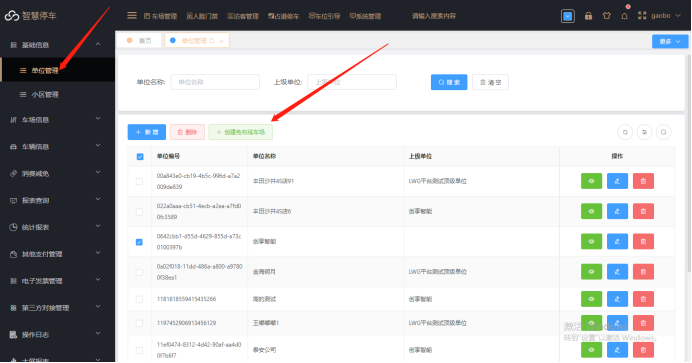

&lt;3.录入车场的公司名称，以及车场名称创建车场

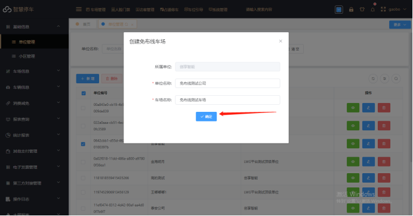

&lt;4.配置设备信息：进入车场信息-&gt;设备管理 输入刚刚创建的车场名称搜索设备信息，并修改设备信息填入相机序列号

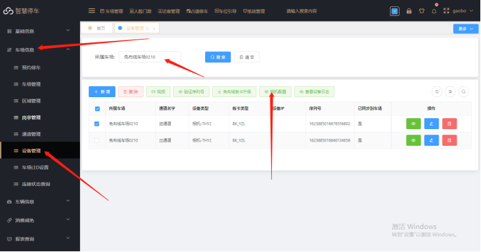

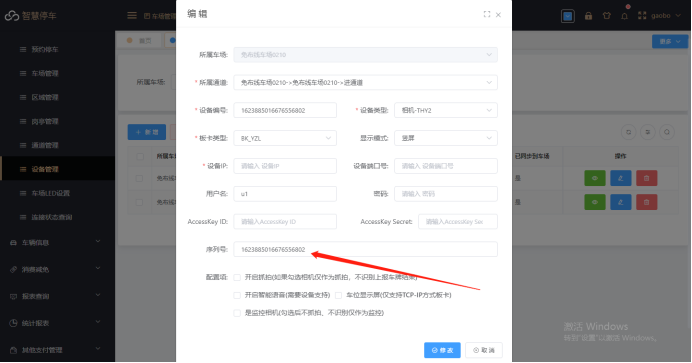

&lt;5.选中对应相机信息，点击相机配置，在弹出的窗口点击新增然后直接点击保存

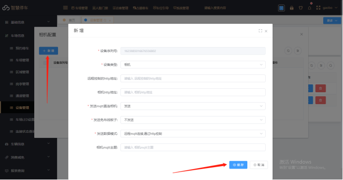

&lt;6.配置车场在线支付信息：进入其他支付管理-&gt;接口参数配置-&gt;新增然后根据您的支付渠道进行支付配置。

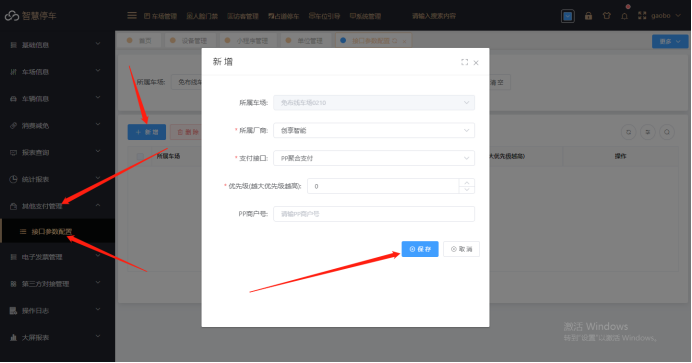

三。VZ相机配置
&lt;1.通过浏览器输入相机IP登录到相机配置界面

&lt;2.在高级设置-高级网络-MQTT配置服务器地址  “39.108.70.214” （注意：如果找不到该选项联系相机厂家拿相机升级包升级相机程序到最新程序)

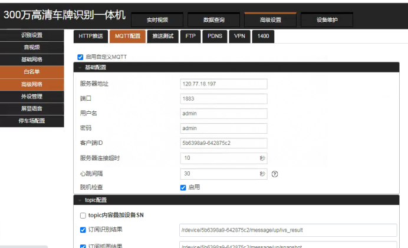

&lt;3.修改topic配置参数：

A. 在订阅识别结果、订阅抓拍结果、以及所有回执的第一个斜杠后加r,在device/后加上相机序列号，序列号为上图客户端ID。

B. 在发布出发识别、发布IO输出事件、发布串口数据转发的device/后加上相机序列号，不需要加r
示例：/rdevice/ac614b39-3bec4843/message/up/ivs_result 回执和结果加“r”

/device/ac614b39-3bec4843/message/down/ivs_trigger 发布不用加“r”（“/”不能少）

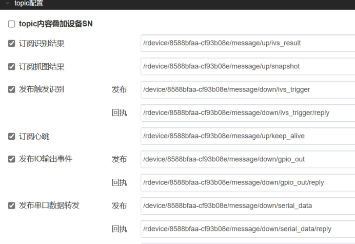

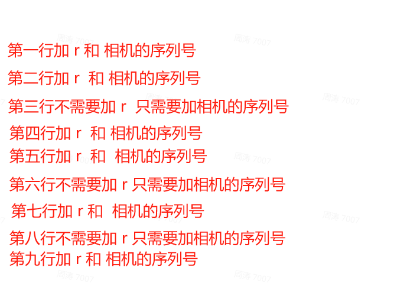

c. 在topic配置完成后直接点保存就行了，这样VZ相机上云的参数就绑定好了。

��。HX相机配置
1.登录相机在网络配置里面找到MQTT

2.勾选打开mqtt功能

3.协议选择2

4.camld类型：选择UID,平台添加相机序列号也是填这个，UID在设备信息里面。

5.服务器域名： photo.cxzntc.com  端口1883  （如图）

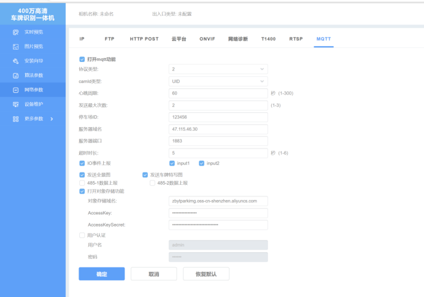

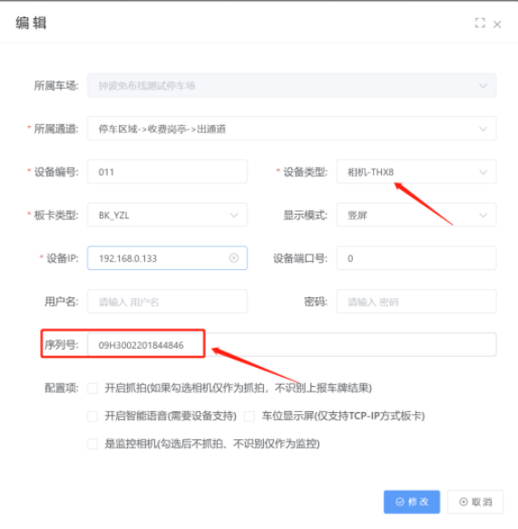

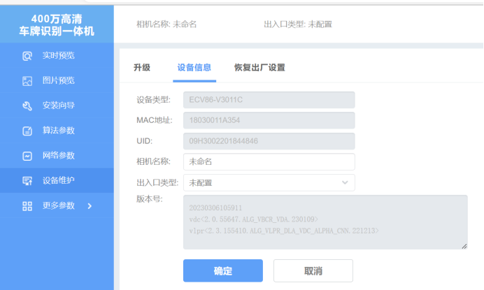

五。芊熠相机配置
1、登录相机在专家模式里面基础配置-MQTT设置。

2、cloud功能勾选

工作模式选“模式5”

camld选择MAC

平台域名：photo.cxzntc.com  端口1883

用户名 photo 密码  photo（如图）

设备标识：填相机的序列号

客户端iD：填相机的序列号

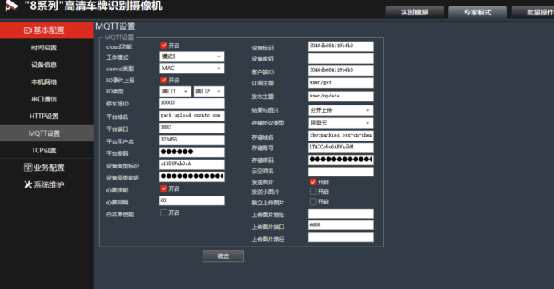

