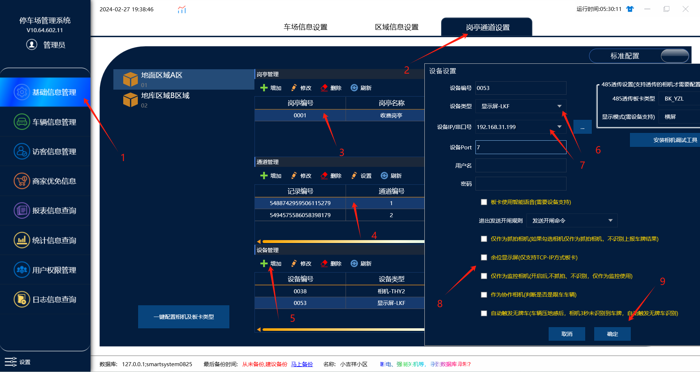
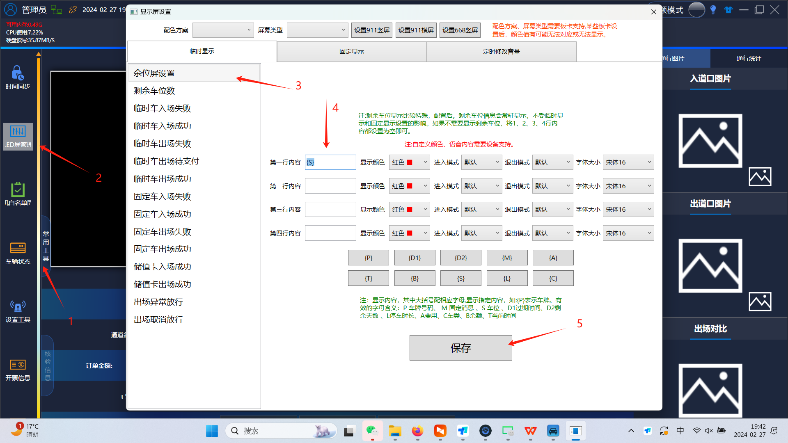

## 余位屏控制板基本电性规格

工作电压: 5V

静态电流: ≤200毫安 (无外部负载)

工作温度范围: -20C ~ 80C

显示屏扫描频率: 30HZ~1KHZ

## 应用场合:

ª免布线直连云车场。

ª 本地端软件车场。

## 支持模组型号及最大支持尺寸:

|                    |                        |                        |                          |                        |             |                                  |
| ------------------ | ---------------------- | ---------------------- | ------------------------ | ---------------------- | ----------- | -------------------------------- |
| **接口类型** | **扫描****类型** | **颜色****深度** | **最大****分辨率** | **显示****模组** |             | **备注**                   |
| 08接口             | 16分之一 逐行扫描      | 2位(4色）              | 64*64                    | P4.75单��色            | 1个口串联   |                                  |
|                    | 8分之一 逐行扫描       | 2位(4色）              | 64*64                    | P4.75单双色            | 1个口串联   |                                  |
| 12接口             | 4分之一 Z行扫描        | 2位(4色）              | 32*160                   | P10单色                | 2个串口串联 | 设置不了彩色，设置的时候选择单色 |

:::caution
图片缺失：
::: 注：控制卡ip默认是自动获取的

管理端软件上在进口通道下面在添加一个设备：设备类型  显示屏-LKF  然后需要勾选余位显示屏的功能

收费软件上在常用工具，led屏管理里面设置余位屏显示类容：\{S\}是显示剩余车位，如果有多行屏也可以设置多行显示类容

