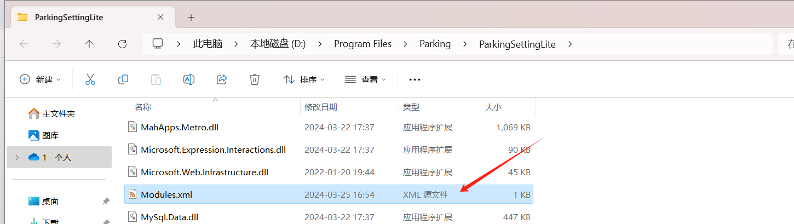
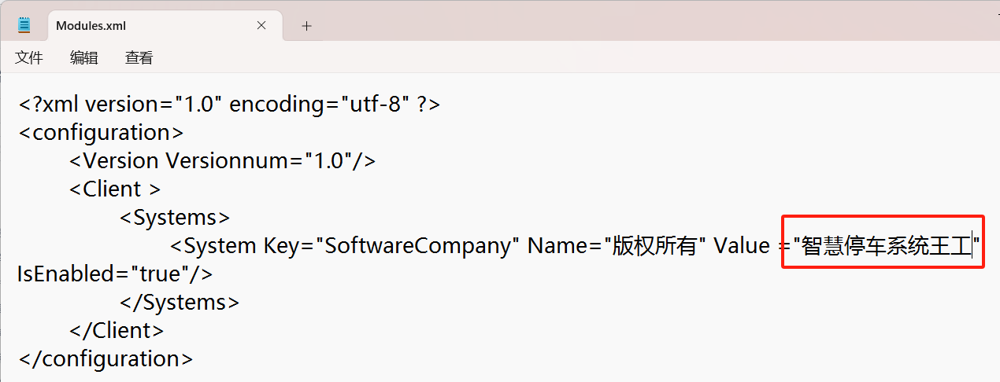
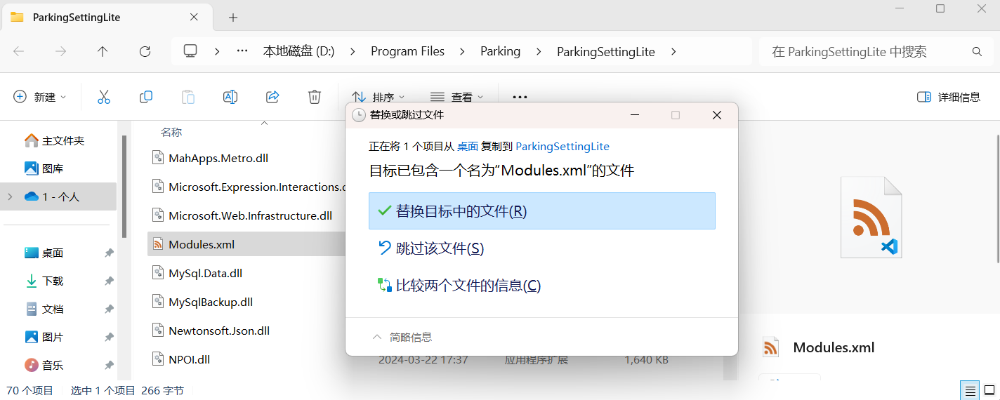
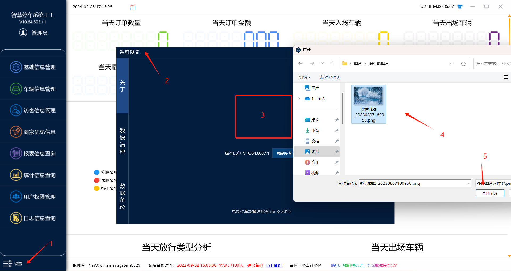

### 一。修改软件名称

1. 右击管理端图标，打开文件夹位置，把 Modules 文件先复制到桌面

2.右击文件使用记事本的方式��开，之后修改红框里面的类容，就是修改软件的名称，修改之后保存也可以按快捷键（Ctrl+S 保存）

3.右击管理端图标打开文件夹位置，把修改之后的文件复制到这个路径里面，直接替换调之前的。

4. 然后在打开软件就是修改之后的名称。

## 二。增加软件Logo

1. 在管理端系统里面，点击修改，然后系统设置，关于，在红框位置鼠标点击一下，就会弹出上传图片的路径，图片只支持上传png格式的图片。

