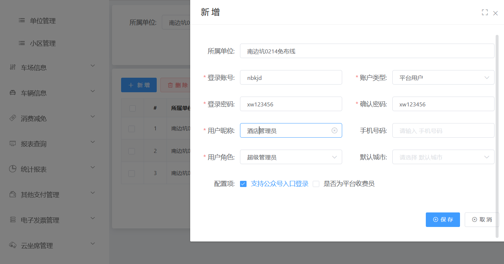
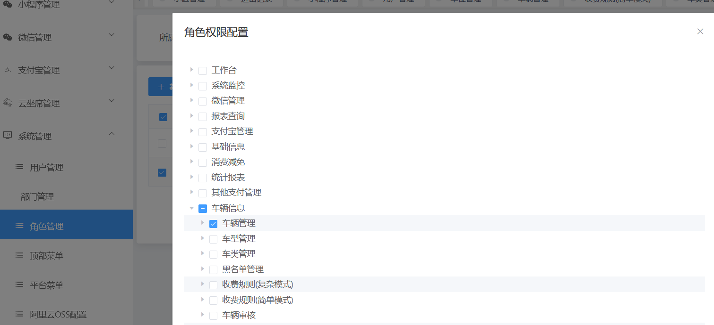
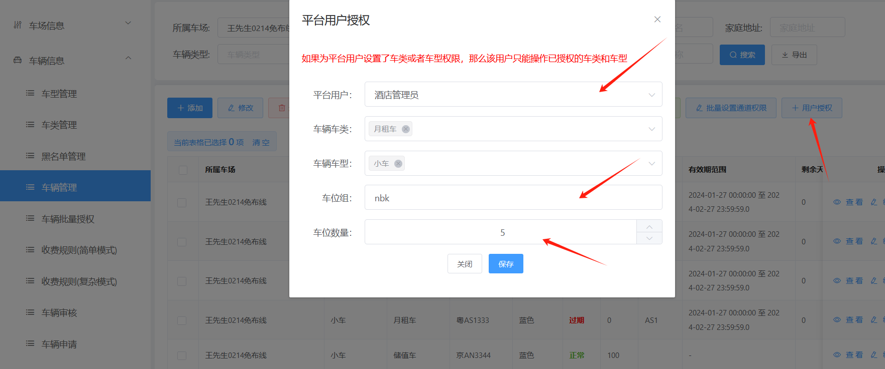
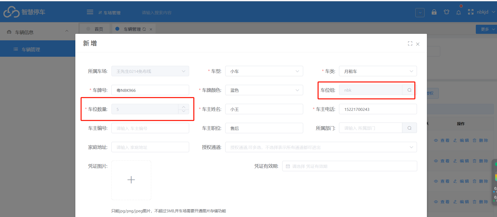

车位池的功能可以实现：比如酒店有自己的5个车位，就可以实现让酒店在车辆信息里面添加月租车牌，添加车牌的数量超过5辆以上的车牌

就转临停进出，没有超过5辆的话就按月租车免费停车进出

设置流程：

首先添加一个酒店用户，然后在添加角色可以只授权只有车辆信息的权限，然后在车辆信息里面按用户授权，绑定账号，车位组以及车位数量，

然后在用这个酒店账号登入平台，这个账号就只能添加对应类型的车类和车型，添加的月租车都会绑定在了一个车位组下面，

添加车牌的数量超过5辆以上的车牌就转临停进出，没有超过5辆的话就按月租车免费停车进出

一：创建用户和角色

二：在车辆信息里面用户授权绑定账号，固定车位组和车位数量

三：登入酒店账号添加月租车，可以看到车位组和车位数量都是固定的

四：添加月租车数量在5辆内，就是正常的月租车进出，数量超过5辆的话，停车先入场的5辆就按月租车免费停车，第6辆及以上的车在入场就是转临停进出。
