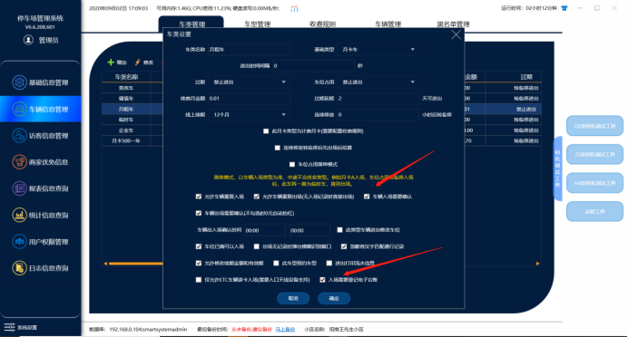
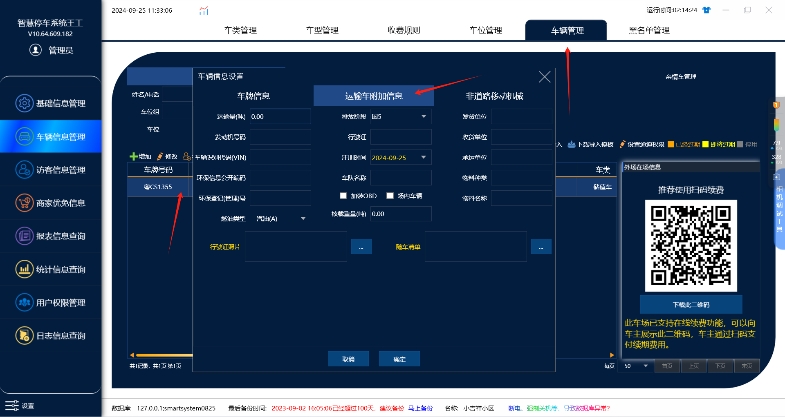
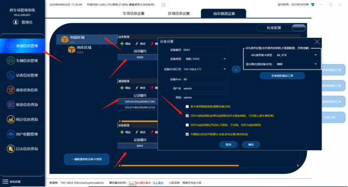
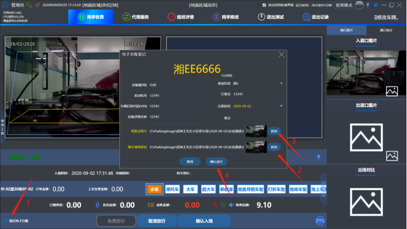
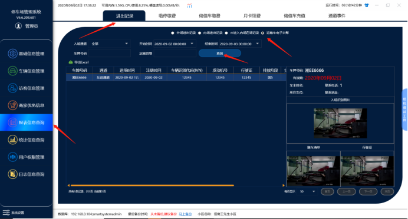

1.在管理端车类管理里面勾选（需要登记电子台账和入场确认）

2.添加车辆信息的时候设置运输车附加信息

3.在设备管理里面添加一个抓拍相机（勾选抓拍相机,和监控相机的功能）—注意:抓拍相机需要另外添加一台相机来做为抓拍相机,不能用进口相机来做为抓拍相机,这样会导致车辆入场不识别，（也可以不添加相机，用usb的摄像头来抓拍行驶证照片和随车清单）

4.在收费端车辆入场的时候点（登记电子台账）然后可以抓拍随车清单和驾驶证照片最后点确认放行，（月租车可以提前在车辆信息里面录入���子台账的信息，然后直接进出就能查到电子台账的记录） ，（而临时车就需要在入场确认的时候点电子台账，然后录入台账信息在点击确认入场）

5.最后在管理端报表信息-&gt;进出记录-&gt;运输车电子台账可以查询记录

