访客申请二维码：（可实现车主自助扫码申请成为访客车）

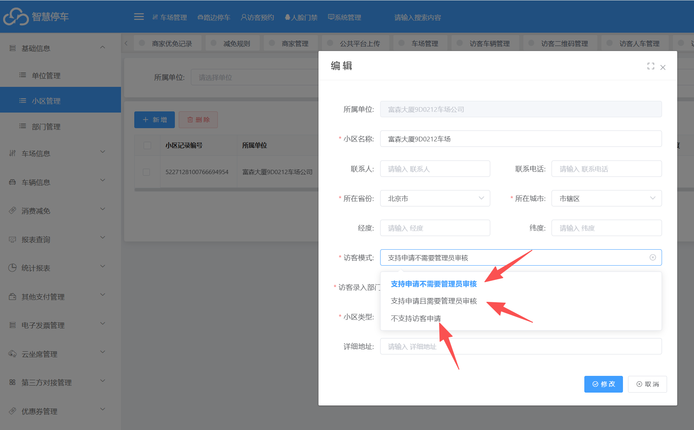

设置前提条件：需要在小区管理里面设置访客车申请是否需要审核或者不需要审核

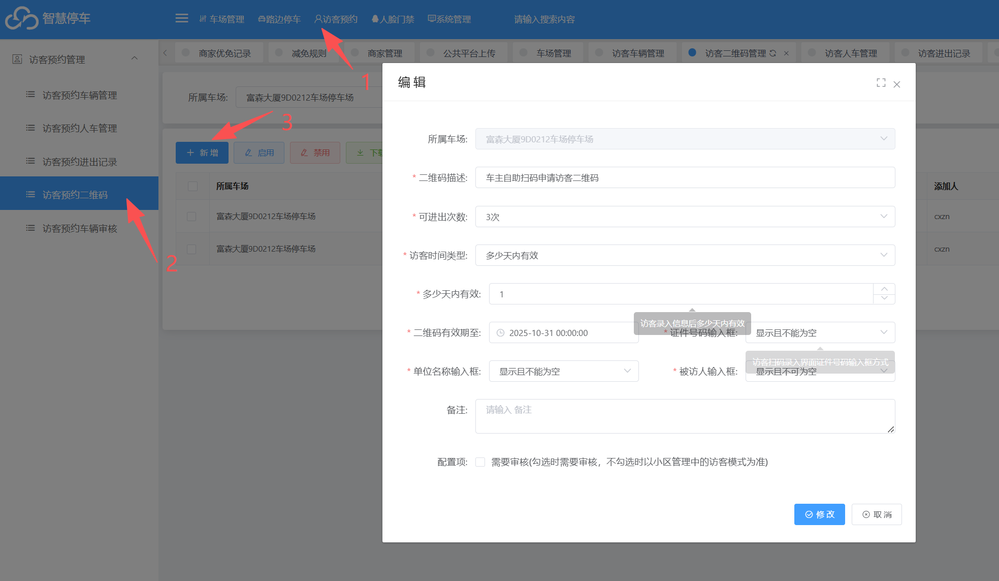

## 新增访客预约二维码流程：
第一步：
在车场平台里面-&gt;访客管理里面-&gt;访客预约二维码功能里面创建访客二维码

第二步：
设置访客预约二维码的二维码的权限
1.可进出次数：（意思是限制多少次，该车申请成为访客后可进出的次数）
2.访客时间选项：有三种

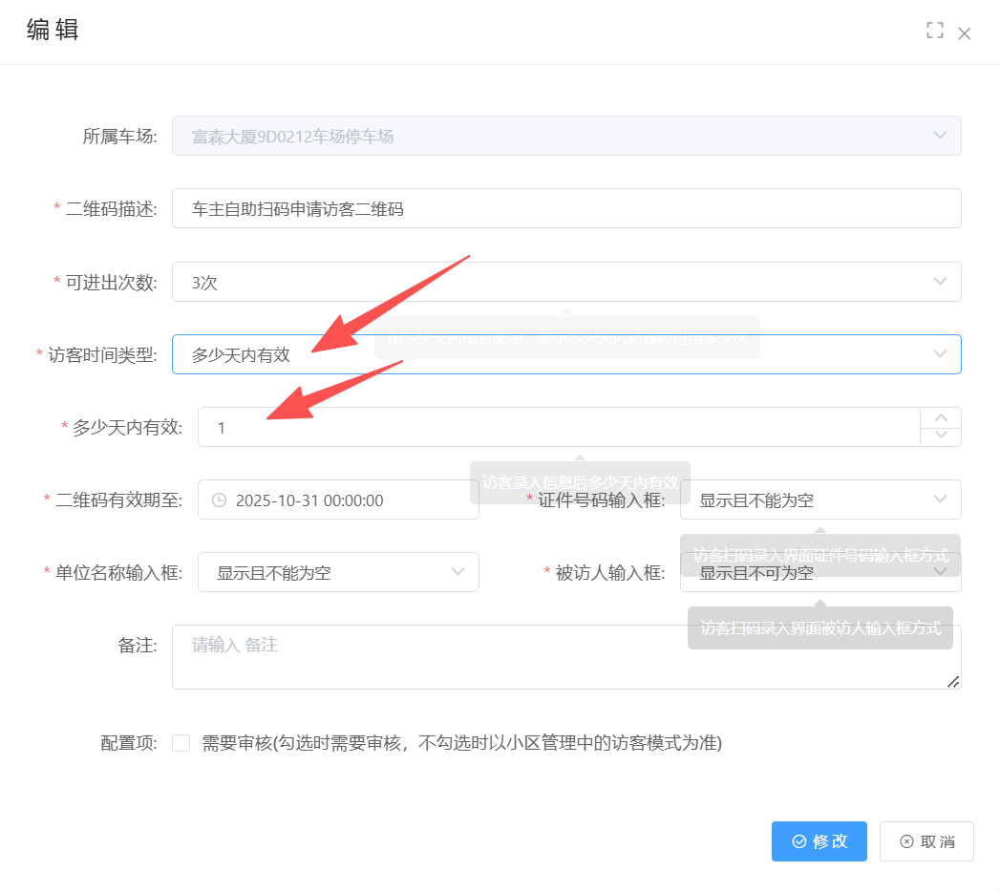

第一种：��少天内有效
限制访客车的进出天数，假设设置1天 即使还在访客二维码的有效期和可进出次数内，只要过了这个限制的1天，就不算访客车了

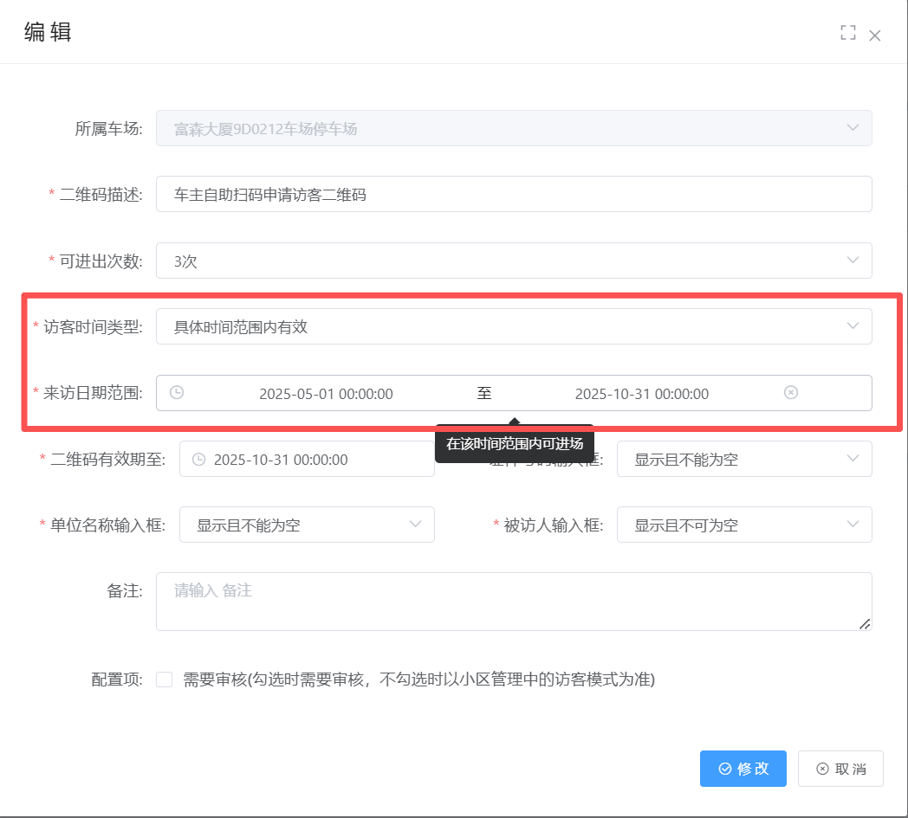

第二种：具体时间范围内有效：意思是在这个设置的时间内进出才算访客车

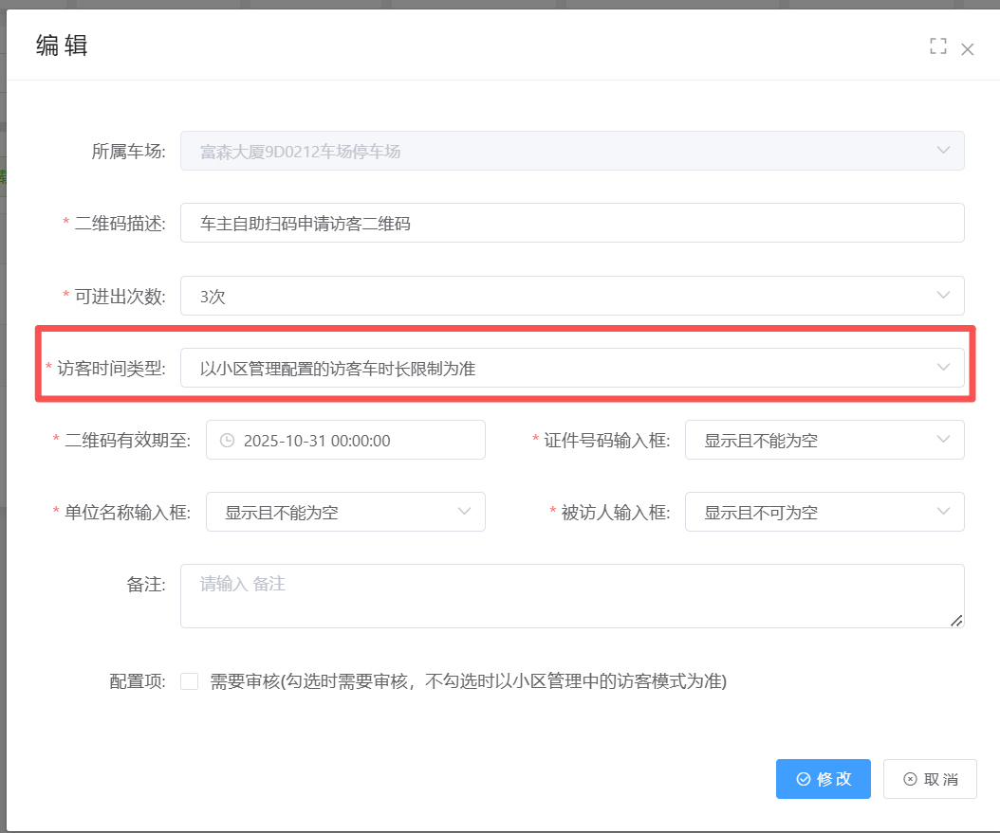

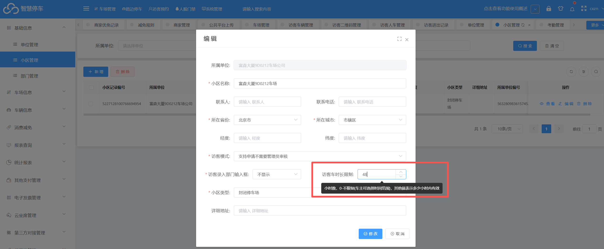

第三种：以小区管理配置的访客车时长为准：意思是在时长设置的小时内才算访客车

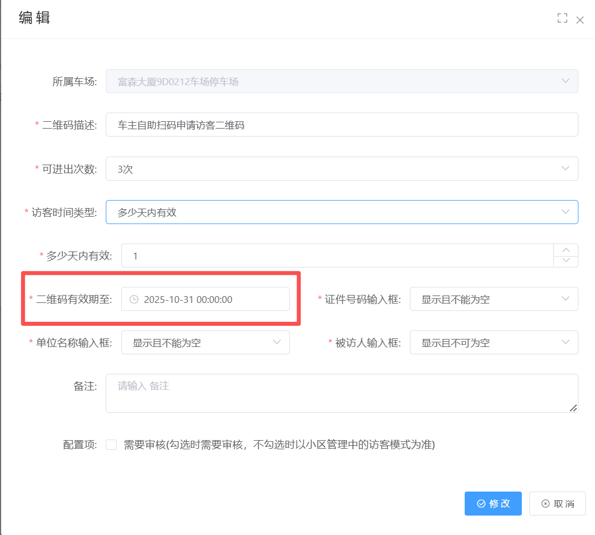

二维码有效期至：意思是添加的访客二维码在设置的时间内才算访客 超过这个时间就不算访客车

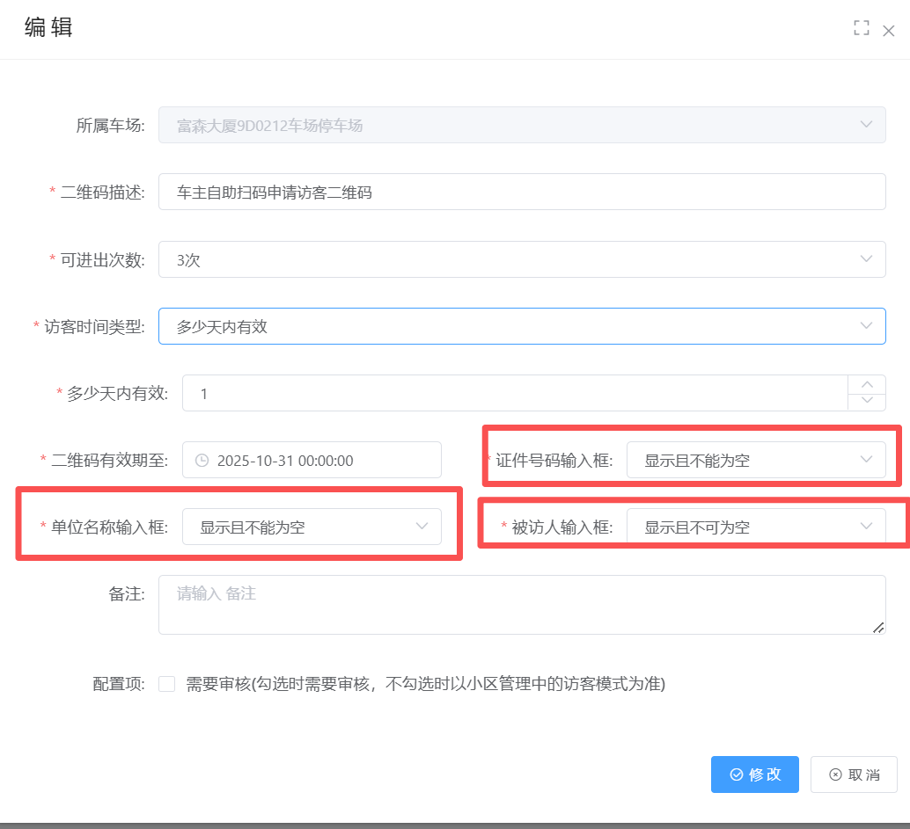

证件号码输入框：意思是车主扫码申请访客的时候是否需要访客人员的身份证号码，设置不能为空的话就是必填
单位名称输入框：意思是车主扫码申请访客的时候是否需要选择被访客的单位，设置不能为空的话就是必填
被访客人输入框：意思是车主扫码申请访客的时候是否需要输入被访人的姓名，设置不能为空的话就是必填

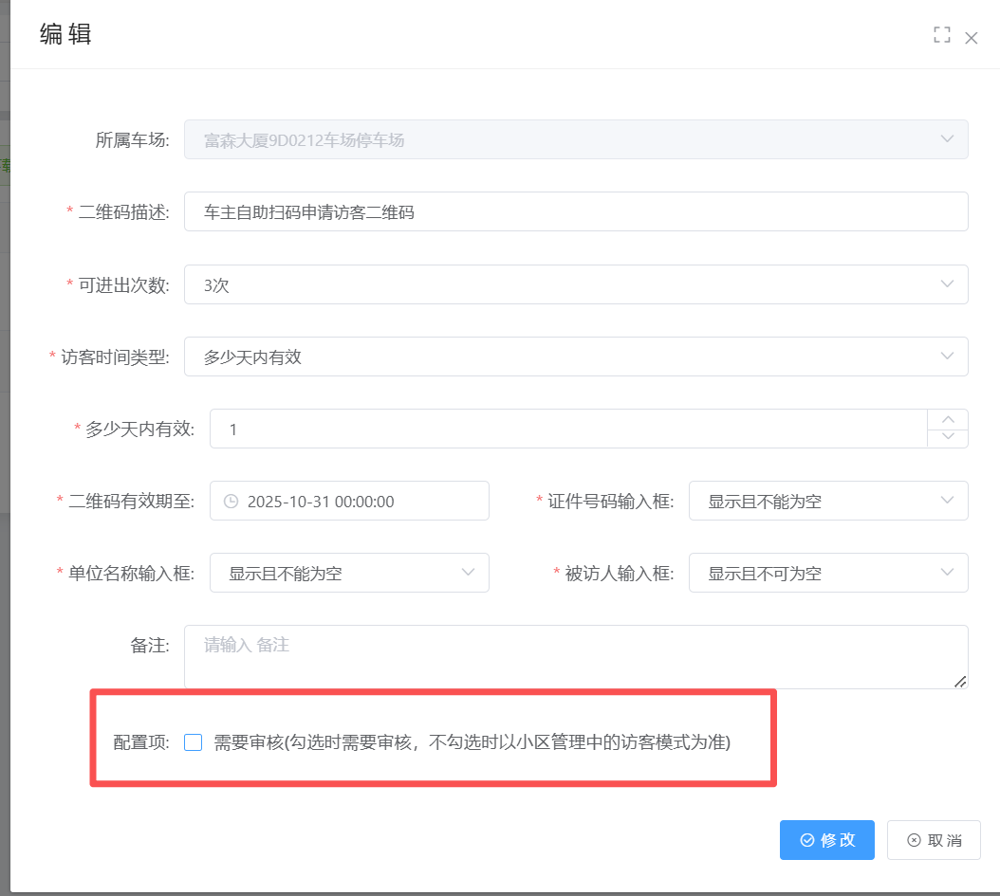

是否需要审核：勾选后就需要管理人员审核才能成为访客车 不勾选的情况下以小区管理里面设置为准

## 车主微信扫码申请流程：
1.下载二维码

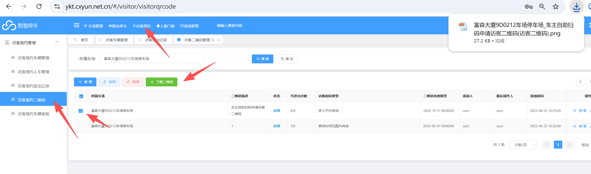

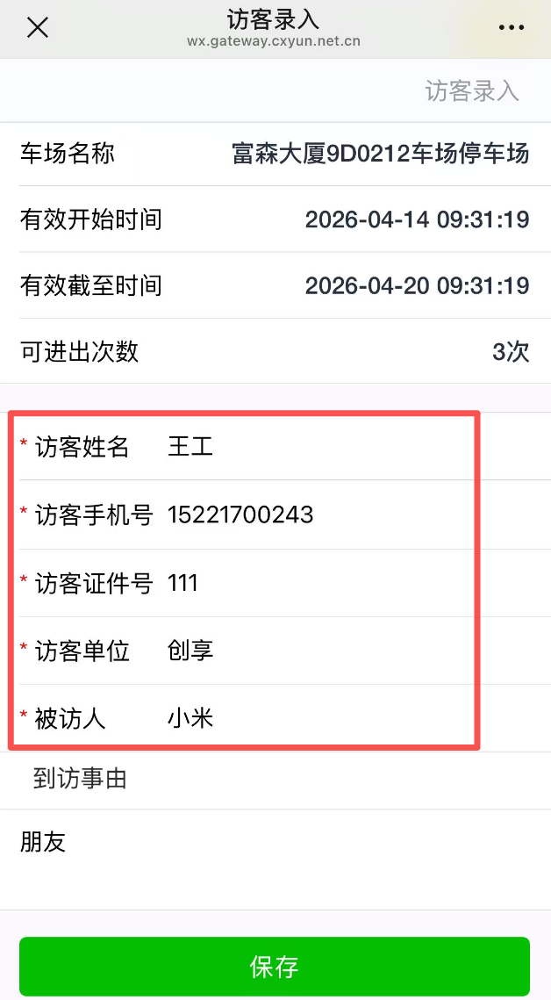

2.扫码录入车牌，姓名，手机号，访客单位和被访人信息

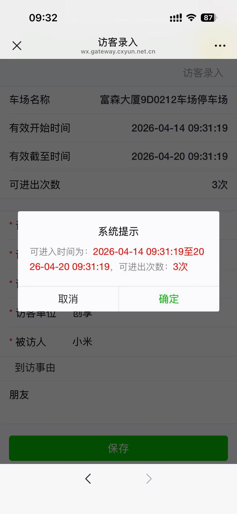

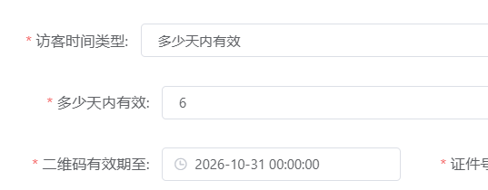

有效期和可进出次数是按在创建访客二维码的设置为准

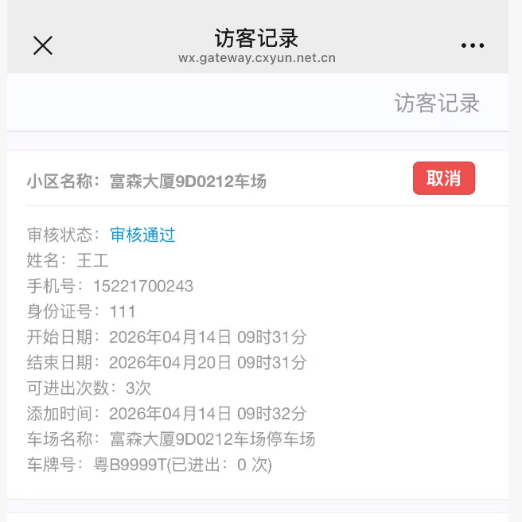

如果不需要审核的话就可以在访客记录里面查到审核通过

3.审核流程（如果小区管理里面设置申请需要审核的话在平台●●客审核里面操作审核）

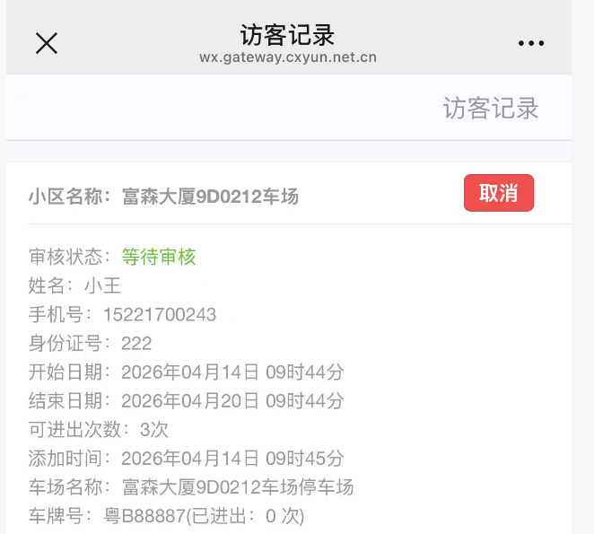

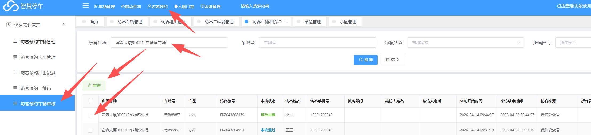

审核通过过才能在访客信息里面查询到这个车牌

