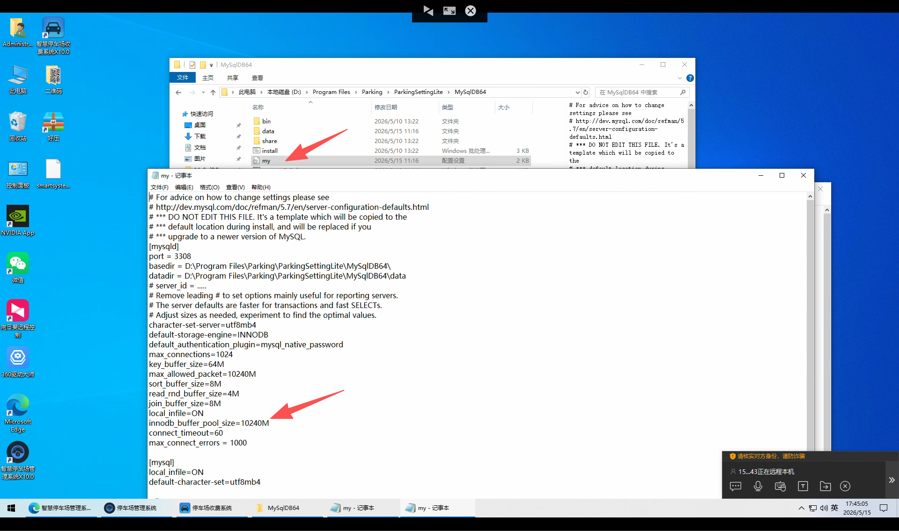

1.电脑配置要求：
建议最低配置 CPU10代 i5  内存16G 独立显卡 设置视频分辨率480P

2.下载最新64位版本的软件去创建车场

3.之后软件上默认数据库内存是2g 2048的 电脑内存高的话 需要修改一下这个数据库内存
优点：修改软件内存后就能优化车场数据量大的情况下 2g内存不够用 导致识别反应慢 软件卡的问题
右击管理端 打开文件夹位置在这个路径下面\Program Files\Parking\ParkingSettingLite\MySqlDB64修改my文件夹里面的数据库内存大小

修改这个innodb_buffer_pool_size=10240M
默认是2048m=2g使用内存  改成10240=使用10g的内存
修改后���存 然后重启一下mysqlcx的数据库服务
注意：一定要是64位的软件创建的数据库 在这里修改了 服务才能启动

二：如果是已经在运行的大车场 车场数据量多 软件反应慢卡顿的情况下需要修改数据库内存的话
建议是重新从网页上下载64位的软件 然后重新强制安装新的数据库 创建64位的车场 然后从平台上通过小区管理里面的代理编码恢复数据，
之后也是同样在右击管理端 打开文件夹位置 在上面那个路径下面修改my文件夹里面的数据库内存