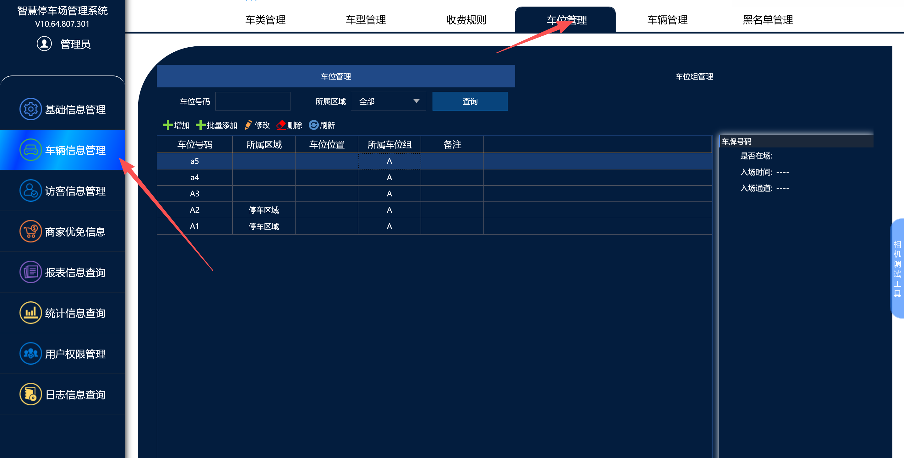
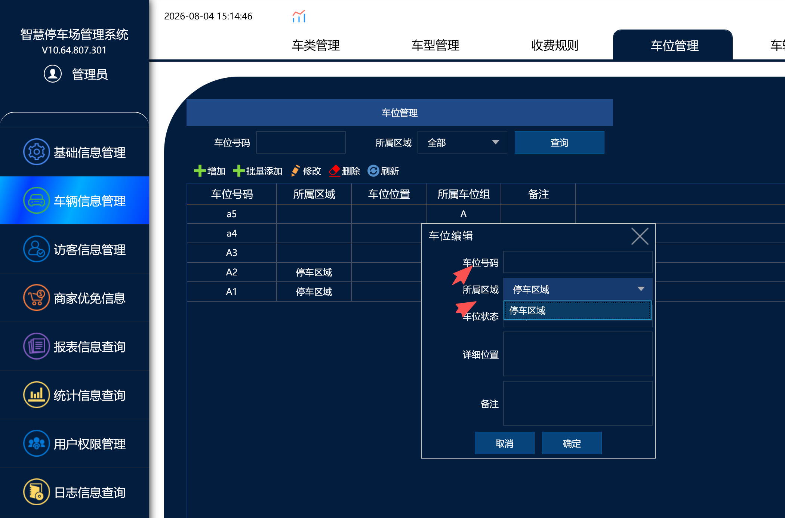
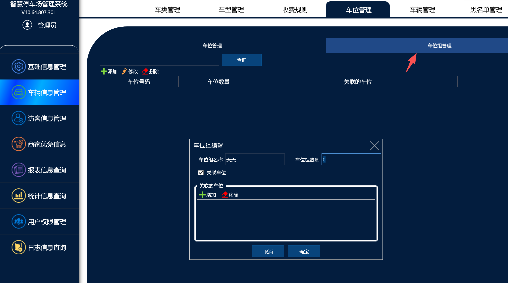
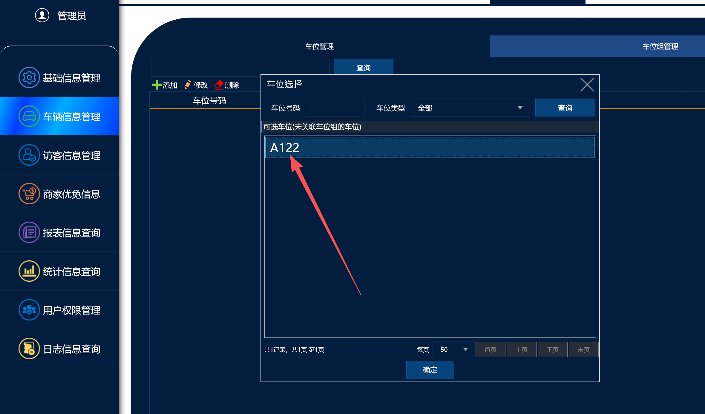
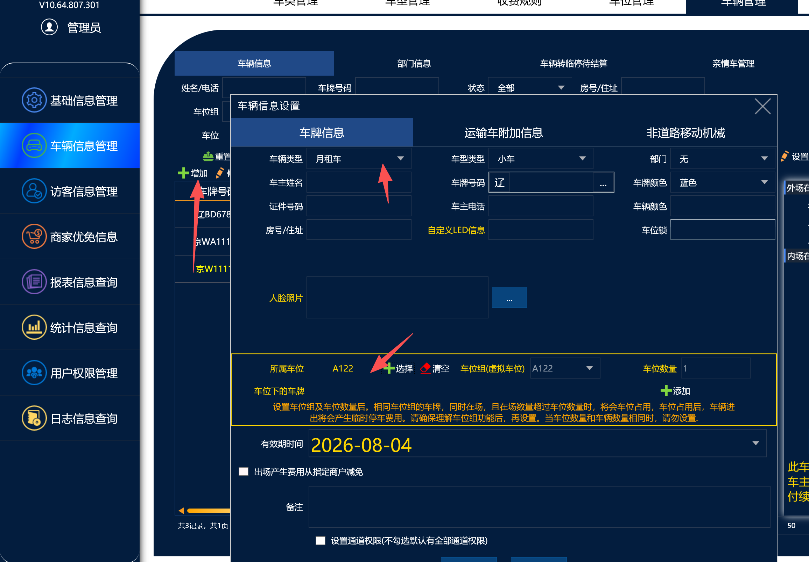

车位管理
功能介绍：此功能主要用在多个区域分别对每个区域有多个车位进行管理
列如：车场有三个区域a,b.c三个区域，a区域2个车位，b区域1个车位，c区域2个车位，那么绑定这个车位组的的车辆，a区域只能进2个月卡，b区域只能进1个月卡，c区域只能进2个月卡，超出的车辆只能转临停或者是禁止进出

使用方法：
打开管理软件，点击车辆信息管理，在点击车位管理功能（如果没有的话需要升级64位的软件）

点击添加
车位号码：这个是车位名字，可以自定义名称
所属区域：这个是选择区域，选择哪个区域就会把这个车位添加到对应的区域下
车位状态：这个默认正常就可以了不需要修改
详细位置：可以根据客户���地址填写也可以自定义填写
备注：客户自定义备注后在车位管理界面可以看的

点击车位组管理
点机新增
点击关联车位，就会把对应的车位添加到该车位组下面

点击车辆管理，点击新增，选择月租车，然后选择所属车位就好了

