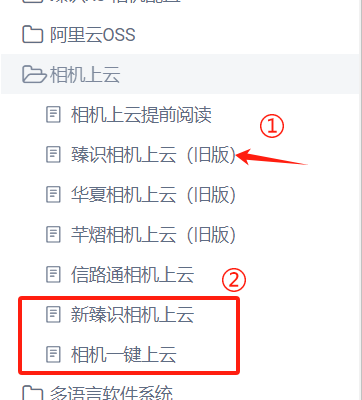
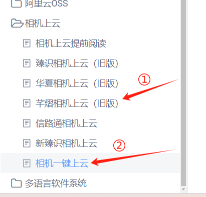
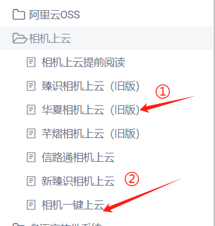
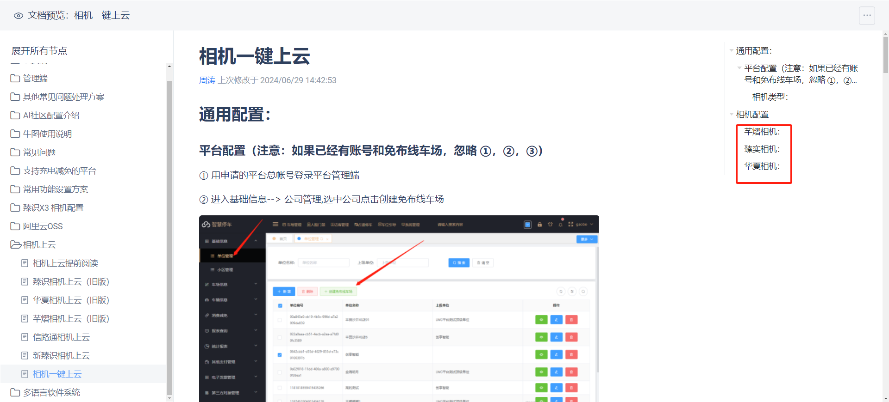

## 相机上云时建议能够升级到最新版本就升级到最新版；但是有些相机版本比较老，可能升级不到，因此有两种上云方式

### 臻实相机

①旧版的相机使用原来的方式上云

②使用一键上云的方式上云

### 芊熠相机

①旧版的相机使用原来的方式上云

②新版相机使用一键上云

### HX相机

①旧版的相机使用原来的方式上云

②新版相机使用一键上云

## 一键上云具体操作详见目录：（相机一键上云）

