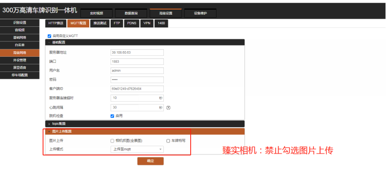
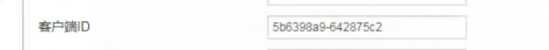
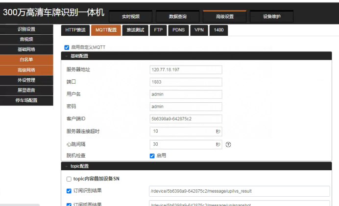
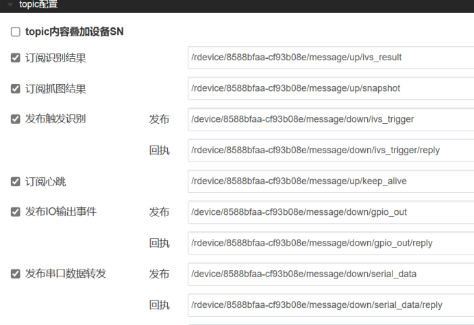

上云时一定要禁止图片上传

（1）先向平台方申请属于自己公司的平台总账号

（2）平台配置（注意：如果已经有账号和免布线车场，忽略①，②，③）

① 用申请的平台总帐号登录平台管理端

② 进入基础信息--&gt;公司管理,选中公司点击创建免布线车场

③ 录入车场的公司名称，以及车场名称创建车场

④ 配置设备信息：车场信息-&gt; 设备管理  输入刚刚创建的 车场名称，搜索设备信息，然后修改设备信息  填入相机序列号

臻���相机序列号为客户端ID

:::caution
图片缺失：
:::

⑤ 选中对应相机信息，点击相机配置，在弹出的窗口点击新增然后直接点击保存

⑥ 配置车场在线支付信息：进入其他支付管理-&gt; 接口参数配置-&gt; 新增然后根据您的支付渠道进行支付配置

（3）相机配置

① 通过浏览器输入相机IP登录到相机配置界面

② 在高级设置-&gt;高级网络-&gt;MQTT配置服务器地址39.108.70.214（如果找不到该选项联系相机厂家拿相机升级包升级相机程序到最新程序）

③ 修改topic配置参数：

A. 在订阅识别结果、订阅抓拍结果、以及所有回执的第一个斜杠后加r,在device/后加上相机序列号，序列号为上图客户端ID。

B. 在发布出发识别、发布IO输出事件、发布串口数据转发的device/后加上相机序列号，不需要加r
示例：/rdevice/ac614b39-3bec4843/message/up/ivs_result 回执和结果加“r”

/device/ac614b39-3bec4843/message/down/ivs_trigger 发布不用加“r”（“/”不能少）

:::caution
图片缺失：
:::
