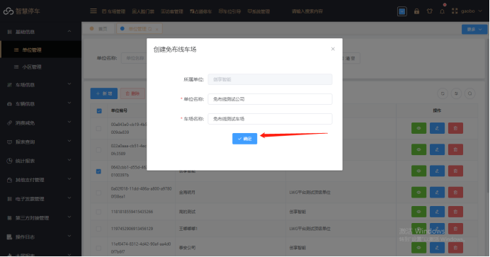
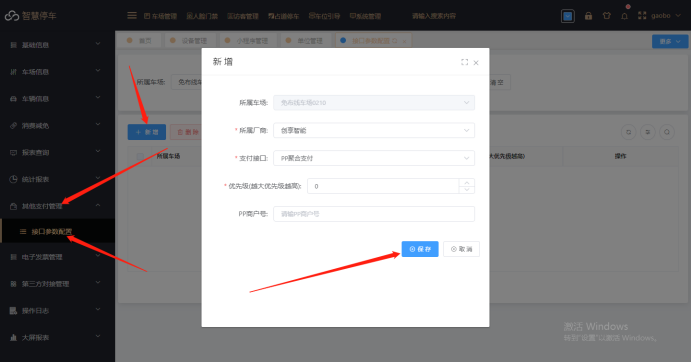

上云时一定要禁止图片上传

（1）先向平台方申请属于自己公司的平台总账号

（2）平台配置（注意：如果已经有账号和免布线车场，忽略①，②，③）

① 用申请的平台总帐号登录平台管理端

② 进入基础信息--&gt;公司管理,选中公司点击创建免布线车场

③ 录入车场的公司名称，以及车场名称创建车场

④ 配置设备信息：进入车场信息-&gt; 设备管理  输入刚刚创建的 车场名称，搜索设备信息，然后修改设备信息  填入相机序列号

注意：HX相机序列号为UID

⑤ 选中对应相机信息，点击相机配置，在弹出的窗口点击新增然后直接点击保存

⑥ 配置车场在线支付信息：进入其他支付管理-&gt; 接口参数配置-&gt; 新增然后根据您的支付渠道进行支付配置

## （3）相机配置

1、登录相机在网络配置里面找到MQTT

勾选打开mqtt功能

协议选择2

camld类型选择UID,平台添加相机序列号也是填这个，UID在设备信息里面。

服务器域名： huaxiamq.cxzntc.com   端口1883  （如图）

:::caution
图片缺失：
:::

:::caution
图片缺失：
:::
