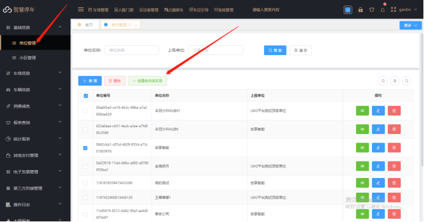
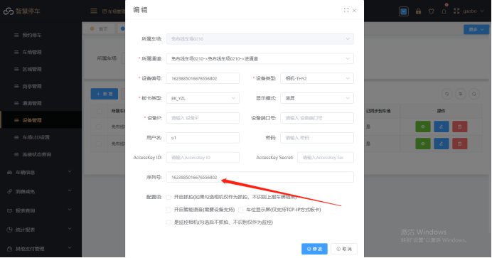
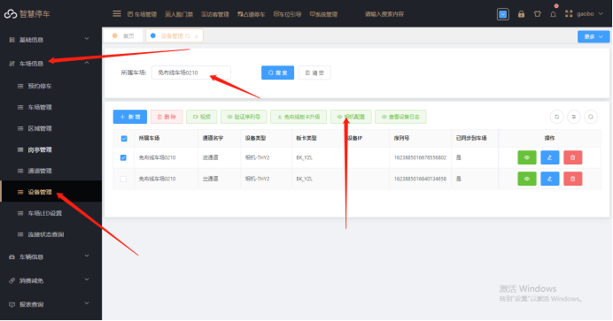
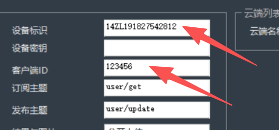

（1）先向平台方申请属于自己公司的平台总账号
（2）平台配置（注意：如果已经有账号和免布线车场，忽略①，②，③）
① 用申请的平台总帐号登录平台管理端

② 进入基础信息--&gt;公司管理,选中公司点击创建免布线车场



③ 录入车场的公司名称，以及车场名称创建车场


④ 配置设备信息：静茹车场信息-&gt; 设备管理  输入刚刚创建的 车场名称，搜索设备信息，然后修改设备信息  填入相机序列号



千熠相机序列号为客户端ID


⑤ 选中对应相机信息，点击相机配置，在弹出的窗口点击新增然后直接点击保存




:::caution
图片缺失：
:::

⑥ 配置车场在线支付信息：进入其他支付管理-&gt; 接口参数配置-&gt; 新增然后根据您的支付渠道进行支付配置


（3）相机配置
1.登录相机在专家模式里面基础配置-MQTT设置。

```
cloud功能勾选
```

```
工作模式选“模式5”
```

```
camld选择MAC
```

```
平台域名：qianyimq.cxzntc.com  端口1883
```

```
用户名 photo 密码  photo
```

 （如图）
结果与图片 一定要选择分开上传 心跳设置成60    如果设置不对 平台不会接收识别记录 就会没有反应


最后设备标识和客户端ID：需要改成相机的序列号



保存后重启一下相机 然后在平台上查看设备连接状态是否在线