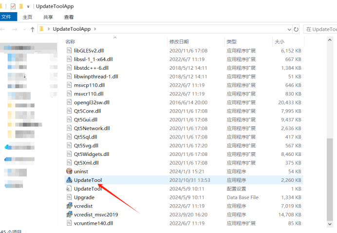
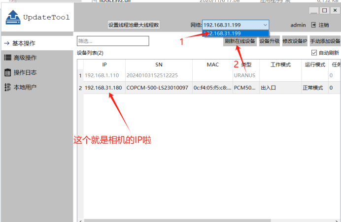
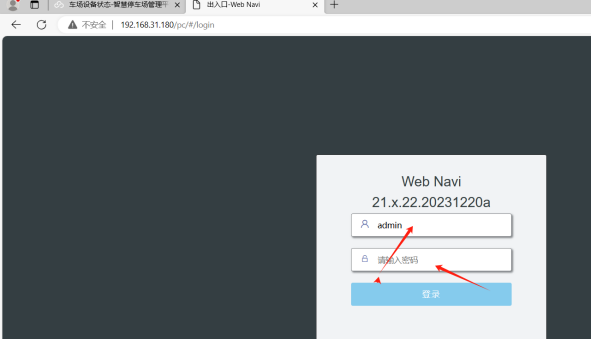
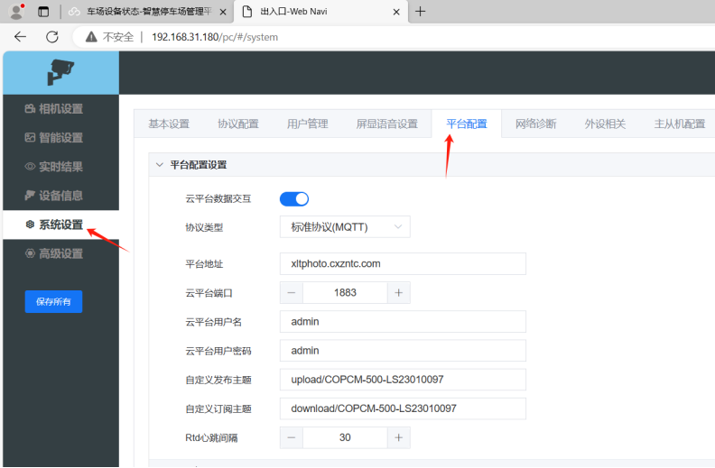
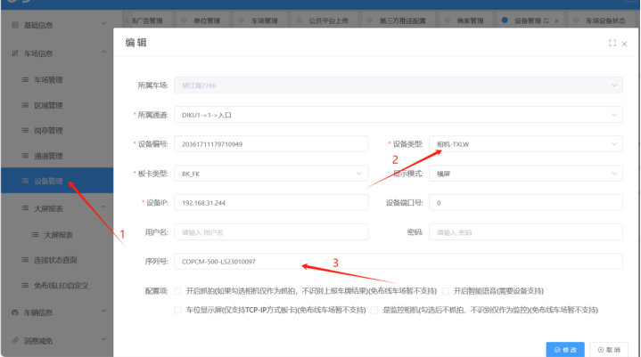
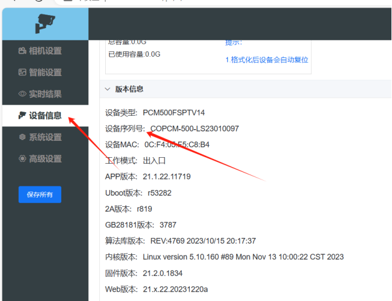
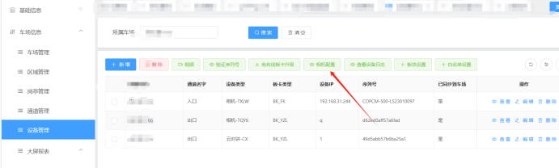
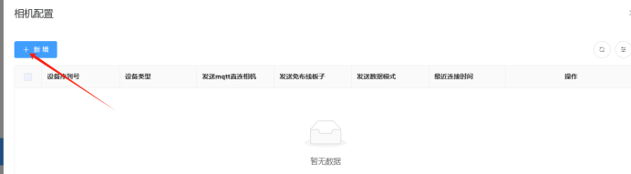
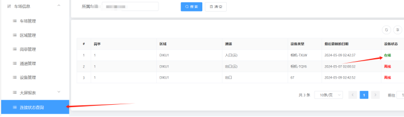

相机工具如下：
[UpdateToolApp.zip](https://www.showdoc.com.cn/server/api/attachment/visitFile?sign=64bbca00d8f9a79b151beb90319069bb &quot;UpdateToolApp.zip&quot;)
1. 打开相机搜索工具  UpdateToolApp （没有的话找售后要一下工具）
2. 点击进去后往下滑找到UpdateTool点击进去
3. 按照图片上的箭头去操作：1选钟自己电脑的ip→2点击刷新在线设备就可以看见信路通相机的相机IP了

相机上的配置
浏览器输入相机IP，输入后跳转到登录界面
登录账号：admin
登录密码：admin
如果账号密码不对的请联系相机那边要一下

登录之后点击系统设置  → 平台配置
1勾选云平台数据交互

2协议类型选择（标准协议MQTT)

3平台地址 xltphoto.cxzntc.com

4云平台端口：1883

其他的都是默认好的就不需要配置了
配置的页面如下图所示：

平台上配置
找到设备管理，点击新增，信路通相机的设备类型选择

相机-TXLW,然后把相机序列号填进去就可以了

（相机序列号在相机里面的设备信息可以查到）

:::caution
图片缺失：
:::

1添加好设备后点击这个相机配置进去，点击进去后直接点击修改在保存，不需要进行其他操作的，然后在设备连接状态那里看看这个相机是否连上，在线的话就可以直接进行测试进出以及语言播报了

:::caution
图片缺失：
::::::caution
图片缺失：
:::
