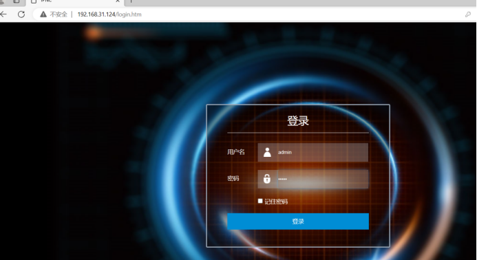
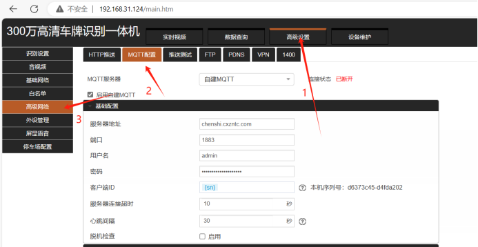
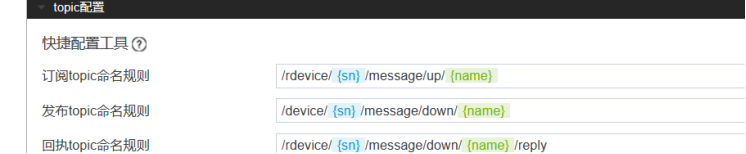
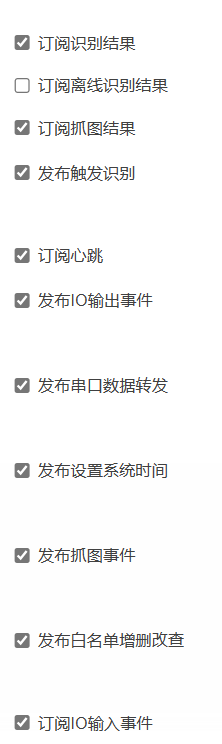
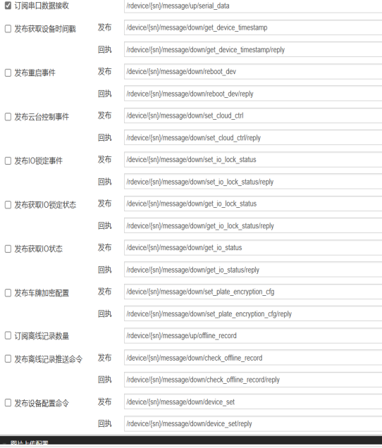
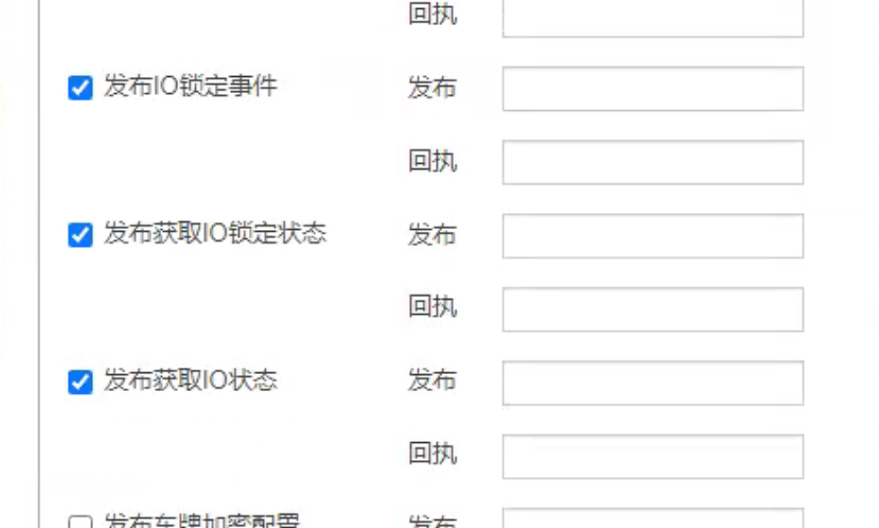
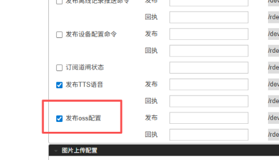
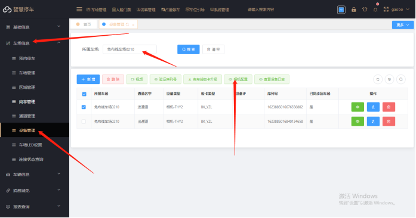
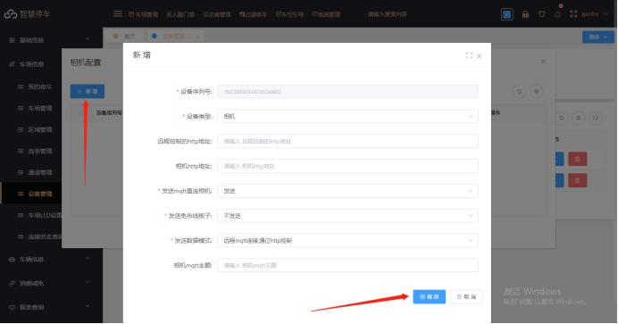

VZ相机工具如下：（可用于搜索相机）
[臻实.zip](https://www.showdoc.com.cn/server/api/attachment/visitFile?sign=57117c81194fbdafb4289e2846abf54e &quot;臻实.zip&quot;)
1打开浏览器输入相机ip登录进相机里面
VZ相机的登录账号和密码一般都是admin

2进入相机页面后点击高级设置→高级网络→mqtt 配置

配置参数：
1. MQTT服务器选自建MQTT
2. 启用自建MQTT要勾选
3. 服务器地址 zhsphoto.cxzntc.com
4. 其他的话都是按默认的
Topic配置
在快捷配置工具工具里面订阅和回执配置前面加/r
发布配置前面加/
如下图配置：

切记这个配置就是配置这三行，下面的不需要配置
1下面配置只勾选的内容如下图：

已下配置项，如果相机配置中存在，建议勾选：
注意：①平台车队模式开启需要配置该配置项

②平台下发OSS,需要配置该配置项

## 平台上配置
配置设备信息：进入车场信息-&gt;设备管理 输入刚刚创建的车场名称搜索设备信息，并修改设备信息填入相机序列号

选中对应相机信息，点击相机配置，在弹出的窗口点击新增然后直接点击保存

