## 通用配置：
##### 平台配置（注意：如果已经有账号和免布线车场，忽略 ①，②，③）

① 用申请的平台总帐号登录平台管理端

② 进入基础信息--&gt; 公司管理,选中公司点击创建免布线车场

③ 录入车场的公司名称，以及车场名称创建车场

④ 相机序列号添加到平台

###### 相机类型：
芊熠相机：相机-TQY6
臻实相机：相机-THY2
HX相机：相机-THX8

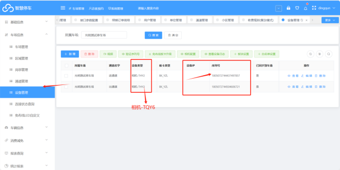

添加相机配置

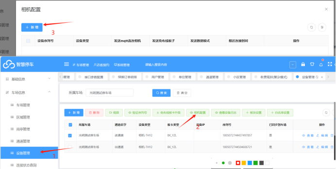

新增   然后直接点保存（不需要设置���他，直接点保存即可）

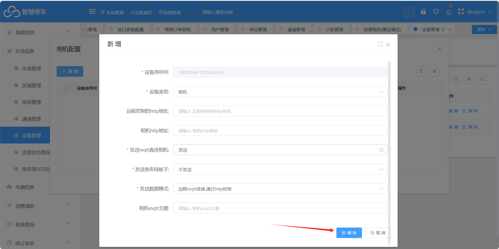

最后查看设备连接状态，如果为在线说明设备在线，并且上云成功

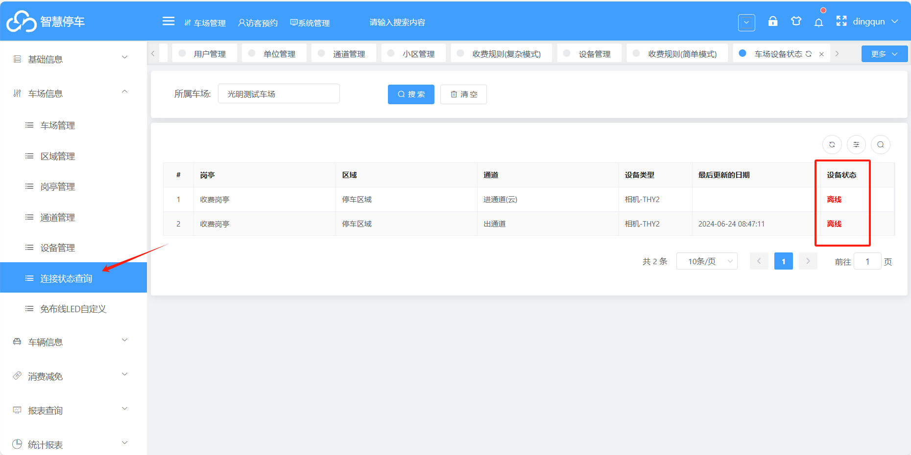

## 相机配置

###### 芊熠相机：
一键上云只需要选择（平台5）如下图：

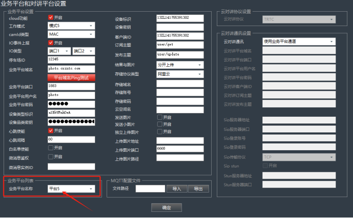

然后点击   **平台域名ping测试**    如果ping的通就说明已连接，如果ping不通，说明网络有问题，需要检查一下网

相机序列号：

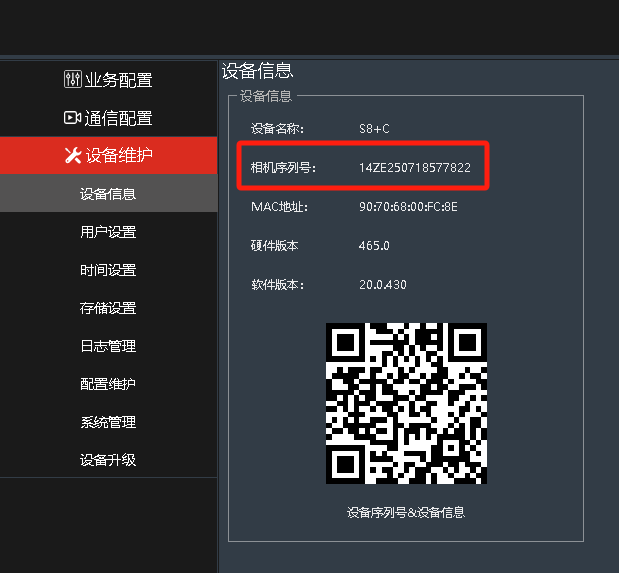

结果与图片 一定要选择分开上传 心跳设置成60    如果设置不对 平台不会接收识别记录 就会没有反应

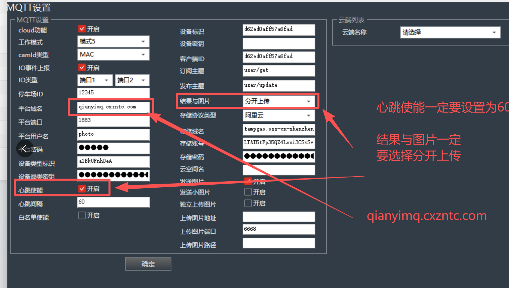

###### 臻实相机：
可以使用通用参数配置文件进行一键导入（配置文件可以找售后）

注：通用参数配置文件，只能在同版本的相机之间使用（不同版本的相机的配置文件不同）

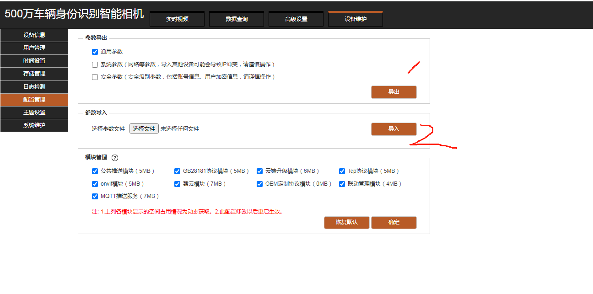

相机序列号：

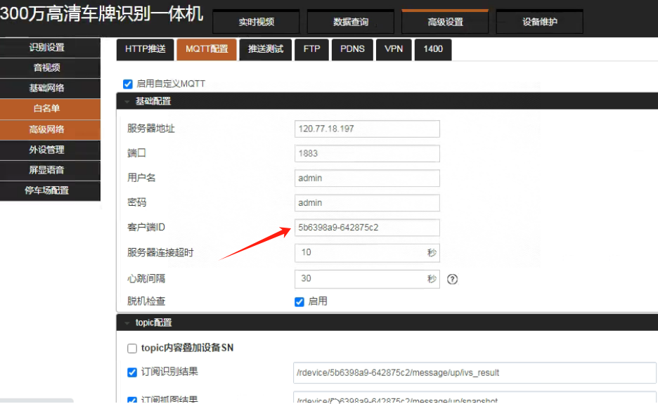

###### HX相机：
HX相机通过工具一键上云（工具可以找售后）  MQTT服务IP选择 如下图：

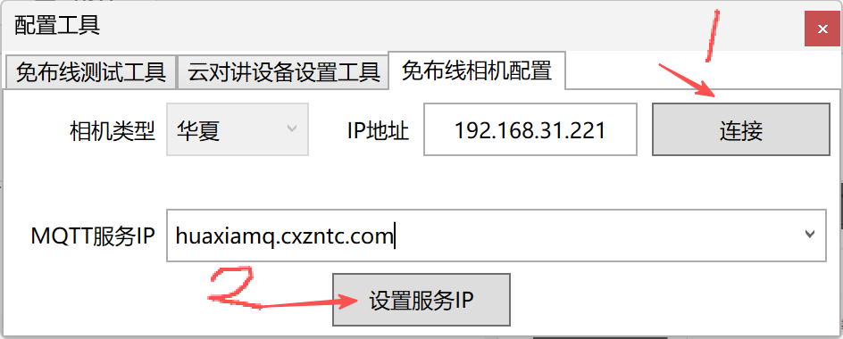

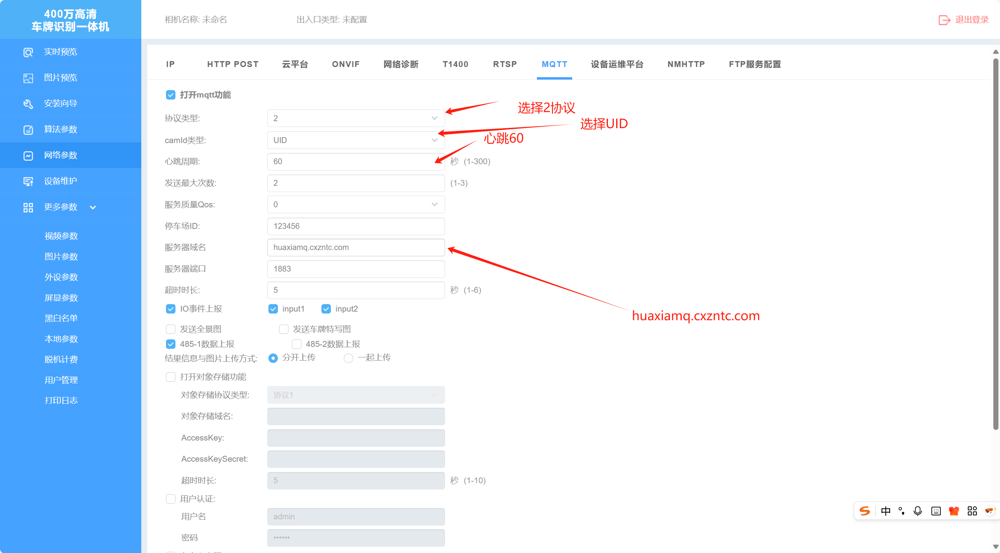

HX相机序列号：UID

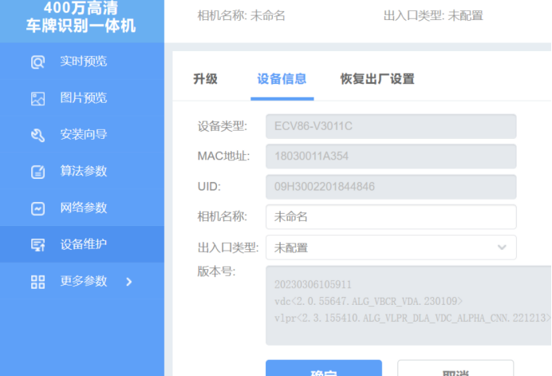

