1.网页登录相机

打开浏览器，通过浏览器的ip登录进相机控制界面，账号和密码一般都是admin，如图

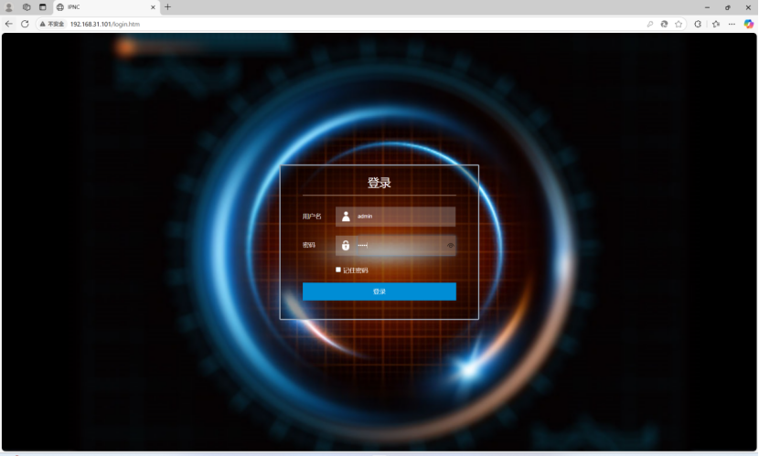

2.设置网络配置

登录相机后打开高级设置，选择高级网络，点击MQTT配置

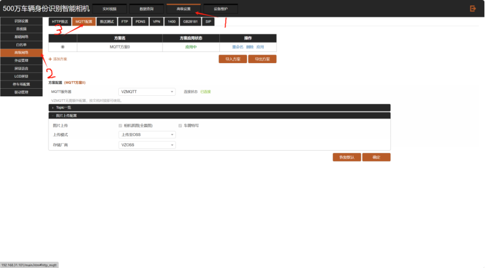

基础配置：

1.选择自建MQTT

2.勾选启用自建MQTT

3.服务器地址 zslcd.cxzntc.com

4.其他默认

Topic批量配置：

1.订阅和回执前面加/r，发布前面加/

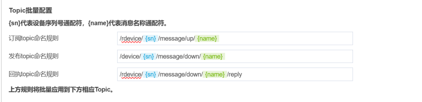

2.勾选如下

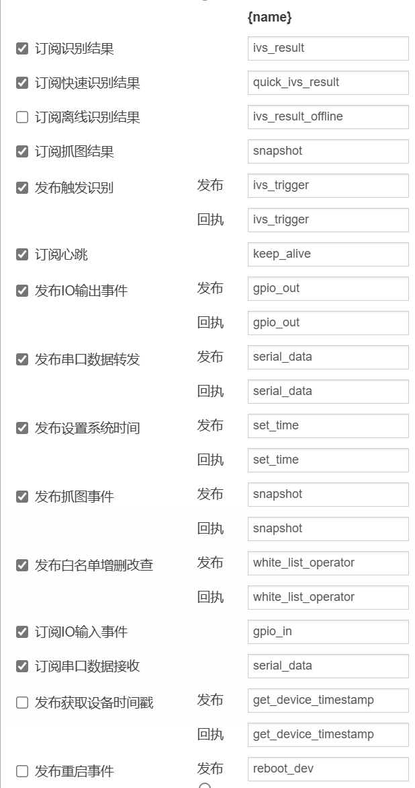

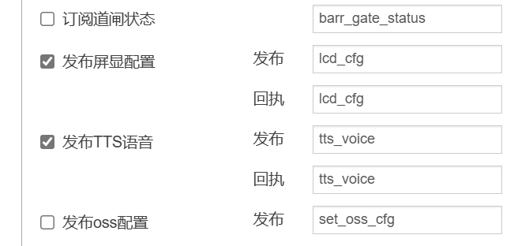

LCD屏幕显示配置

1.首先设置屏幕配置，将显示屏尺寸调到合适的大小

2.上云的相机要将屏显控制模式调为软件控制

3如果是半屏忙时显示按照如下配置，字体大小和颜色可以调整

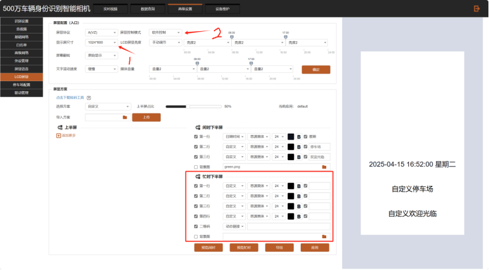

平台配置

1.车场需要勾选屏上显示二维码，不然识别到车辆后不会出现二维码

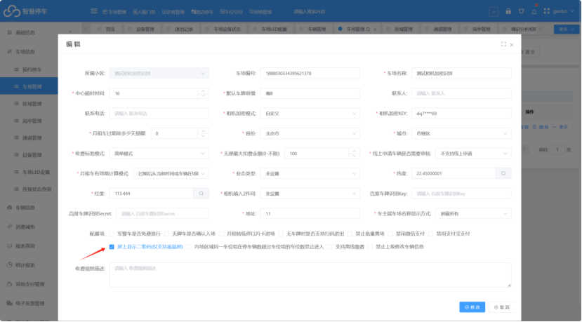

2.需要在设备管理中勾选开启智能语音，板卡类型选择未设置。

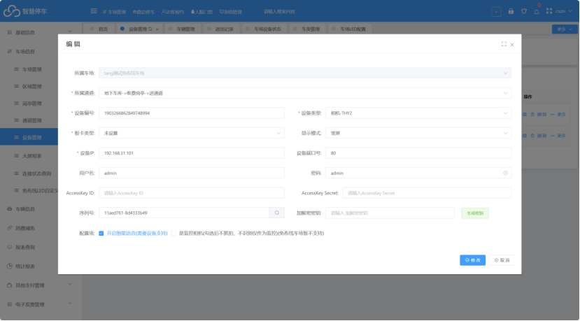

3.设置相机配置

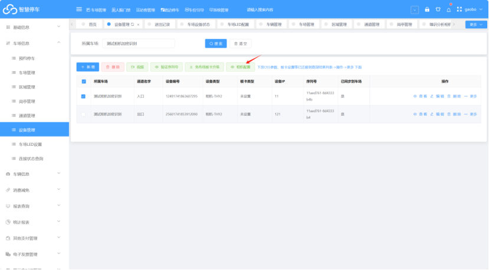

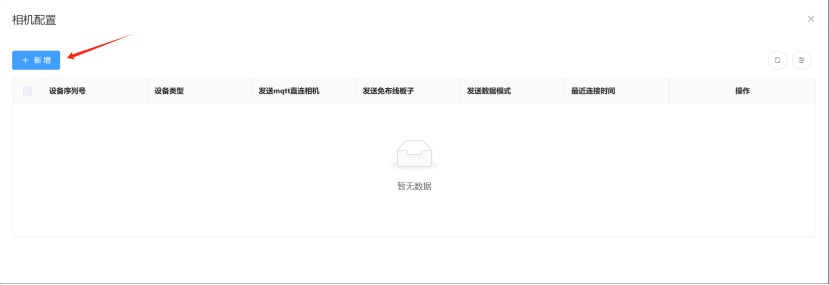

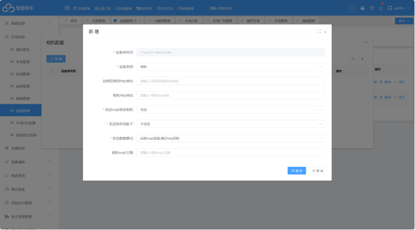

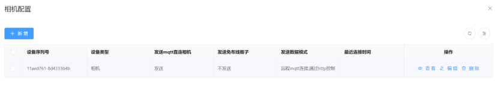

4.查看相机状态，在线则表示上云成功

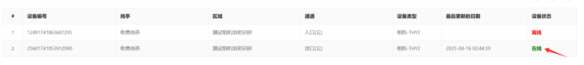

