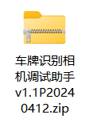
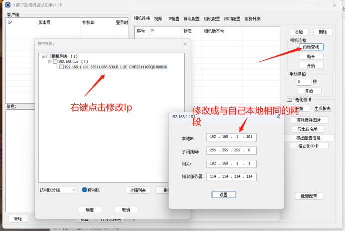
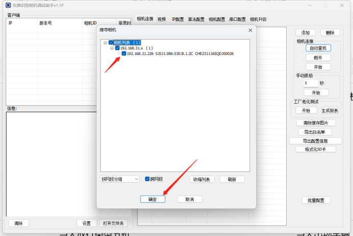
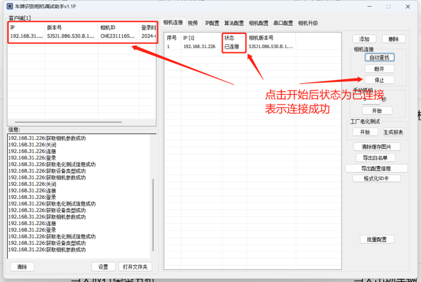
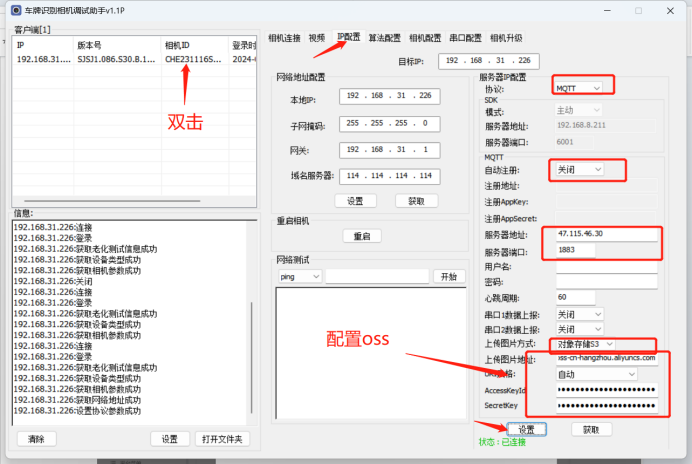
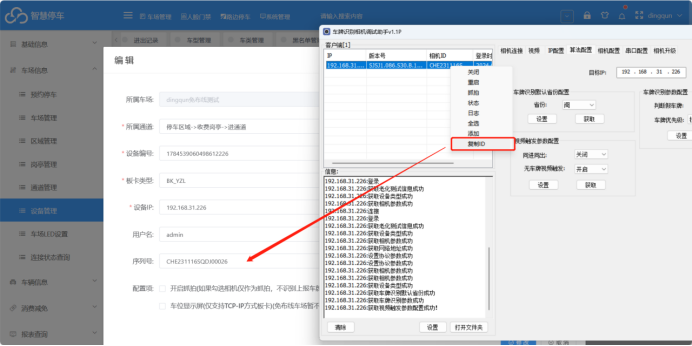
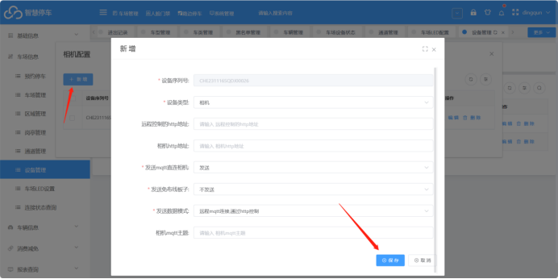
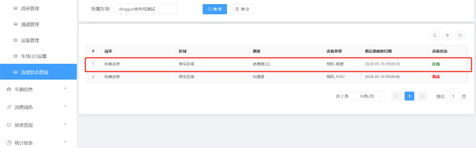

## 1.相机配置
首先使用工具连接相机，工具如下：
[车牌识别相机调试助手v1.1Q20240625(2).zip](https://www.showdoc.com.cn/server/api/attachment/visitFile?sign=820762d57f8c228933ab2e1e30476128 &quot;车牌识别相机调试助手v1.1Q20240625(2).zip&quot;)

由于相机与我们本地的网络不是一个网段，需要修改一下相机的IP以及网关，然后再连接

修改Ip成功之后，选择相机IP--&gt;确定---&gt;开始---&gt;出现如图   说明连接成功

连接成功之后点击IP配置，将服务器地址改为**47.106.217.71，端口：1883**（如果需要配置oss就直接选择对象存储配置一下mqtt以及oss就可以了，配置mqtt中的上传图片地址为   包名.oss-cnXXXX）

## 2.平台配置

车场管理--&gt;设备管理--&gt;给对应IP的相机填写一下序列号

点击相机配置---&gt;添加---&gt;直接点保存

然后在设备连接状态中查看设备连接状态，在线说明上云成功

