## 一、修改相机IP(如果相机IP已经修改完成，可以直接看第二点)

1 使用工具查询在线设备（工具可以直接下载）

https://cn.uniview.com/Service/Service_Training/Tools/Top/EZtools-2/

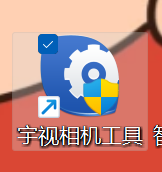

2 将相机IP改成和现场同一网段的IP

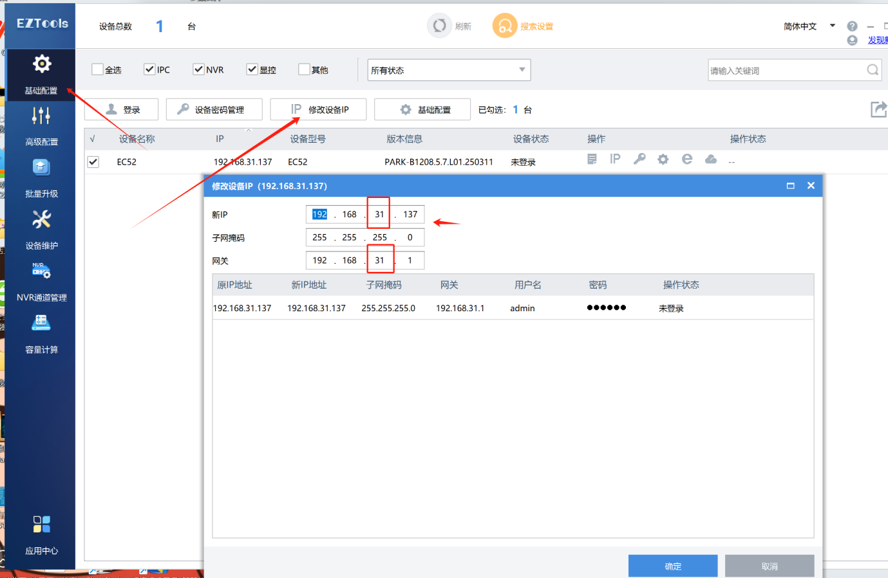

## 二、相机配置

### 1 在网页输入修改后的相机IP地址，登录相机默认账号为：admin  密码为：123456

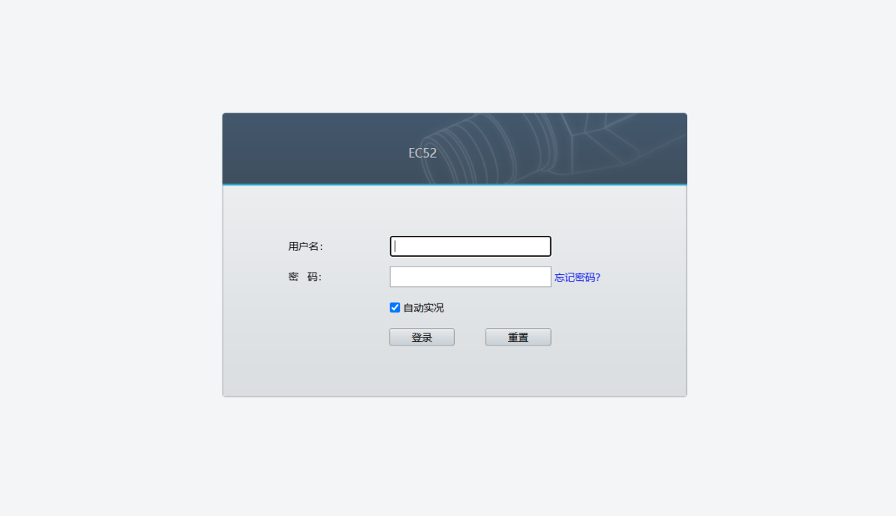

### 2 配置照片服务器

#### (1)配置--&gt;系统--&gt;照片服务器

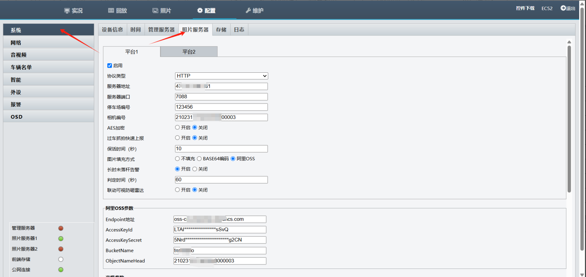

服务器地址：ysmqtt.cxzntc.com
端口号：7099
停车场编号：123456
相机编号：相机编号为相机序列号

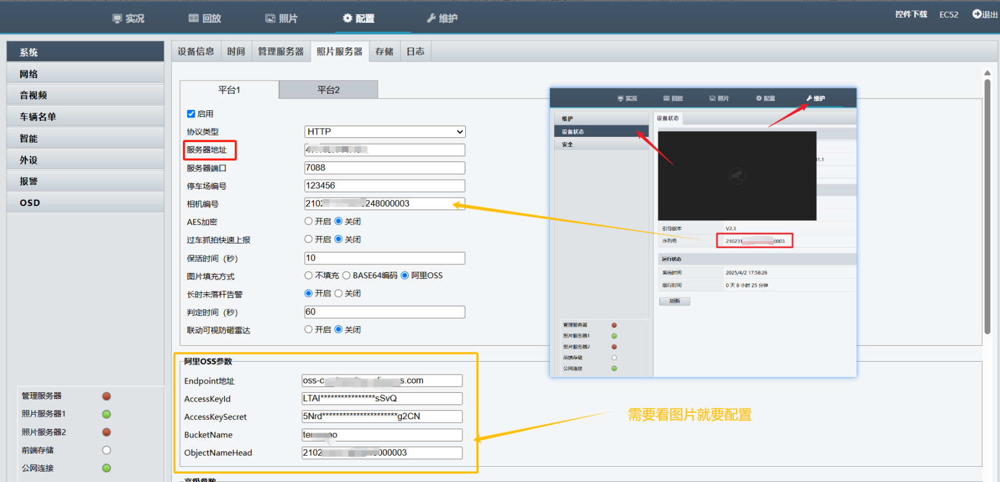

MQ服务器地址：ysmqtt.cxzntc.com
端口号：1883
客户端ID：相机序列号
请求topic：/device/相机序列号/message/do

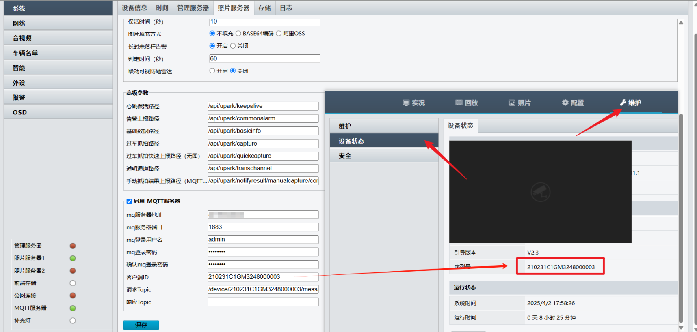

#### (2) 配置波特率：配置---&gt;外设--&gt;串口

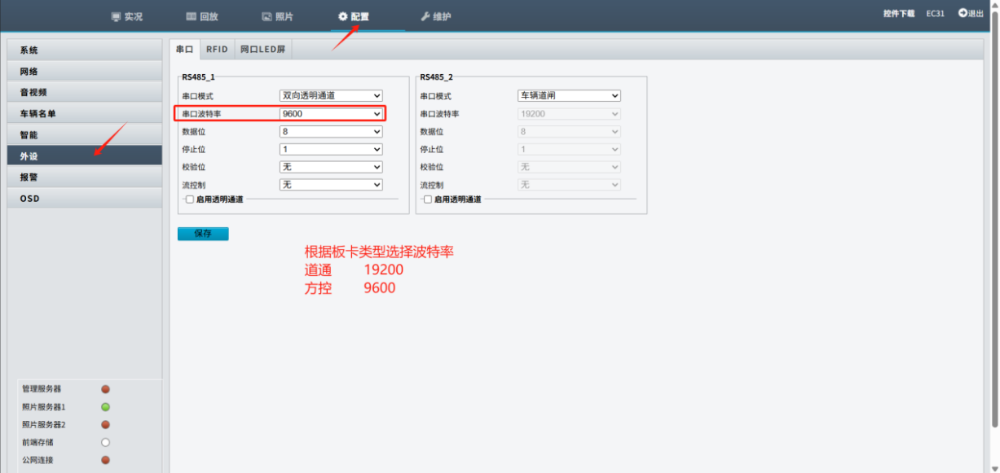

## 三、平台配置

### （1）登录平台--&gt;设备管理--&gt;新增

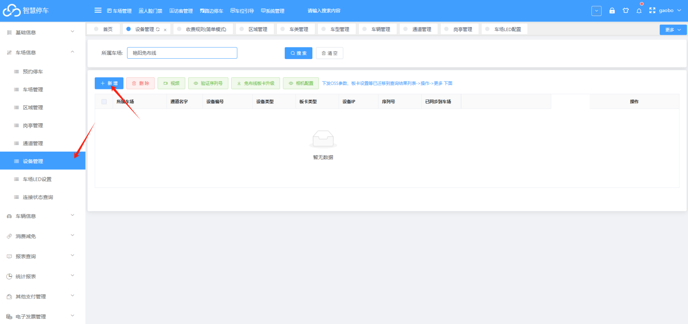

### （2）将相机设置好

设备类型：相机-TYS

板卡类型：按照对应板卡选择板卡类型

例如：

FK    BK-FK

DT    BK-YZL

序列号：添加相机序列号

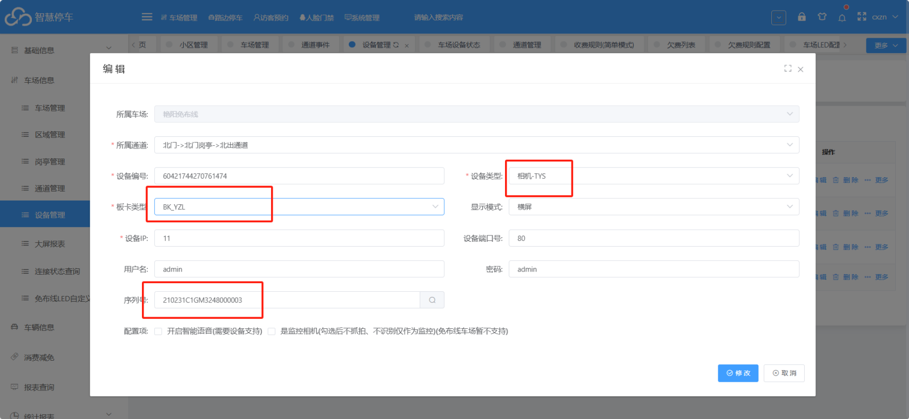

点开相机配置

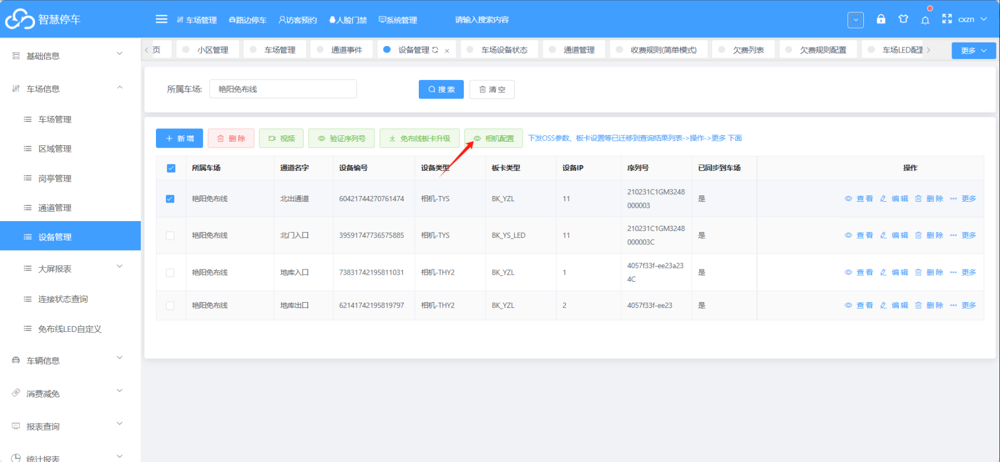

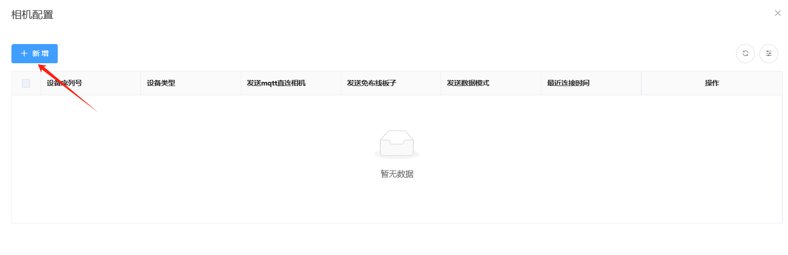

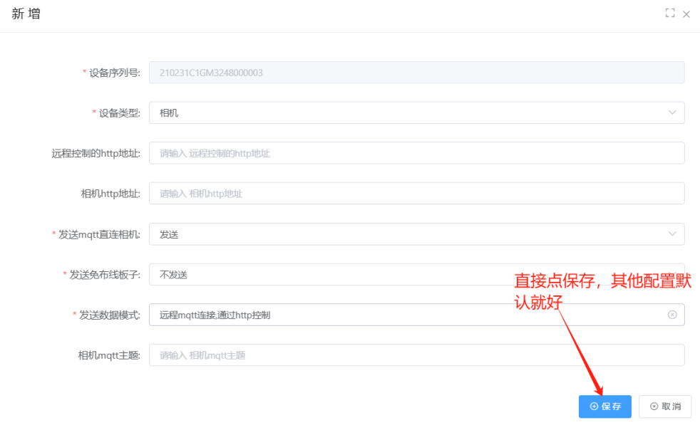

### （3）查看设备连接状态是否在线（在线说明上云成功）

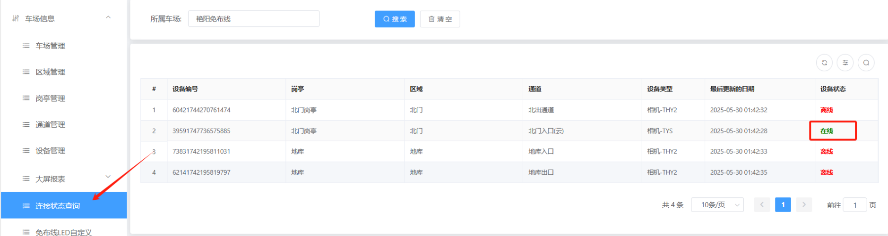

