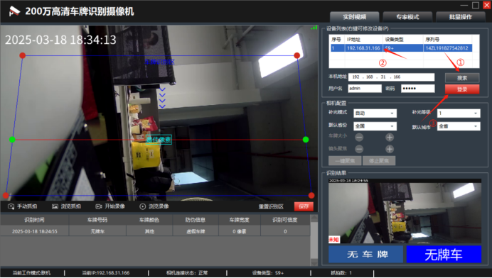
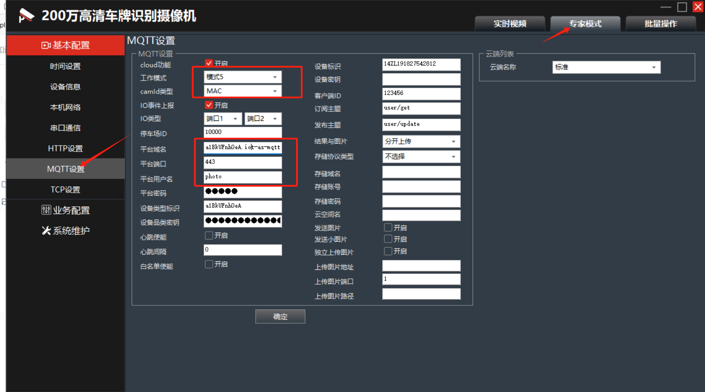
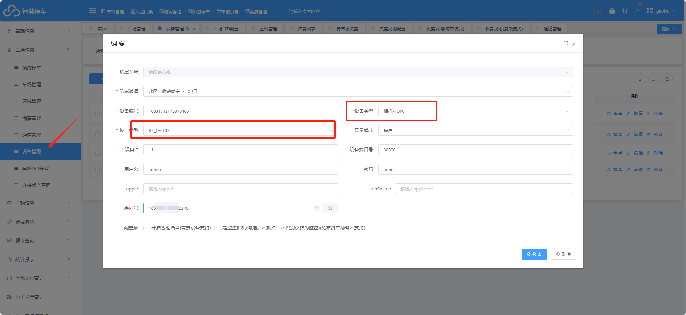
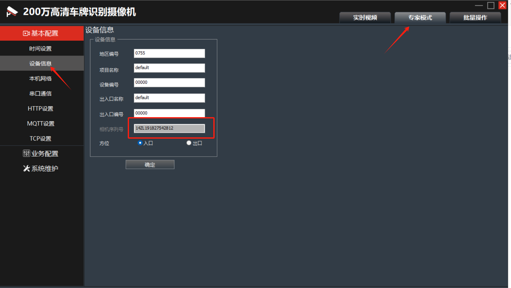

## 相机配置

1.登录相机

2.专家模式--&gt;基本配置--&gt;MQTT设置

勾选cloud功能

工作模式选“模式5”

camld选择MAC

平台域名：hqmqtt.cxzntc.com  端口1883

用户名 photo 密码  photo

3.设备标识和客户端ID：需要改成相机的序列号

4.重启一下相机

## 平台配置：

车场信息--&gt;设备管理

注意：

设备类型  选择   相机-TQY6

板卡类型  选择   BK-QYLCD

序列号  如 图二

图一：

图二：

