#### 相机接线注意事项：

485接线要接A2B2不然不会显示和播报哦

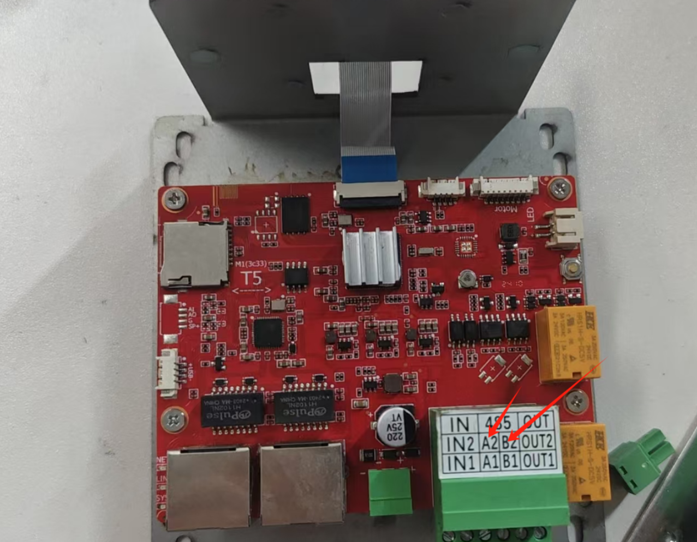

## 相机配置
### 1找到售后人员或者相机厂家要到相机搜索工具

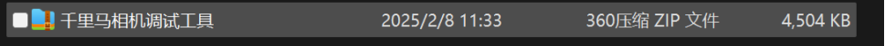

### 2 进入工具后，点击搜索设备，搜索出附近所有的在线设备

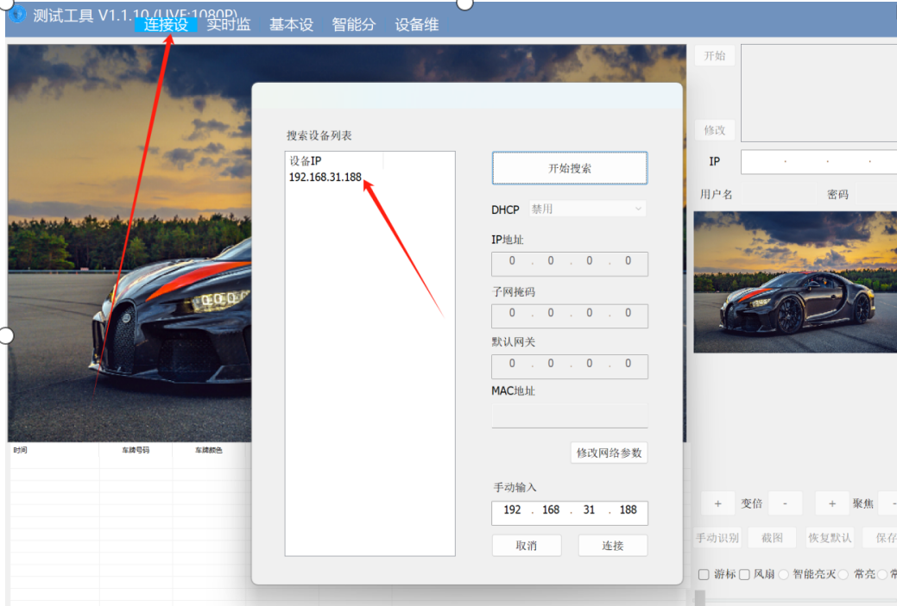

### 3在浏览器里输入相机的ip登陆
相机默认密码
账户：admin
密码：admin

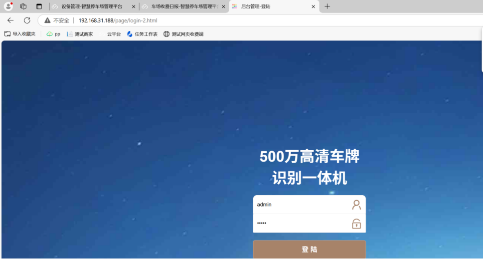

### 4登陆之后找到高级设置→高级网络→mqqt点击进去进行配置
### 服务器地址：mqda.cxzntc.com（只需要更改这个其他的不需要操作）
## 如果要配置oss储存服务器地址要加http://哦
## 平台配置：
1.在单位管理哪里选择对应的单位点击创建免布线车场
根据提示一步一步创建单位→小区→车场→通道→设备这些
操作如下图：

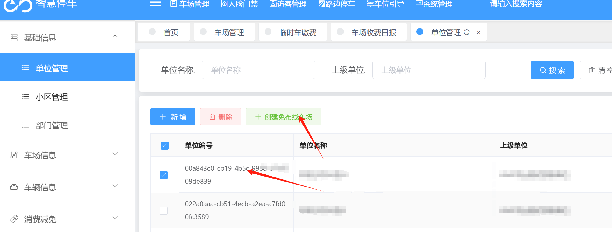

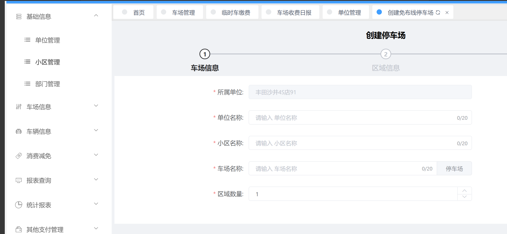

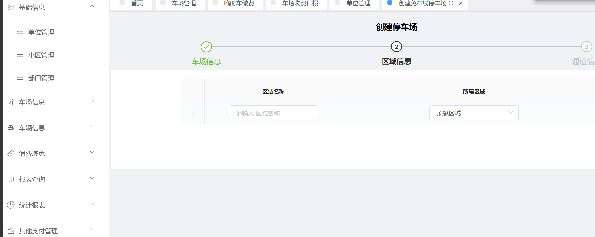

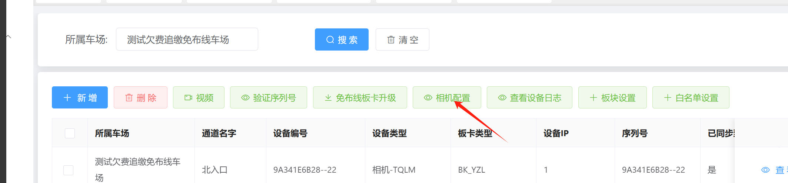

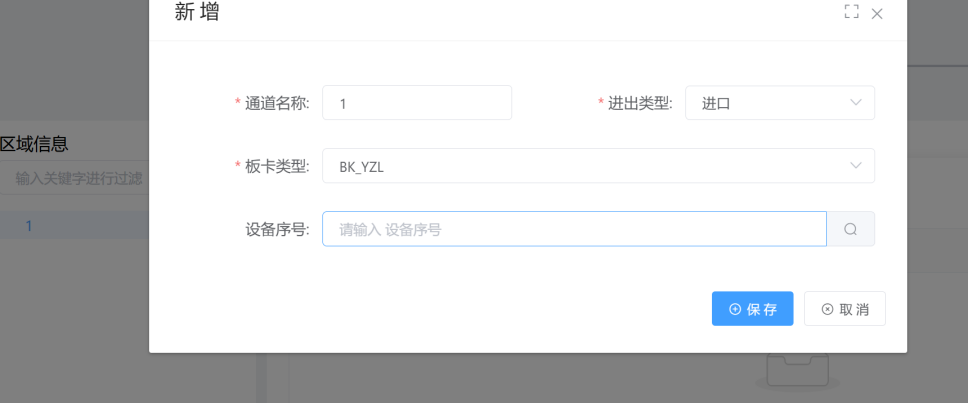

### 2.在设备管理这里点击新增或者修改通道设备信息
迁里马相机设备类型=相机-TQLM
选择好相机和板卡后把序列号填进去就可以啦
操作如下图

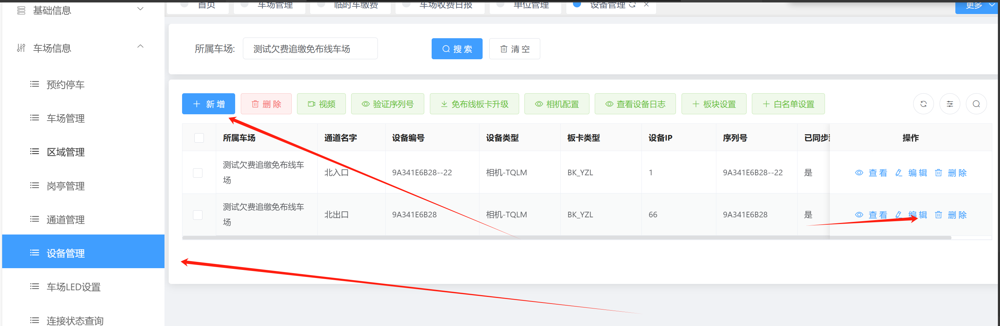

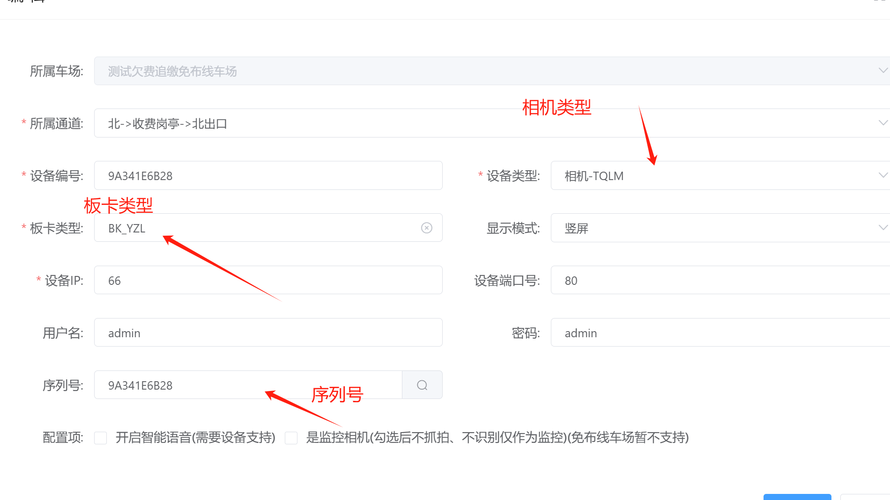

##### 3.添加好设备后点击相机配置直接添加新增报存就好啦。操作完后再设备连接状态那里看看设备在不在线，在线的话就直接可以测试一下进出开闸，语音播报这些了

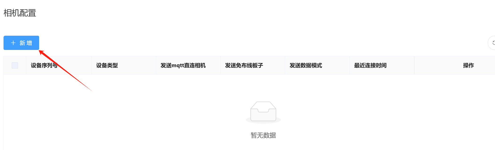

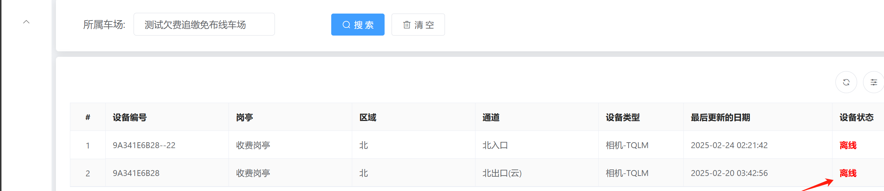

