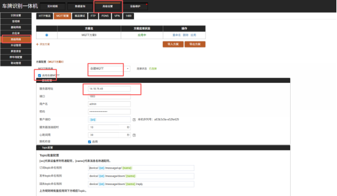
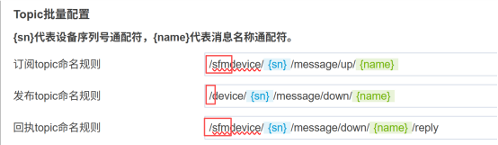
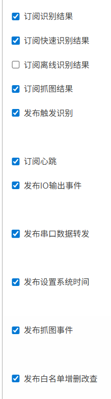
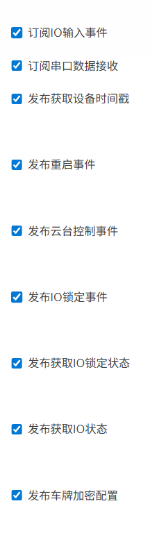
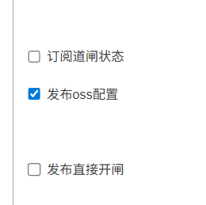
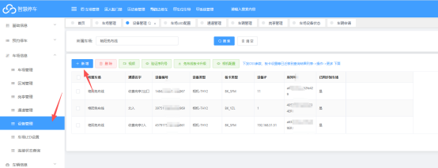
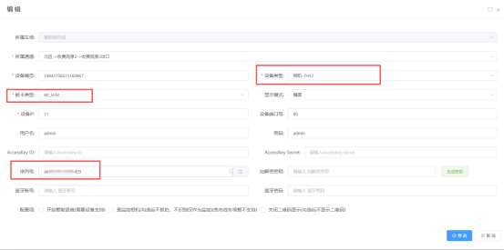

[TOC]

## VZ赛菲姆板卡一体机
### 1.相机配置

MQTT服务器  选择  自建MQTT
勾选 启用自建MQTT
服务器地址  ： saifeimumq.cxzntc.com
端口号      ： 1883
Topic批量配置设置如下：
订阅和回执    添加  /sfm
发布         添加  /

&lt;table&gt;&lt;tr&gt;&lt;td&gt;

&lt;/td&gt;&lt;td&gt;

&lt;/td&gt;&lt;td&gt;

&lt;/td&gt;&lt;/tr&gt;&lt;/table&gt;
### 2.平台配置

相机类型选择：相机-THY2
板卡类型选择：BK-SFM