## 注意：每款相机的序列号都是唯一的，相同的相机序列号不能重复添加绑定在不同的车场
### 一：VZ相机
VZ相机通过网页查询：

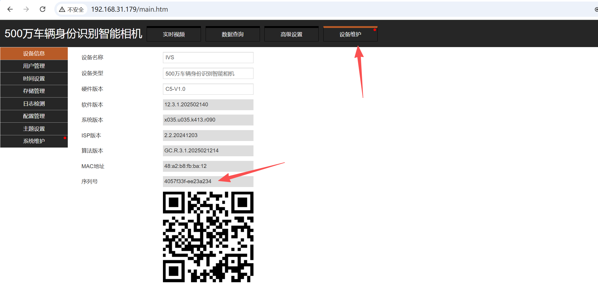

VZ相机通过设备查询

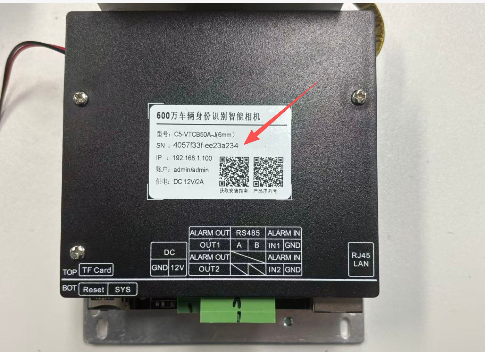

### 二：信路通相机
信路通相机通过网页查询：

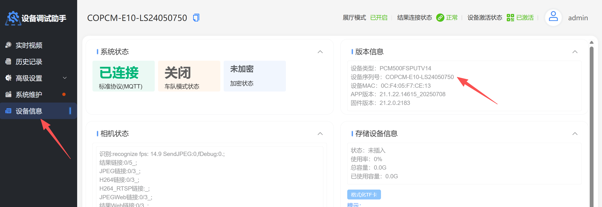

信路通相机通过相机查询：

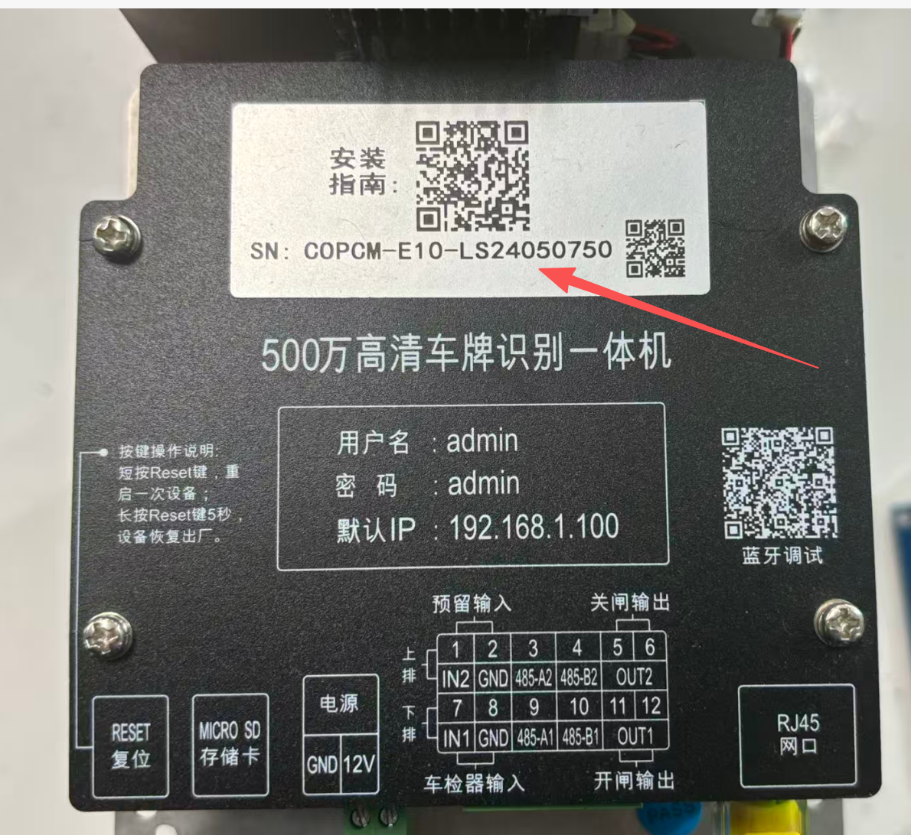

### 三：HX相机
HX相机通过网页查询：

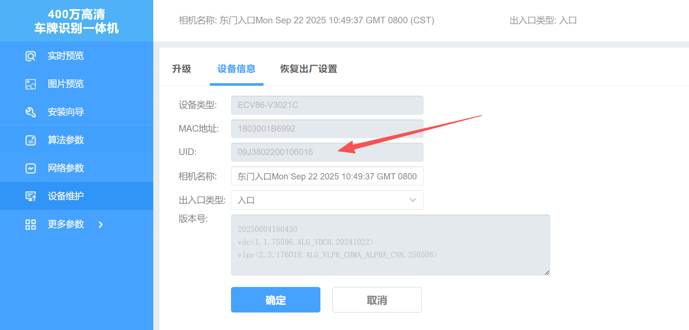

HX相机通过设备查询：

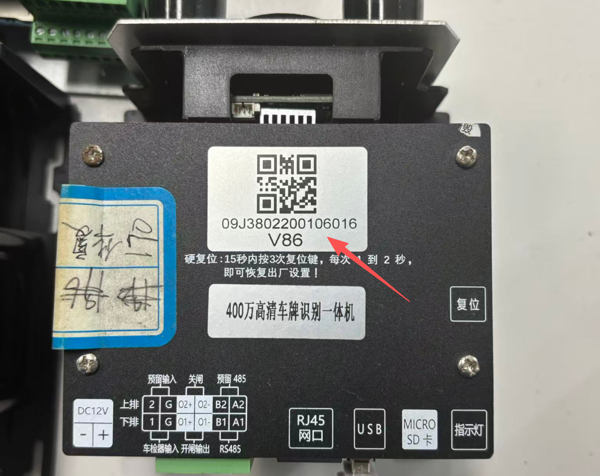

### 四：芊熠相机
芊熠相机通过相机工具查询：

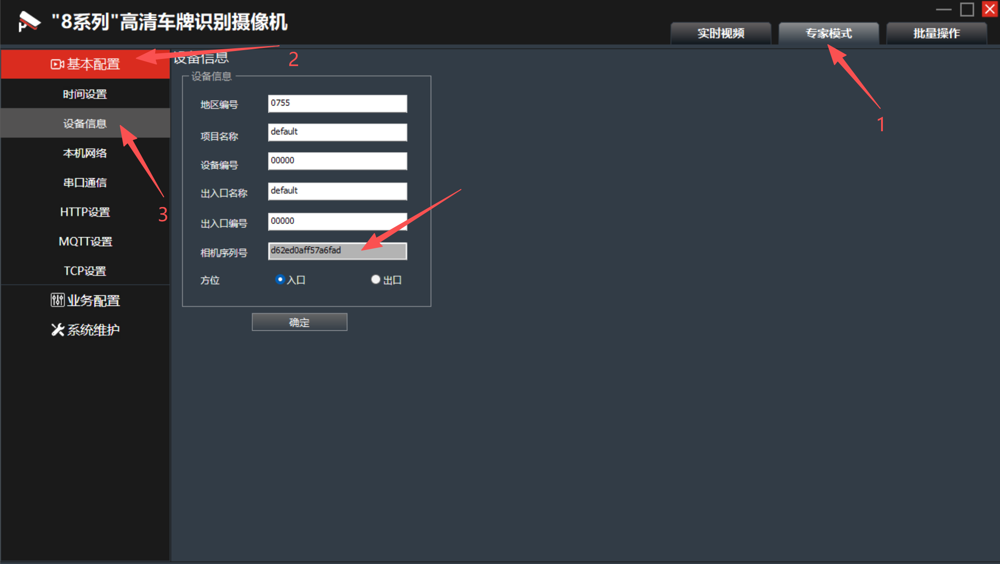

### 五：视捷相机：
视捷相机通过网页查询：

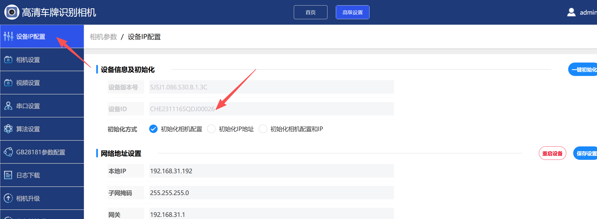

视捷相机通过相机工具查询：

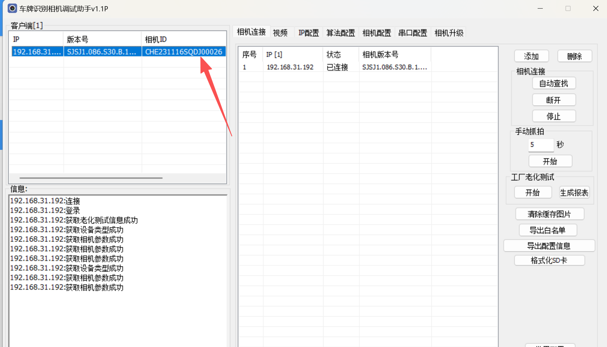

### 六：宇视相机
宇视相机通过网页查询：

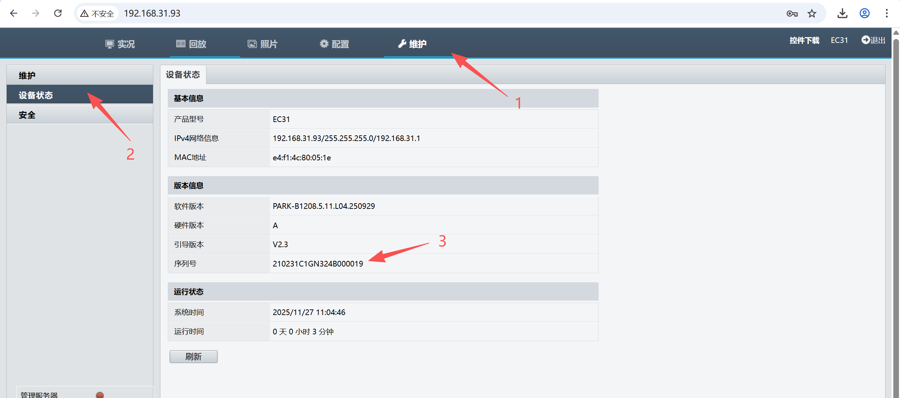

宇视相机通过相机工具查询：

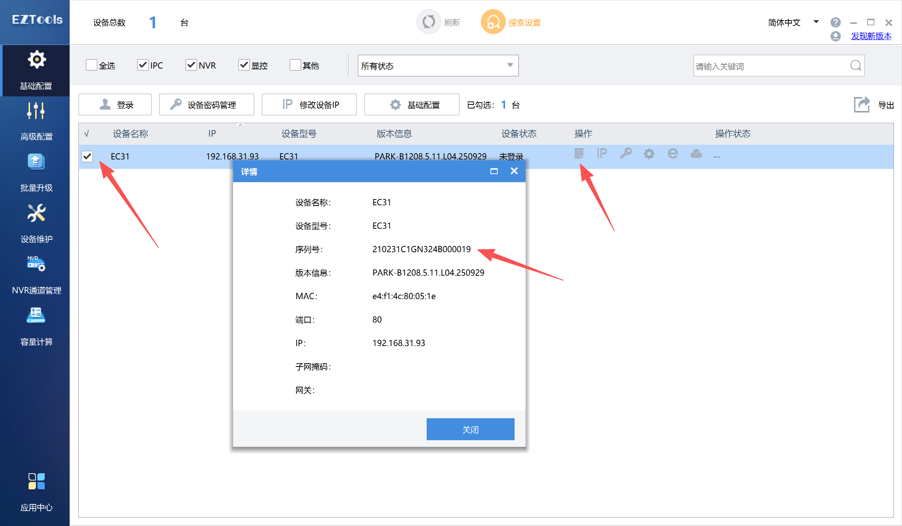

### 七：迁里马相机
迁里马相机通过网页查询：

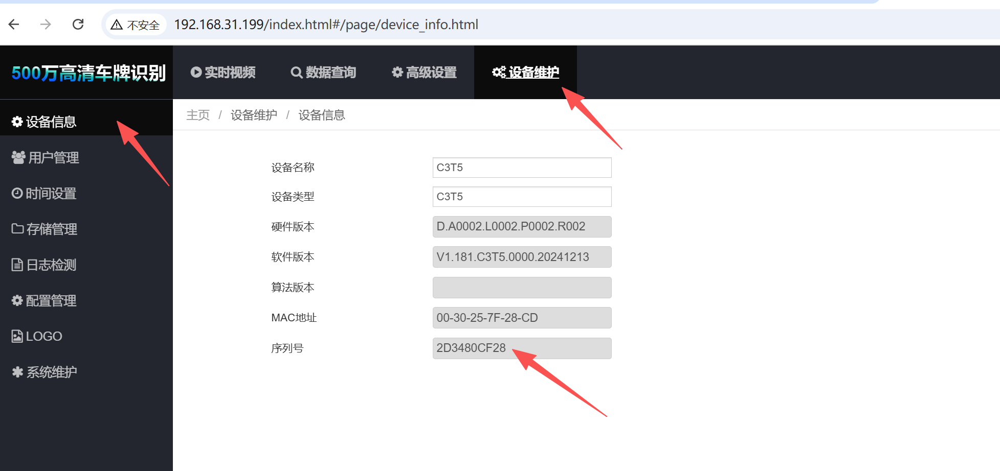

迁里马相机通过设备查询：

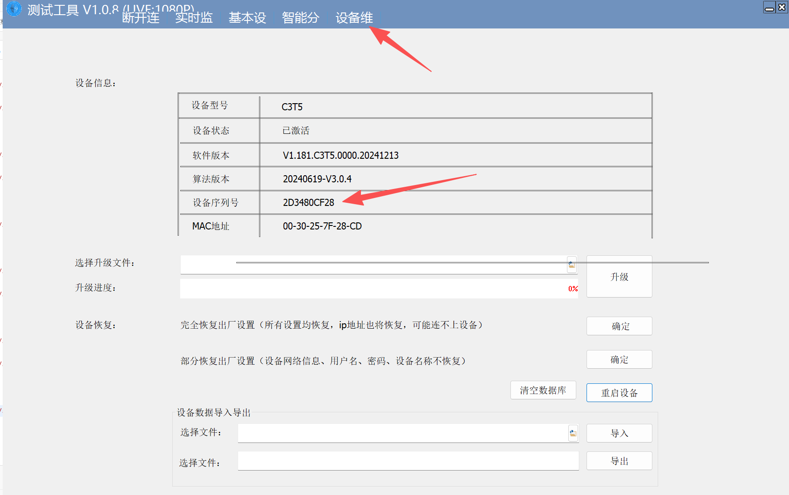

