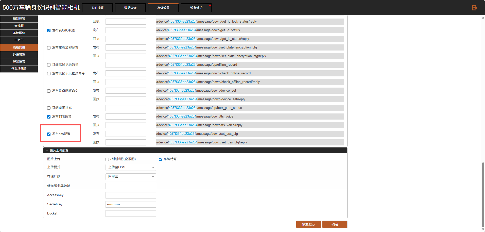
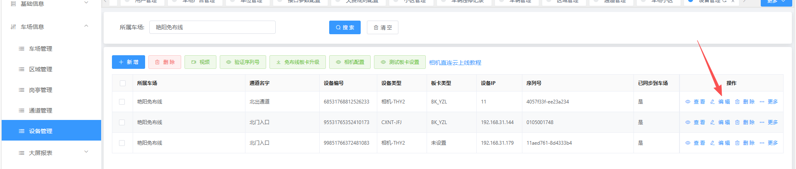
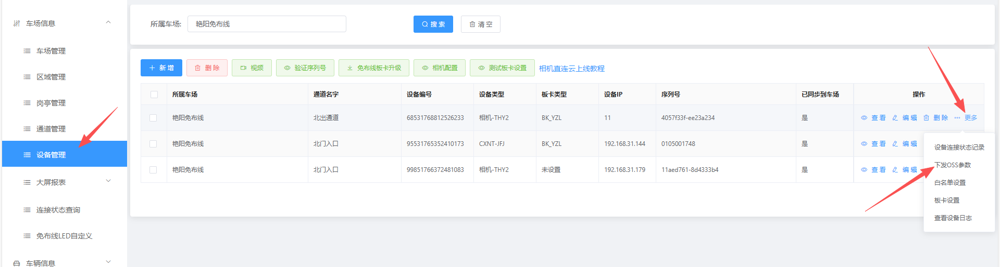

## VZ相机
注意：本功能支持相机C3 R3 C5 C5H R5 R5L R5H ，版本需要 25年以后的版本哦
首先相机里面mqtt配置需要  勾选发布OSS配置

第一种，自动下发平台默认看7天图片的参数
将相机配置上云，平台上面相机在线后，触发一个无牌车，平台就会自动下发；如果之前没有下发成功，可以设备管理点下修改保存，重新识别一个车牌，也能够自动下发

第二种，手动下发OSS，需要车场先在平台上面给车场配置好OSS，配置完成后，就可以在设备管理的更多中，直接点击下发OSS

