相机上云两种配置方式：
## 注意：第一次上线通过4G网卡上云相机需要先绑定我们这边臻云，由售后这边协助授权配置

## 一、通过相机内置4G网卡上云（相机配置）
#### 1、首先在臻云极致中绑定相机，然后从臻云极致中打开相机

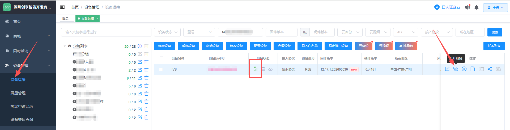

#### 2、然后mqtt配置选中  VZmqtt

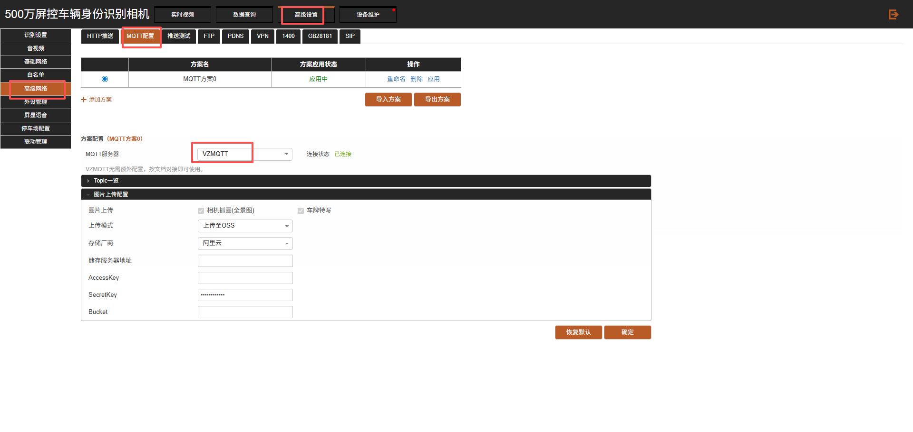

#### 3、接着找到屏显语音
①将启用状态改为外部启用
（建议先将状态改为强制启用保存，然后再改为外部启用保存）

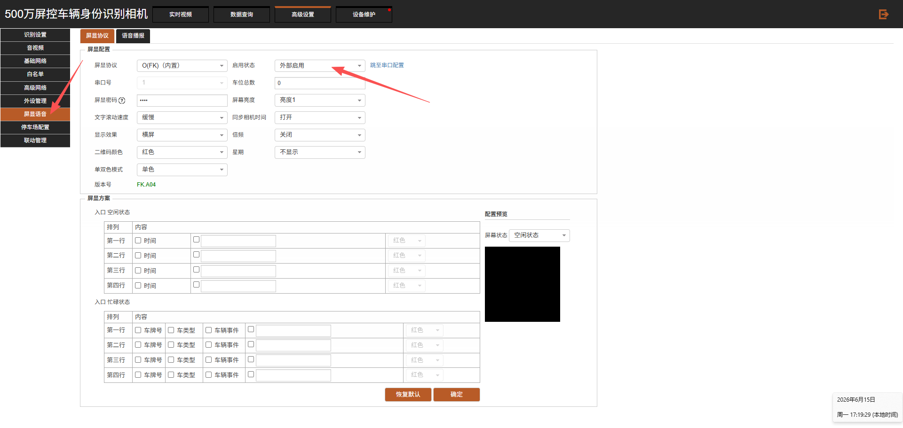

②语音播报也修改为外部启用

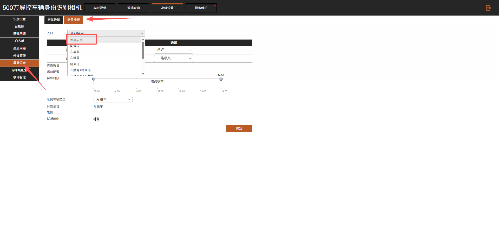

## 二、相机连接有线网络（插网线）
#### 1、首先选择   自建mqtt

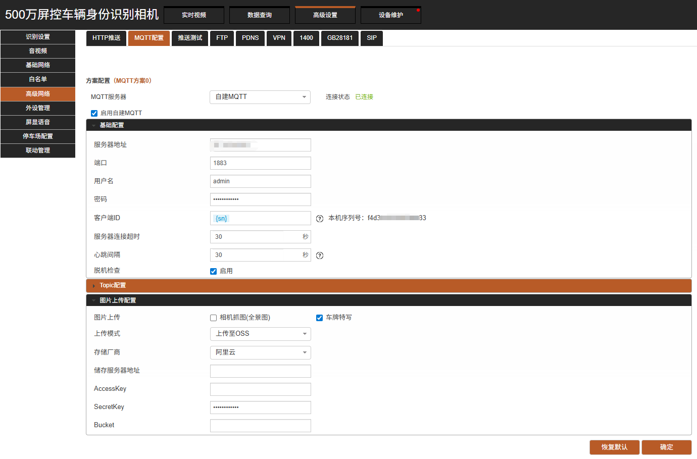

服务器地址：zhshce.cxzntc.com
#### 2、配置一下 topic配置：
修改批量配置
在  订阅和回执  前面添加   /r
在  发布       前面添加   /

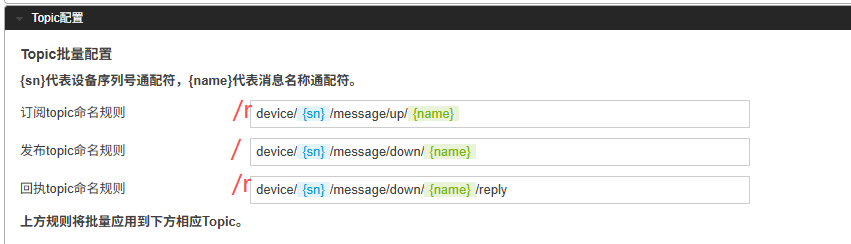

然后勾选一下配置项：

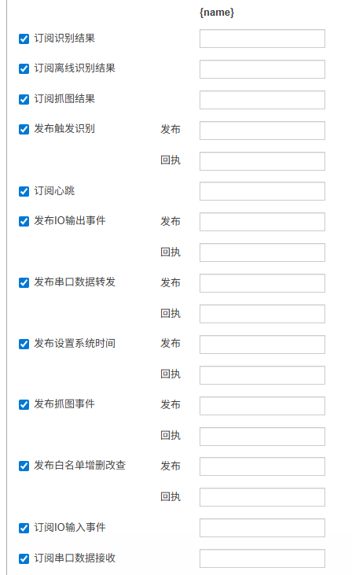

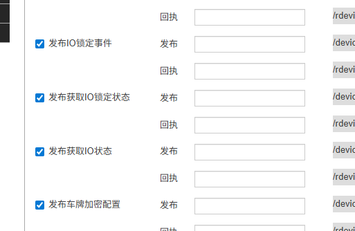

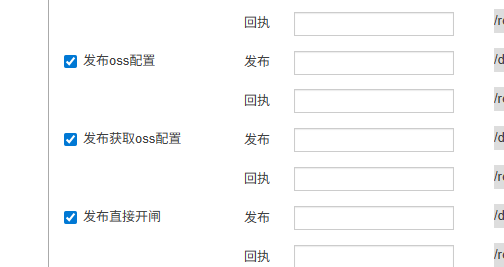

## 三、平台配置
#### 1、设备管理中添加设备
相机类型：相机-THY2
板卡类型：THY2-R5E-FK

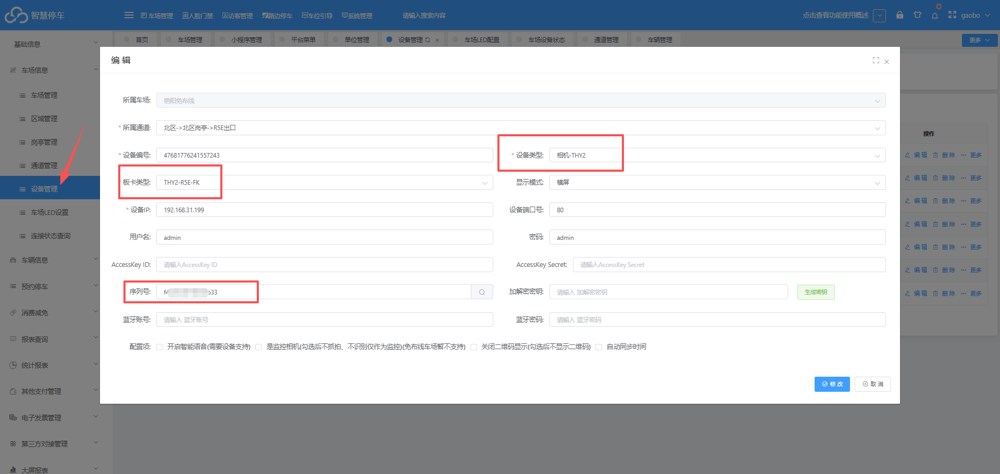

#### 2、点开相机配置
（注：如果相机配置里面为空，则添加一个）

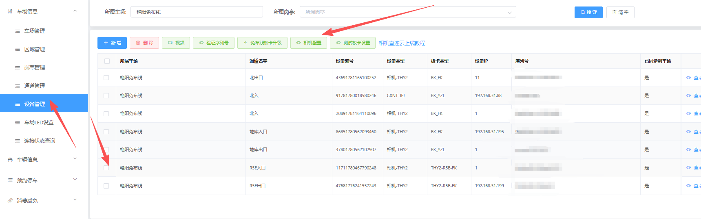

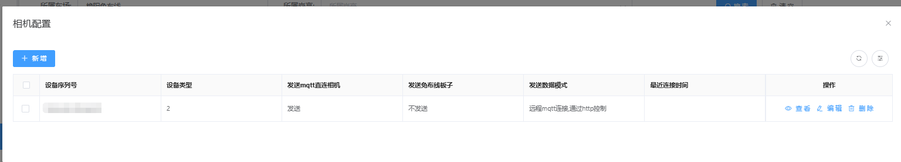

#### 3、查看设备连接状态

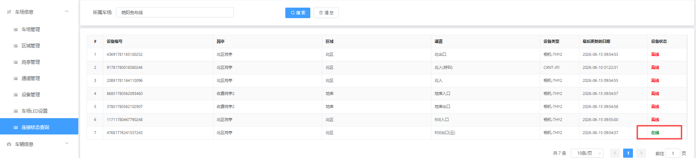

