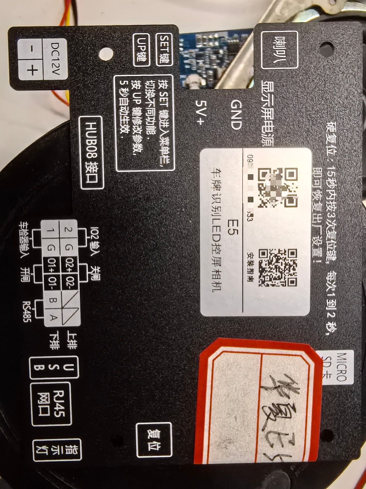
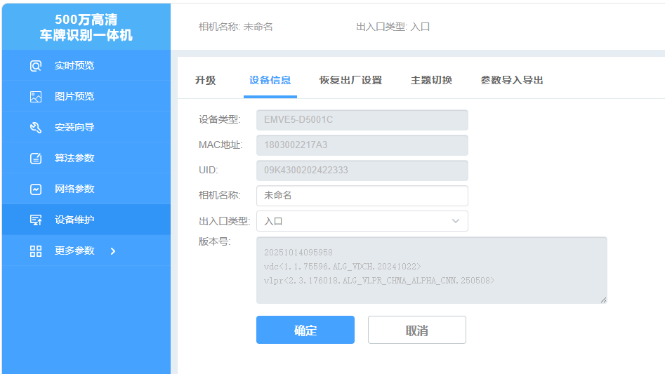
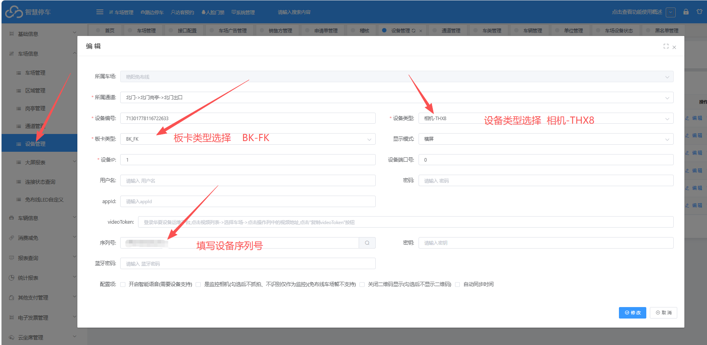
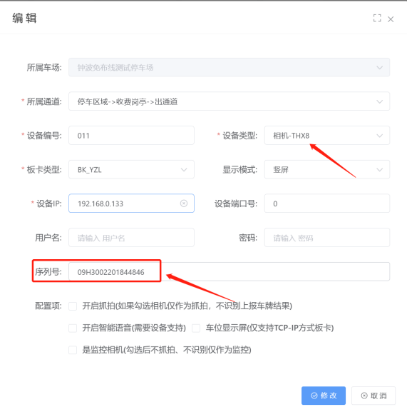
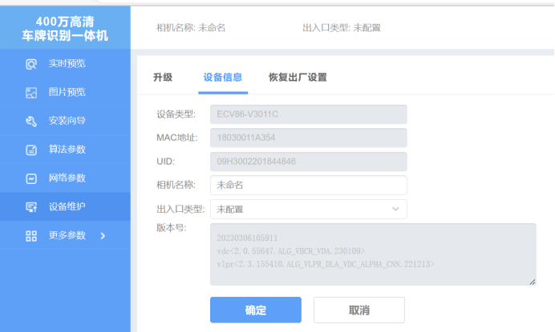
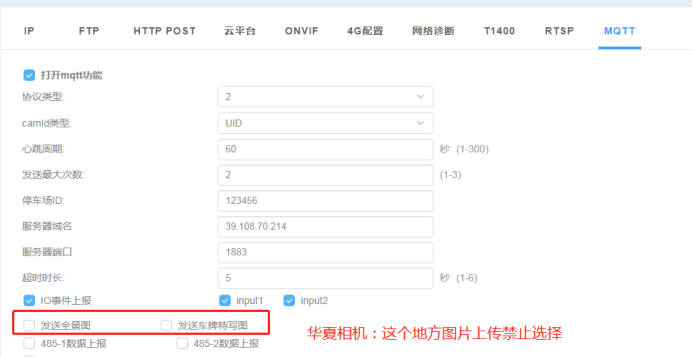

## 相机型号：

## 平台配置
平台设备管理添加设备
设备类型：   相机-THX8
板卡类型：   BK-FK

## 相机配置

1、登录相机在网络配置里面找到MQTT

勾选打开mqtt功能

协议选择2

camld类型选择UID,平台添加相机序列号也是填这个，UID在设备信息里面。

服务器域名： huaxiamq.cxzntc.com   端口1883  （如图）

:::caution
图片缺失：
:::

:::caution
图片缺失：
:::

注意：上云时一定要禁止图片上传

