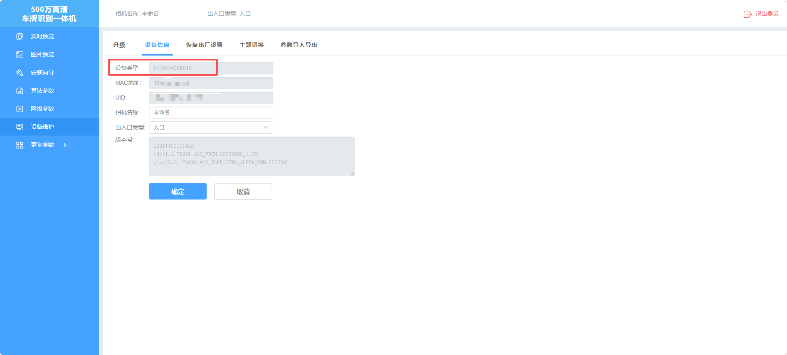
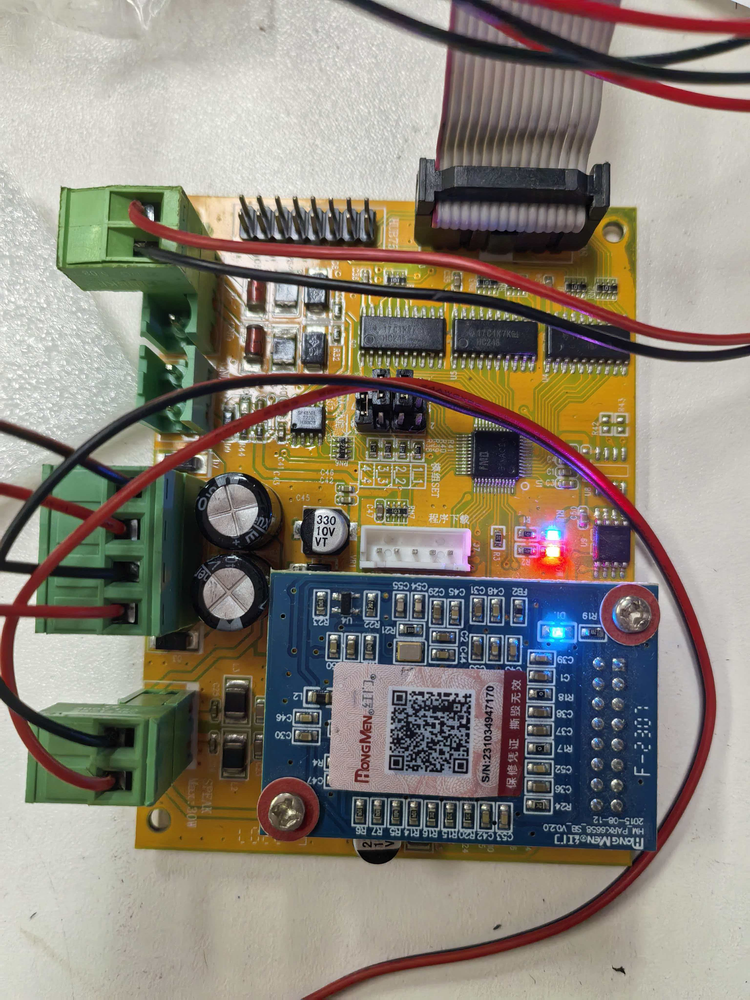
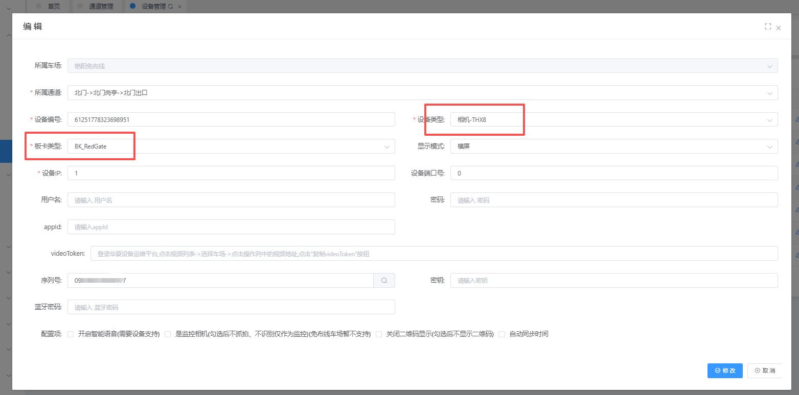
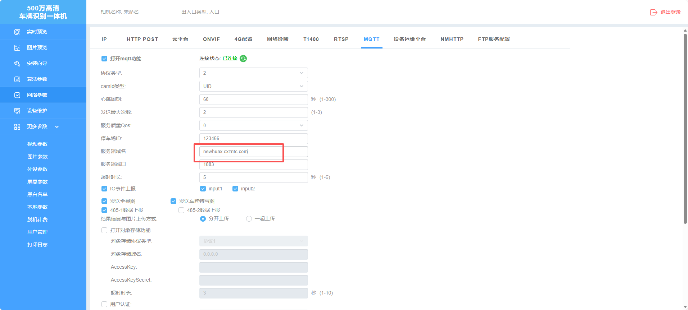
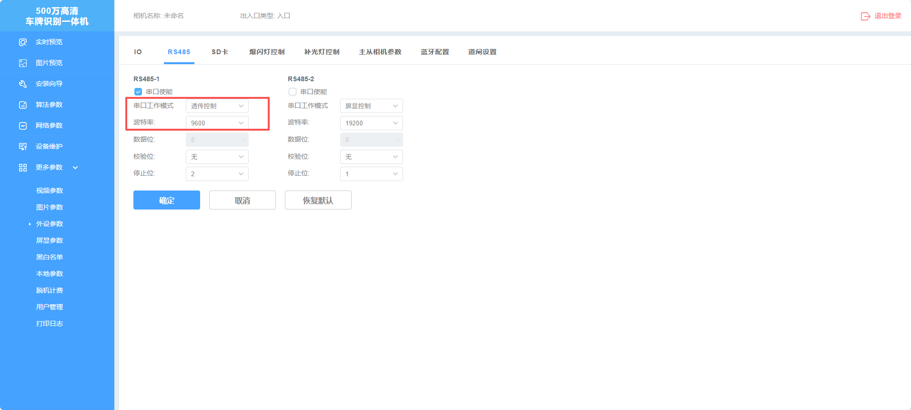
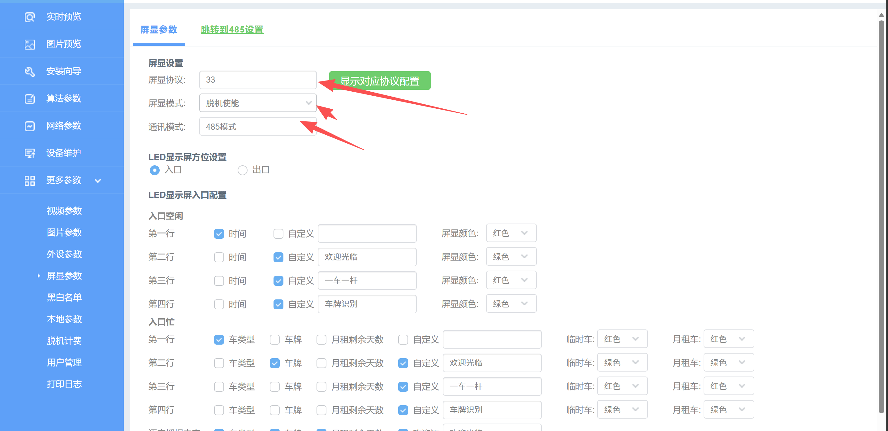

[HX相机工具.rar](https://www.showdoc.com.cn/server/api/attachment/visitFile?sign=fb9230553c69793f18eb928af561663f &quot;HX相机工具.rar&quot;)
## 相机型号：

### 板卡：

## 平台配置
平台设备管理添加设备
设备类型：   相机-THX8
板卡类型：   BK-RedGate

## 相机配置

1、登录相机在网络配置里面找到MQTT

勾选打开mqtt功能

协议选择2

camld类型选择UID,平台添加相机序列号也是填这个，UID在设备信息里面。

服务器域名： newhuax.cxzntc.com   端口1883  （如图）

波特率  设置为   9600
串口工作模式   设置为   屏显控制

屏显参数
屏显协议 设置为  33
屏显模式 设置为  脱机能使
通讯模式 设置为  485模式

注意：上云时一定要禁止图片上传

