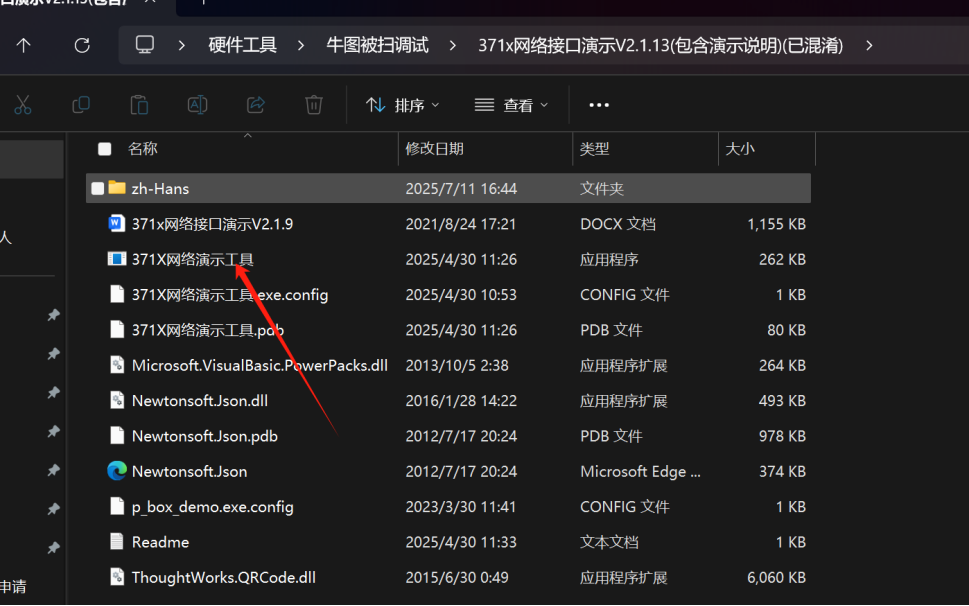
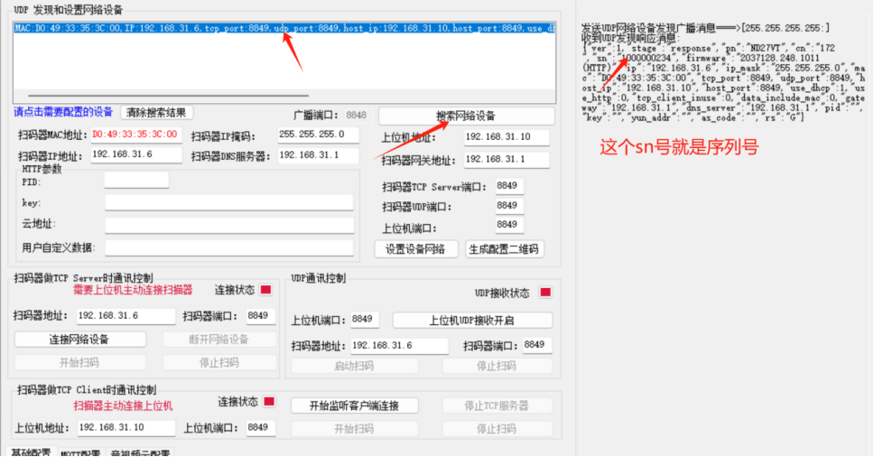
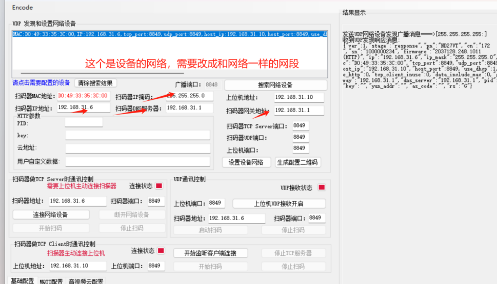
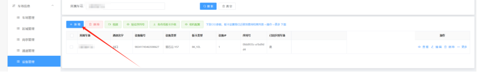
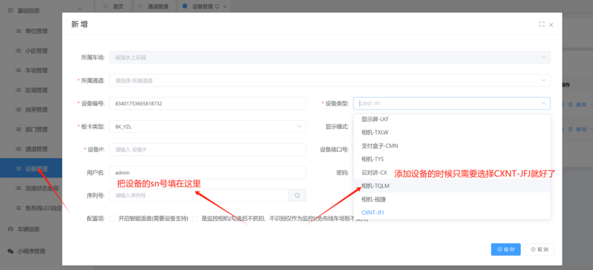
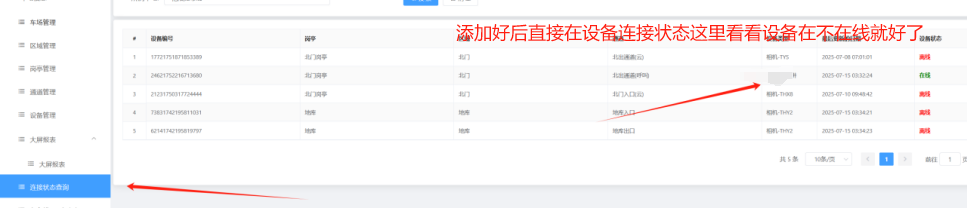

CXNT-JFJ设备调试

**（注意：本地的话是需要两跟网线哦。纯云的只需要一根网线**）
1. 打开CXNT-JFJ工具

2. 点击搜索设备,并选中调试的设备，并复制好序列号

3. 配置好设备的网络，点击设置设备网络

4. 在平台上设备管理去进行添加设备，最后点击保存就好了

5. 添加好后再平台上设备连接状态那里查看是否在线就好了

6. 在线后就可以直接测试一下呼叫和显示啦

