## 升级固件

### 1.配置 IP（若 ip 已经配置过，则跳过）

打开电脑本地连接，点击【属性】，点击【TCP/IPv4】，手动修改 IP 地址，配置为 192.168.5.x

地址（不要与设备默认 IP192.168.5.245 相同，否则 IP 冲突，无法正常连接设备）。

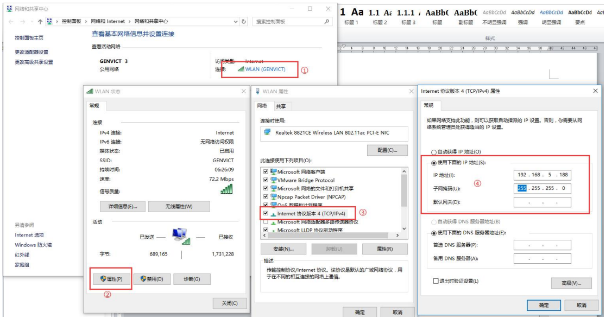

### 2.打开升级软件

打开升级工具【Etc_v2.0.exe】，界面如下所示：（注意：ETC升级工具可以询问售后）

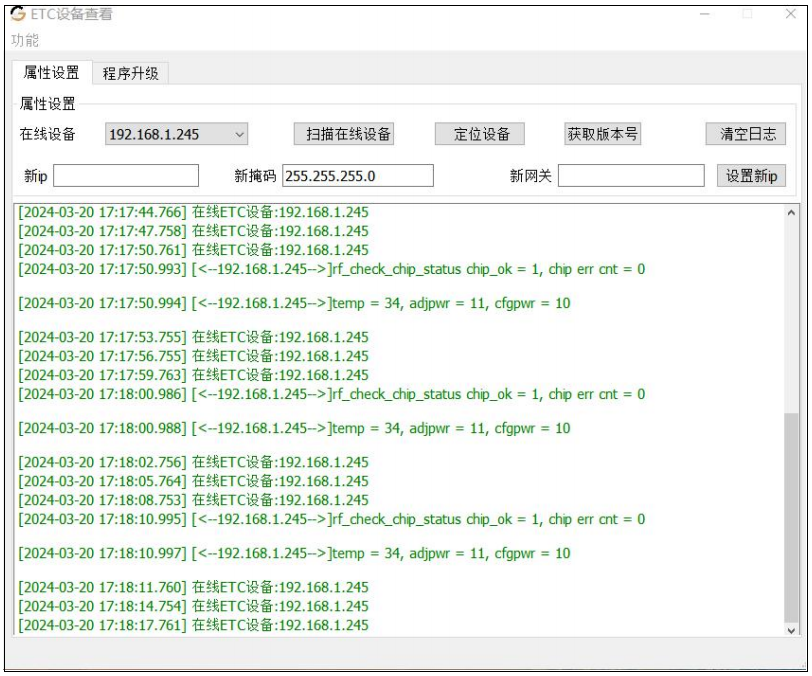

### 3.查看硬件版本号是否支持云扣费（若不支持，则不允许升级固件）

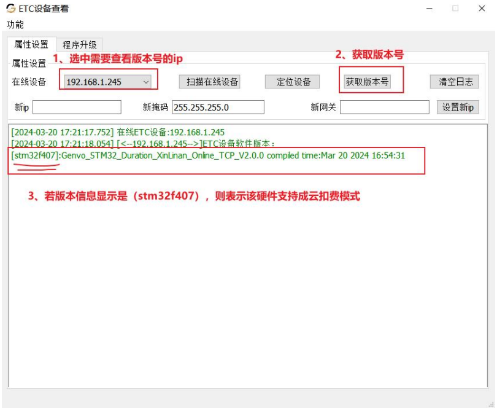

### 4.查看软件版本号（若是云模式版本，则无需升级）

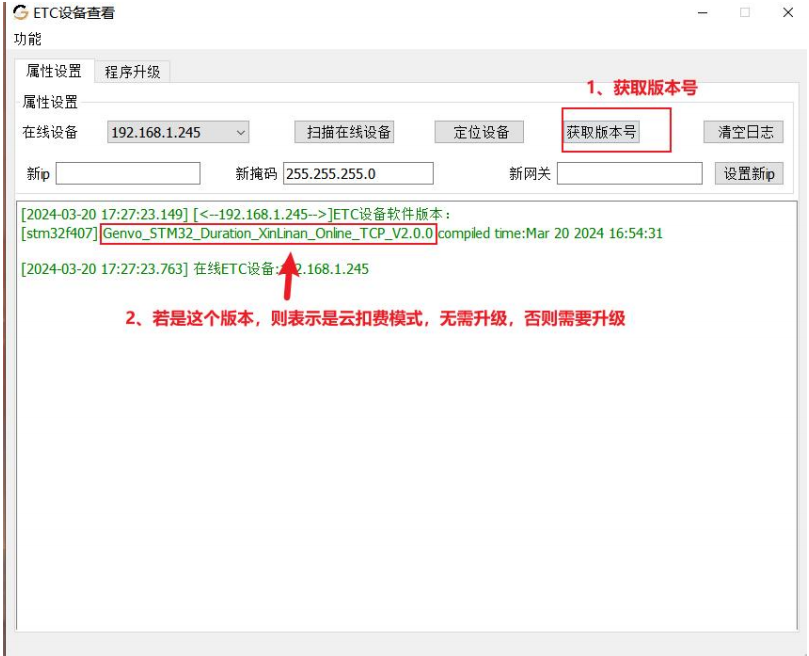

### 5.升级步骤如下所示（如果已经是云扣费模式，直接跳过）

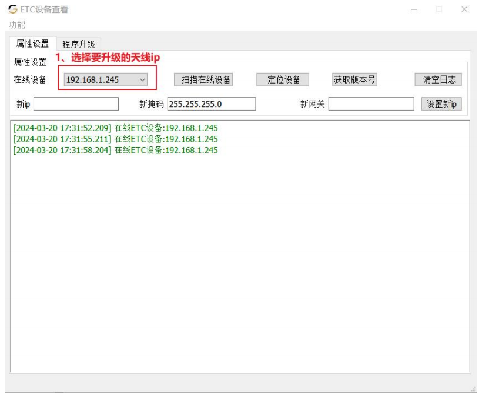

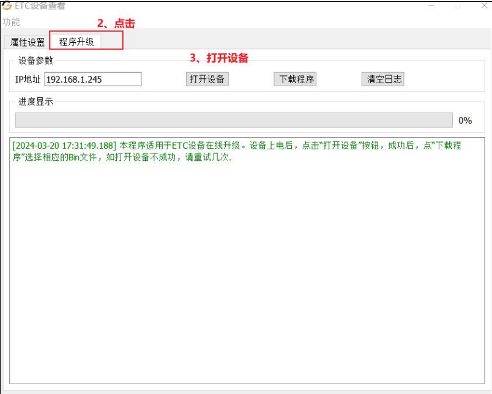

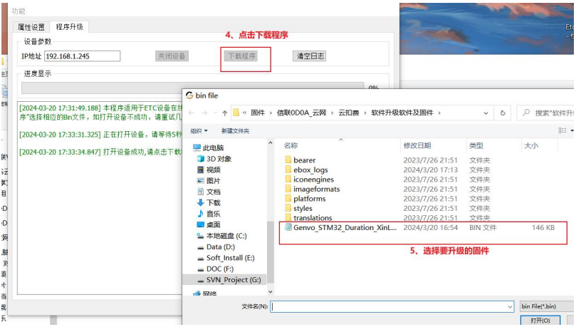

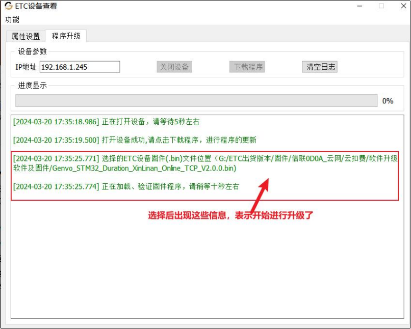

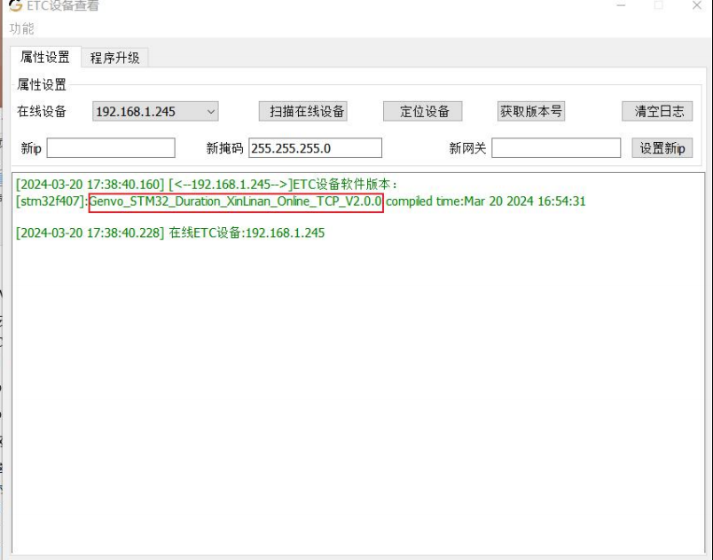

## 天线配置

### 1.使用天线ip在浏览器输入，直接进入天线配置界面

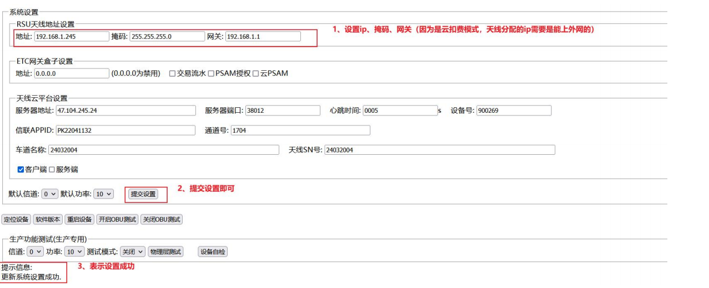

默认信道：0，默认功率：25
### 2.天线云平台设置

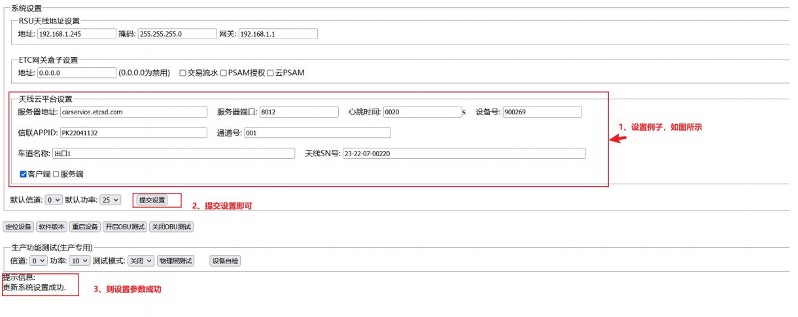

服务器地址：carservice.etcsd.com（必填）
服务器端口：8012（必填）
心跳时间：0020（必填）
设备号:(默认即可)

信联 APPID：由业主或者第三方平台,向信联申请停车场的生产环境的 appid（必填）
通道号：道闸端应该叫车道号（lane_id），参数长度麻烦控制在 12 个字符以内，应该与道闸端一致，
对应匹配上（必填）

车道名称：与道闸端一致，对应匹配上（必填）
天线 SN 号：etc 天线靠近网口位置的数字编号（必填）
客户���/服务端：只选中客户端(默认即可)
当修改完毕之后，记得提交设置。

## 平台配置

### 1.首先再通道管理中修改通道名称也叫车道名称 （修改时注意不要与平台的其它通道名称重复）和通道编号也要车道号（输入唯一的10-12位数字）

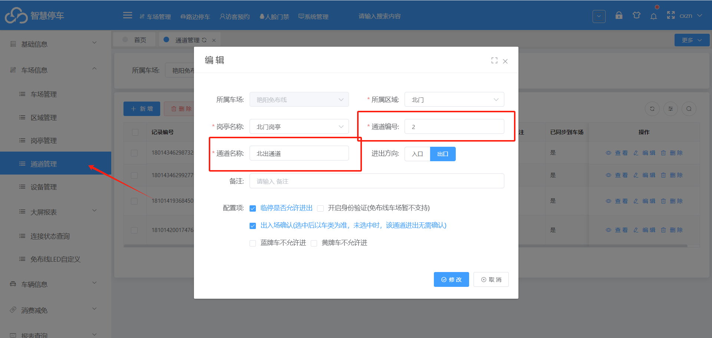

### 2.其它支付管理中  再配置一个支付（选择山高信联ETC云端扣费）

应用id：由山高信联提供   类似（PKXXXXX）

密钥：找售后

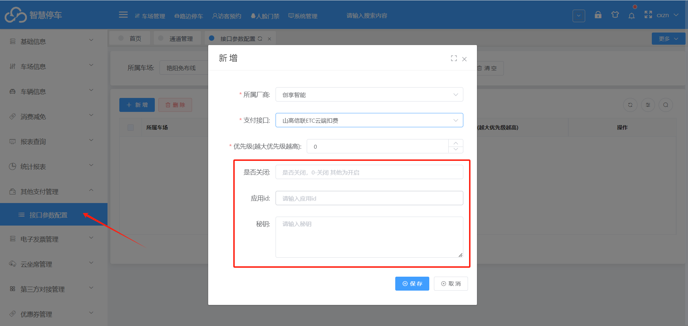

