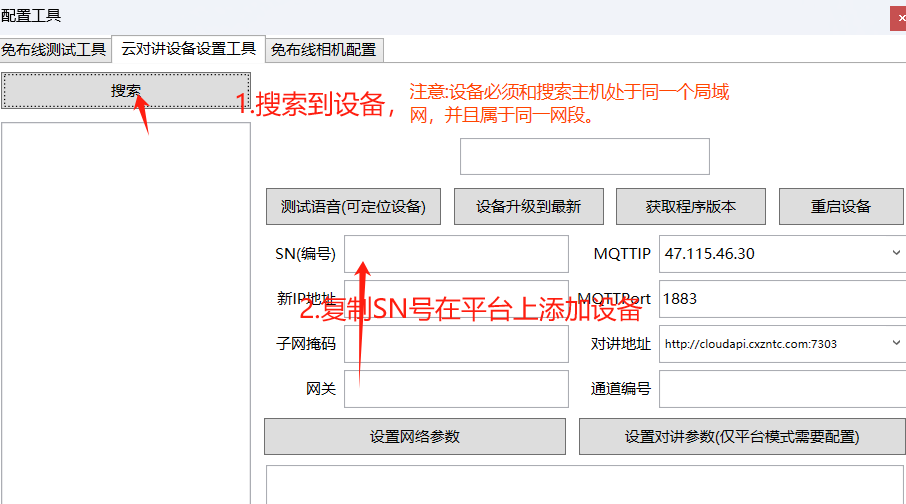
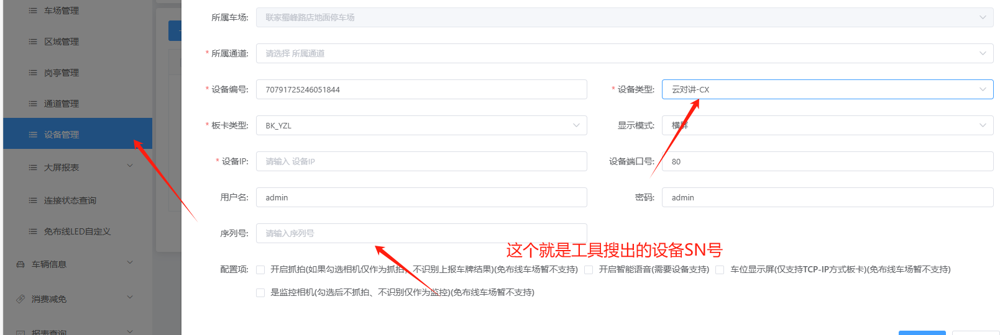
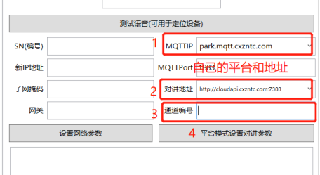
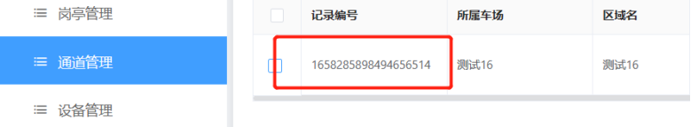

#### 1、修改设备ip，添加设备到平台

## 2、配置平台参数

## 第三点通道编号对应设备在平台上的通道记录编号。

## 3、呼叫
### 开通车场云坐席（联系售后）

云坐席地址：http://charge.cxyun.net.cn/charge/login.html

开通后按设备“帮助”按钮，在云坐席平台接听，设备从“等待接听中”变为“通话中”。

注：

1、若是接听了仍旧显示“等待接听”，可能是电脑没有喇叭、摄像头、麦，换成笔记本尝试。

2、若是呼叫时设备显示的车场名不对，可重复第二点平台参数设置，重新设置一遍。
