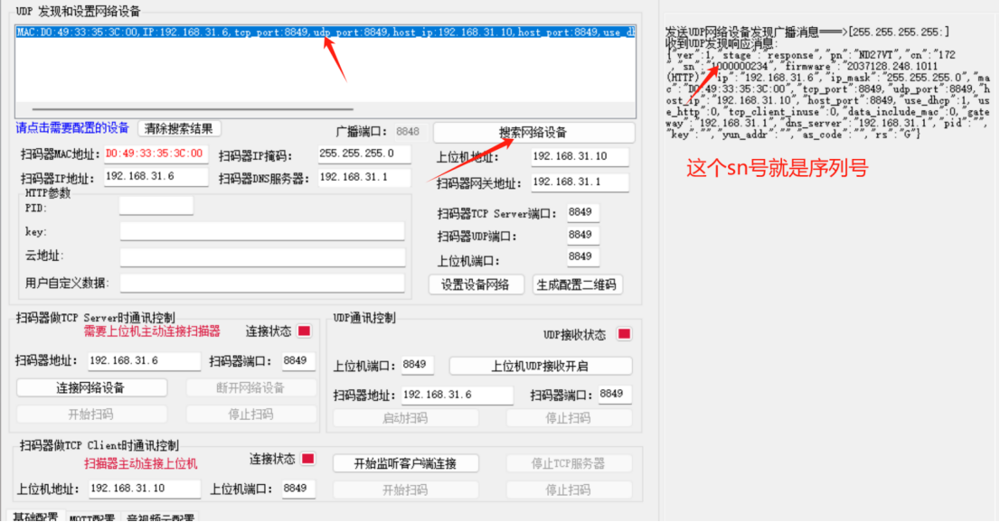
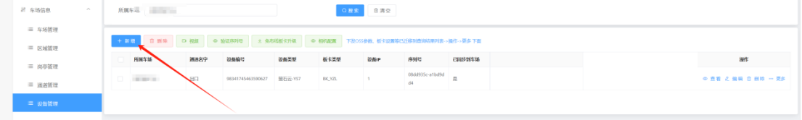
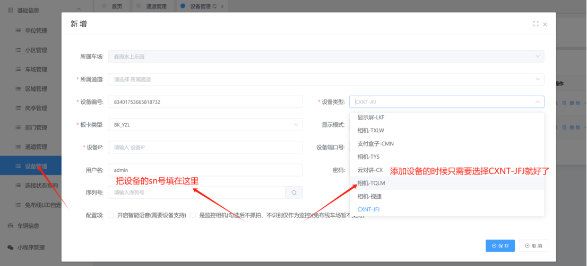
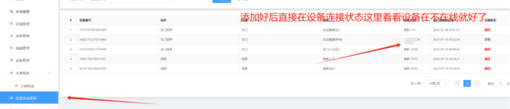
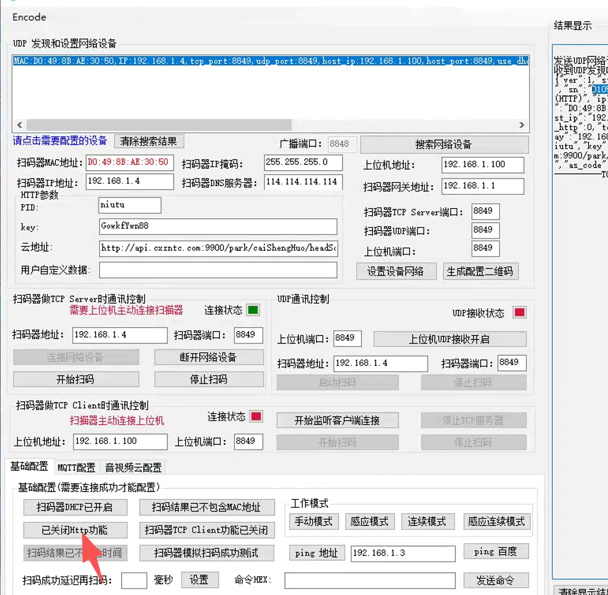

工具如下：
[(客户)371x网络接口演示V2.1.13(包含演示说明)(已混淆)(1).zip](https://www.showdoc.com.cn/server/api/attachment/visitFile?sign=c9a7a96173245f3788ea0db91eb7b347 &quot;(客户)371x网络接口演示V2.1.13(包含演示说明)(已混淆)(1).zip&quot;)牛图对讲调试

1. 打开牛图被扫工具

2. 点击搜索设备,并选中调试的设备，并复制好序列号

3. 配置好设备的网络，点击设置设备网络

4. 在平台上设备管理去进行添加设备，最后点击保存就好了

5.添加好后再平台上设备连接状态那里查看是否在线就好了

注意：http不能打开哦打开会导致支付抬杠慢哦

