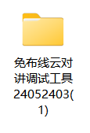
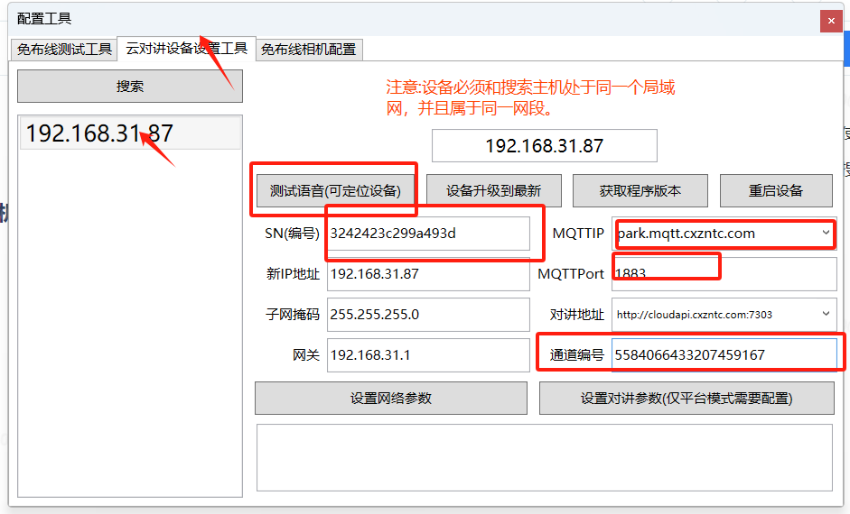
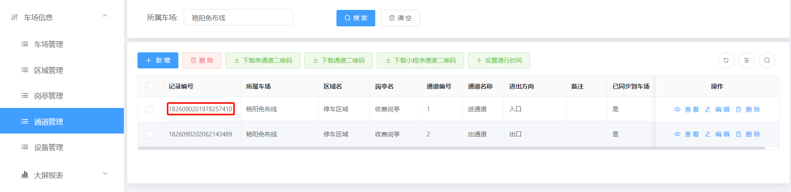
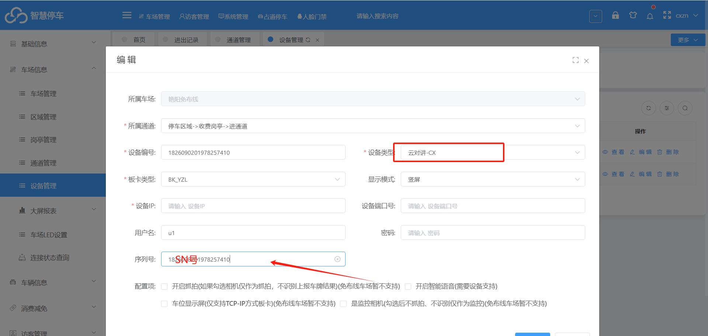
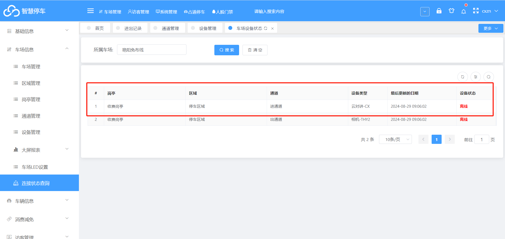

## 1.首先可以使用工具搜索缴费机ip
工具如下：（可以点击下发文字下载）
[免布线云对讲调试工具24052403.rar](https://www.showdoc.com.cn/server/api/attachment/visitFile?sign=4212ca923a85384fa4e38172fbac39ef &quot;免布线云对讲调试工具24052403.rar&quot;)

## 2.配置设备

测试语音   可以定位设备

SN号（编号）：用于和平台车场绑定

MQTTIP：park.mqtt.cxzntc.com（选择对应平台的mqttIP）

对讲地址：http://cloudapi.cxzntc.com:7303 （选择对应平台的地址）

通道编号：对应平台上通道管理中的通道编号

参数设置好之后  点击设置对讲参数
3.平���配置

在平台上**设备管理**添加一个云对讲设备

设备类型：云对讲-CX（固定参数）

序列号：对应上云SN号（编号）

### 配置完成后去链接状态查询中查询链接状态是否在线

