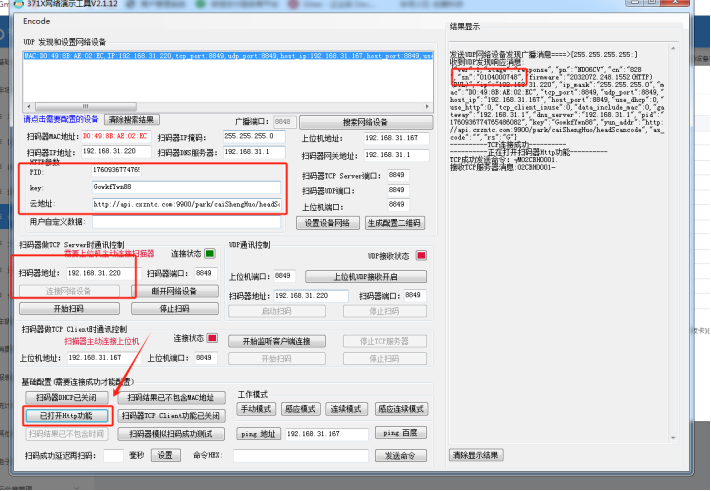
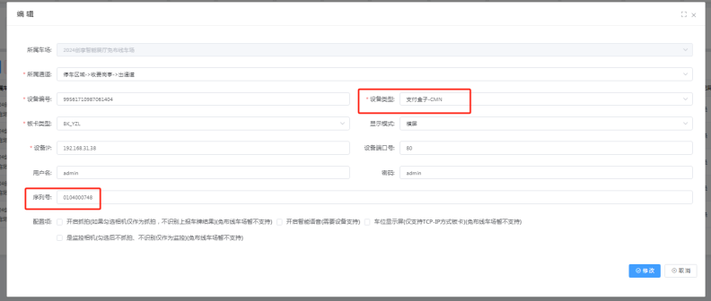

工具如下：
[(客户)371x网络接口演示V2.1.13(包含演示说明)(已混淆)(1).zip](https://www.showdoc.com.cn/server/api/attachment/visitFile?sign=c9a7a96173245f3788ea0db91eb7b347 &quot;(客户)371x网络接口演示V2.1.13(包含演示说明)(已混淆)(1).zip&quot;)

## 牛图二维码直连云设置

1.搜索链接设备
2.设置好对应的参数http功能需要打开，key和云地址是固定的
PID：    对应软件平台的车场管理里面的车场记录编号，切记不是车场编号
Key:      GowkfYwn88
云地址：[http://api.cxzntc.com:9900/park/caiShengHuo/headScancode](http://api.cxzntc.com:9900/park/caiShengHuo/headScancode)

:::caution
图片缺失：
:::

平台添加支付盒子-CMN 设备类型，序列号对应上面牛图工具上面的sn号码
碰到使用不了还有之前有乱设置过扫码恢复出厂之后重新设置

:::caution
图片缺失：
::: 复制到手机上面给扫码枪扫码一下即可！