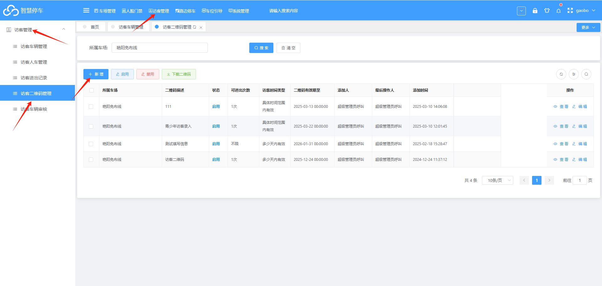
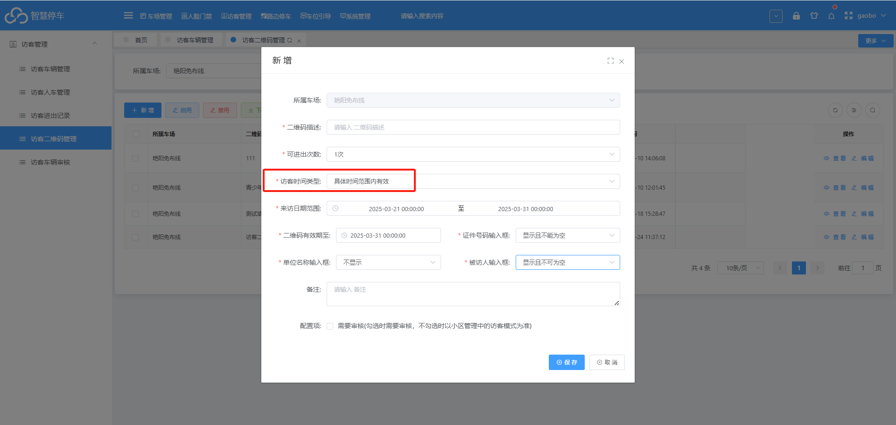
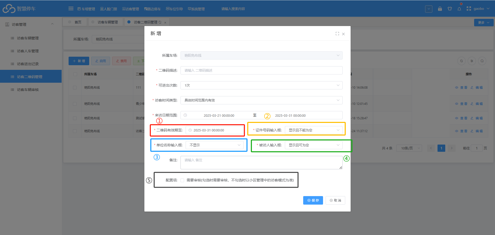
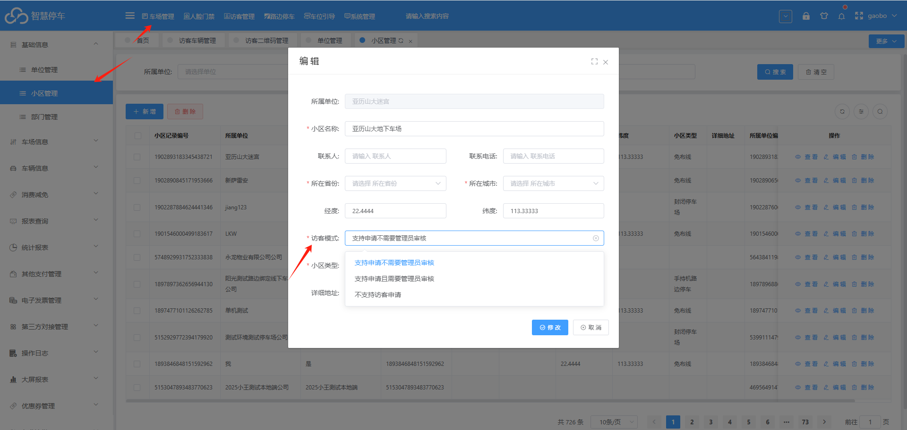

## 1.访客管理--》访客管理--》访客二维码管理

## 2.点击新增  添加   访客二维码

### 访客时间类型有两种

（1）多少天内有效：设置对应天数有效；这样扫码后，指定天数内可以进出

例如：设置  2  天内有效     那么扫码登记后的两天内可以进出

（2）具体时间范围有效

设置来访日期范围    这样登记的访客车，只能在指定范围内  进出车场

例如：设置3月21号--3月31号    这样扫码登记的访客车   只能在   21-31号之间 进出车场，超出或者提前都不能够进出车场

### ①二维码有效期至：设置二维码的��效期

比如设置3月31号到期；那么在31号之前都是可以扫码登记的，超出这个时间，二维码则不能够再使用

### ②③④的下拉选项中有三个选项（这三个条件标识，设置的是扫码后需要填写的信息）

（1）显示且不能空：则表示扫码登记时，本条件为必填项

（2）不显示：则表示扫码登记时，本条件不显示在页面中

（3）显示且可为空：则表示扫码登记时，本条件为非必填项，可填写也可以不填写

### ⑤勾选时，需要审核，如果不勾选，以小区管理中的访客模式为准

