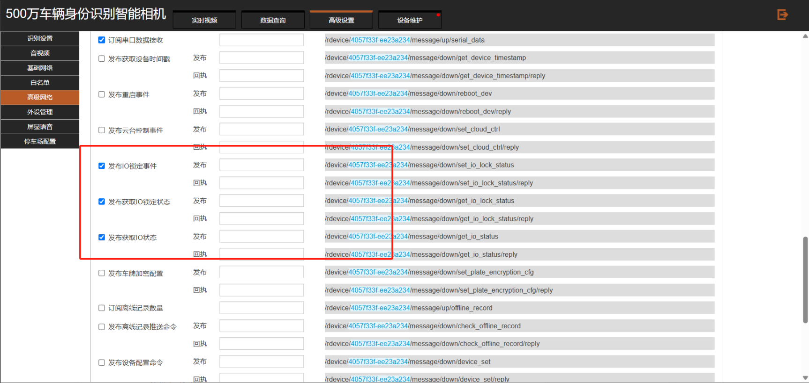
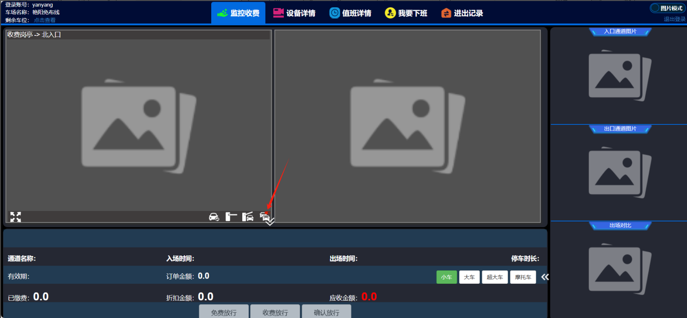

&gt; 臻实相机
首先相机配置中需要做配置

①服务器地址：zhsphoto.cxzntc.com
②勾选：

发布IO锁定事件
发布获取IO锁定状态
发布获取IO状态
如下图：

如果没有  请升级相机（升级相机可以根据相机型号自行下载，也可以询问售后）

型号为 **C5/R5/R5L**  的相机

文件名称：VZ_C5_R5_12.3.1.202502140_u904241035k1031241413r2501090a202502140.bin

版本号：12.3.1.202502140

设备型号：R5L

文件大小：61.77 MB

下载链接：

https://open.vzicloud.com/#/sharePage?token=Aq4opEr9Z-Zm5BRtMFMM7gmOpfc.eyJpYXQiOjE3NDM0MTAwMDc2ODQsImlkIjoxNTk1LCJ1aWQiOjYzLCJ0eXBlIjoicHVibGljIiwiZXhwIjoyMTQ3NDgzNjQ3LCJpc3MiOiJhZG0ifQ

请登录臻云后下载

型号为**C3/R3**的相机

文件名称：VZ_R3_12.1.2.202502281_u720231923k531231106r2310120a202502281.bin

版本号：12.1.2.202502281

设备型号：R3

文件大小：57.92 MB

文件说明：基于202409275版本的优化版本

下载链接：

https://open.vzicloud.com/#/sharePage?token=1NUGEfjRVxcaH0v044ISB0Tcapw.eyJpYXQiOjE3NDM0MTAwODg5MTMsImlkIjoxNjEyLCJ1aWQiOjYzLCJ0eXBlIjoicHVibGljIiwiZXhwIjoyMTQ3NDgzNjQ3LCJpc3MiOiJhZG0ifQ

请登录臻云后下载

平台上面开启车队模式在免布线收费端

