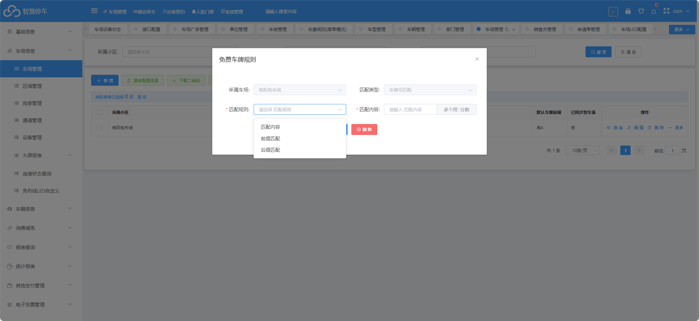

1.车场管理--&gt;更多--&gt;军警车免费 （最多只能添加15个）

（1）匹配内容

完全匹配车牌，默认为军警车

例如   设置匹配  对应车牌为  军警车

比如车牌    京BC3WW2    那么只要识别到  京BC3WW2    这个车牌号  就会被认为是军警车牌

（2）匹配前缀

只要识别到 设置的 前缀   默认为军警车

例如  设置匹配前缀   HJ   这样，只要识别到车牌前缀为   HJ   的 车牌，就会被匹配成军警车

（3）匹配后缀

只要识别到 设置的 后缀   默认为军警车

例如  设置匹配后缀   警   这样，只要识别到车牌后缀为   警   的 车牌，就会被匹配成军警车

