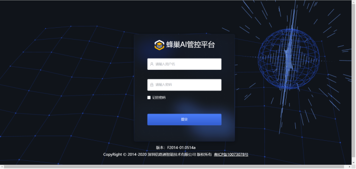
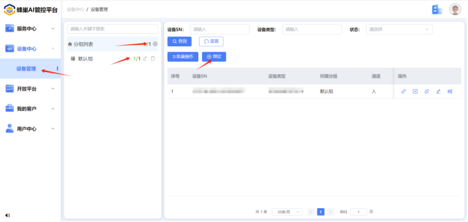
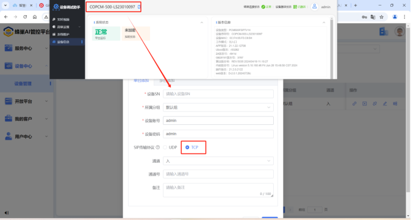
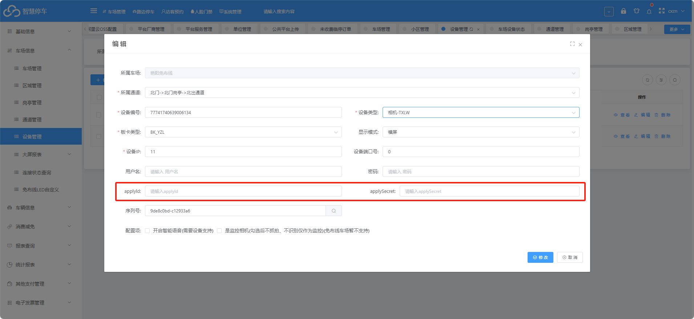

首先找信路通相机方开通蜂巢AI管控平台账号
平台地址：[http://honeycomb-manege.platformcenter.net/](http://honeycomb-manege.platformcenter.net/)

（相机平台配置）登录平台后  找到设备中心---&gt;设备管理---&gt;创建组---&gt;选中组-----&gt;添加

车场平台绑定对应参数即可（applyID和applySecret）参数由信路通提供

:::caution
图片缺失：
:::
