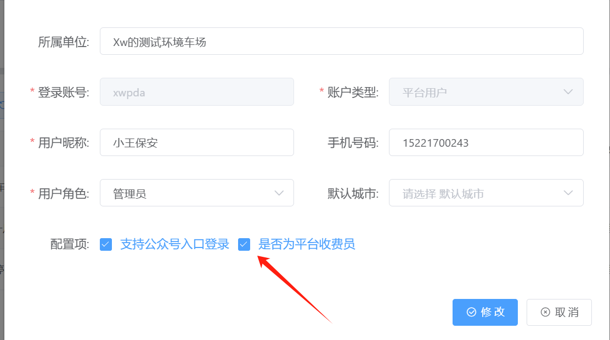
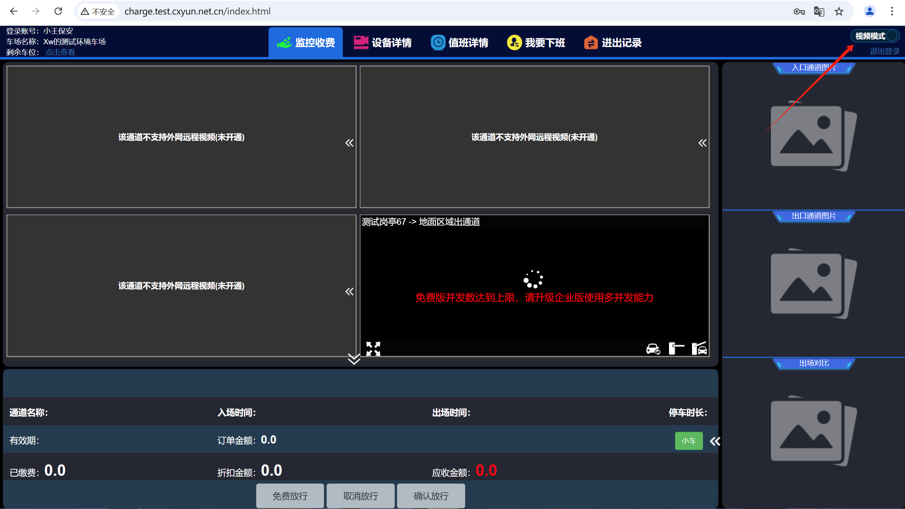
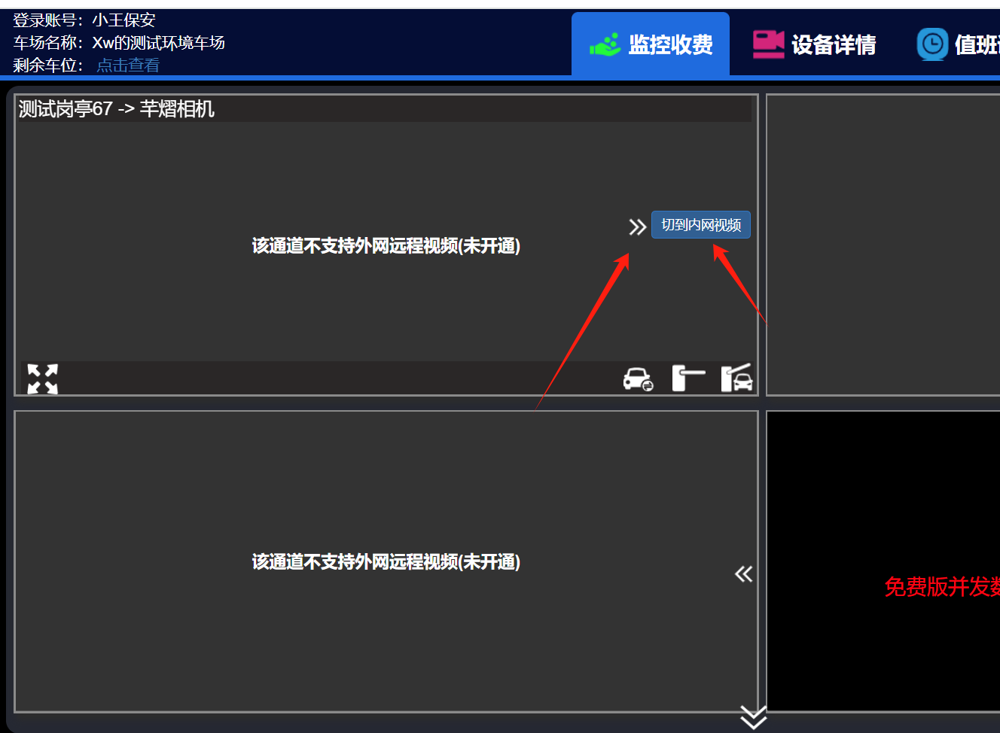
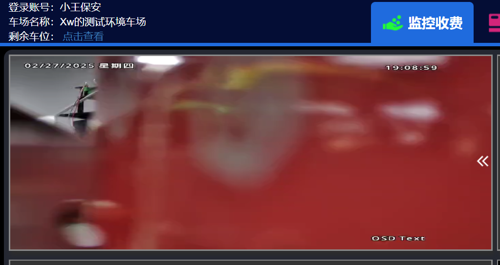
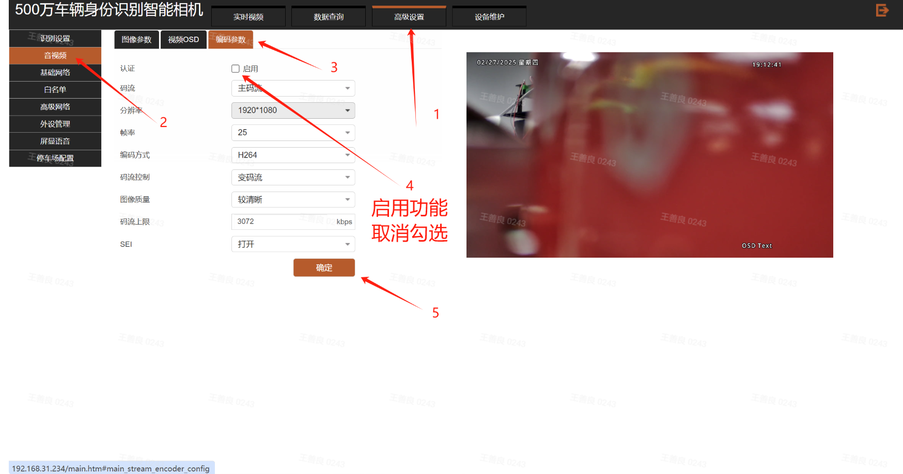
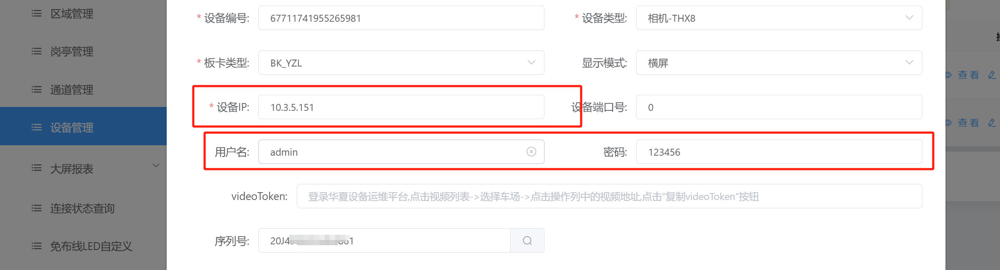
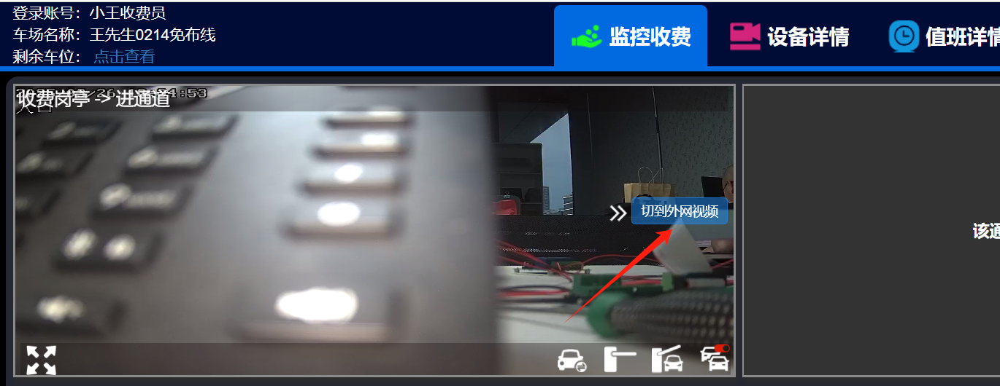
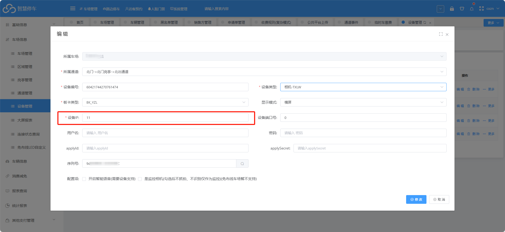
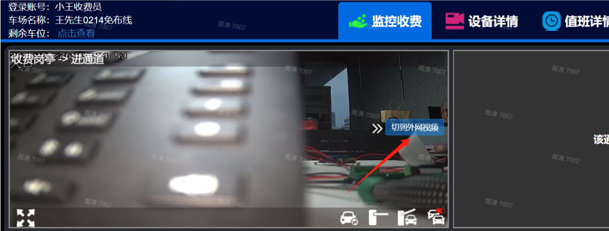
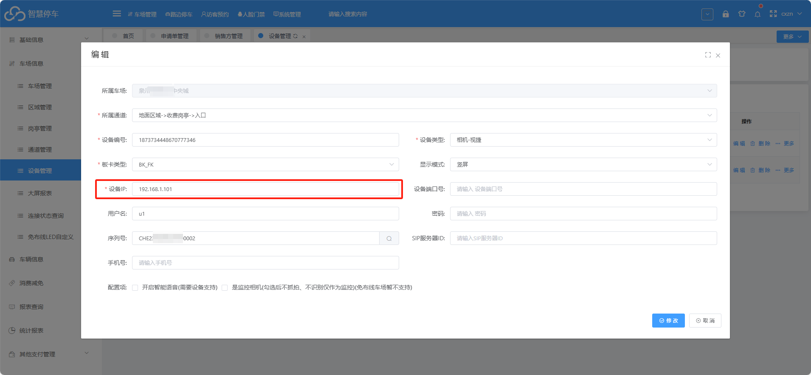

重点：
1.纯云收费端地址：http://charge.cxyun.net.cn/charge/login.html
2.登入收费端的账号和密码需要在车场平台用户管理里面创建，创建的账号需要在用户管理里面勾选支持收费员的功能，这个账号才能登入这个收费端平台
3.登入收费端后，右上角点击视频模式，然后在视频画面里面点击切换到内网视频，这样就能查询到内网视频了
4.查询内网视频的话，电脑和相机必须要在同一个局域网

## 1.如何查看内网视频

1.在收费端平台右上角点击视频模式

2.在相机里面点击《《箭头 然后点击切换到内网视���

3.这样就能通过内网查询到相机的实时视频，

### 一：VZ相机需要在相机里面修改一个参数才能看到内网视频

在高级设置解码参数里面把启用的功能关闭，这个默认是勾选的，需要关闭才能通过内网查看视频，取消勾选后直接点击确定就好了
### 二：HX相机什么都不需要修改，平台上设备管理里面，设备ip和用户名，密码需要输入正确

电脑和相机需要在同一个网段，比如这个相机ip是5网段的，电脑也必须是5网段，通过电脑在浏览器里面能打开相机才没问题
### 三：信路通相机什么都不需要改，只要电脑和相机在同一个局域网，在免布线收费端系统切换视频模式，然后切换内网视频就行了

注意：信路通相机内网看视频，平台上面填写的相机IP必须与实际相符

### 四：视捷相机什么都不需要改，只要电脑和相机在同一个局域网，在免布线收费端系统切换视频模式，然后切换内网视频就行了

视捷相机内网看视频，平台上面填写的相机IP必须与实际相符

