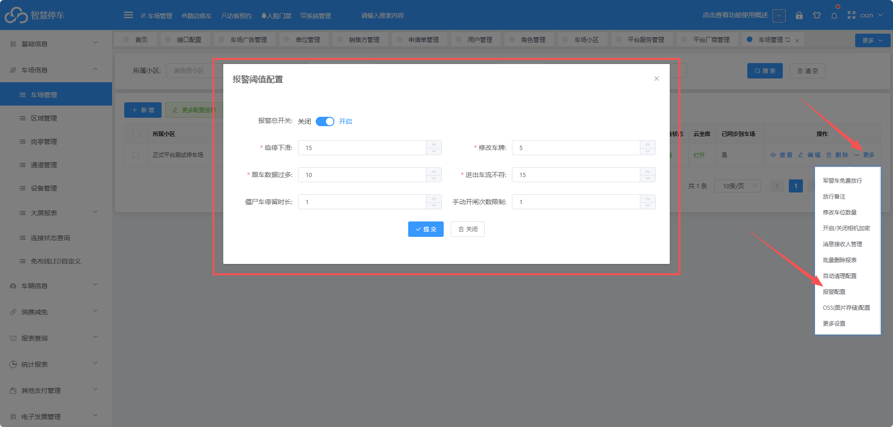
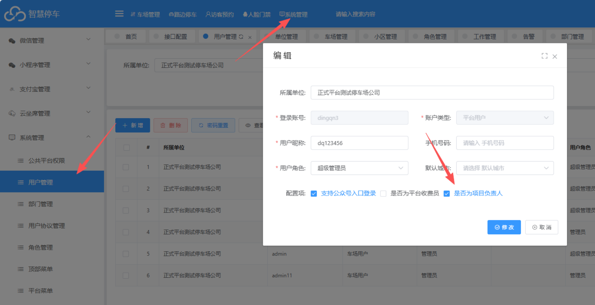
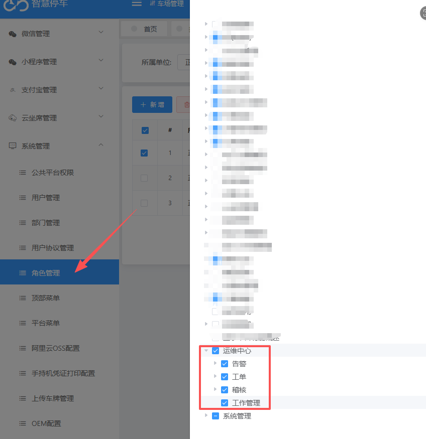
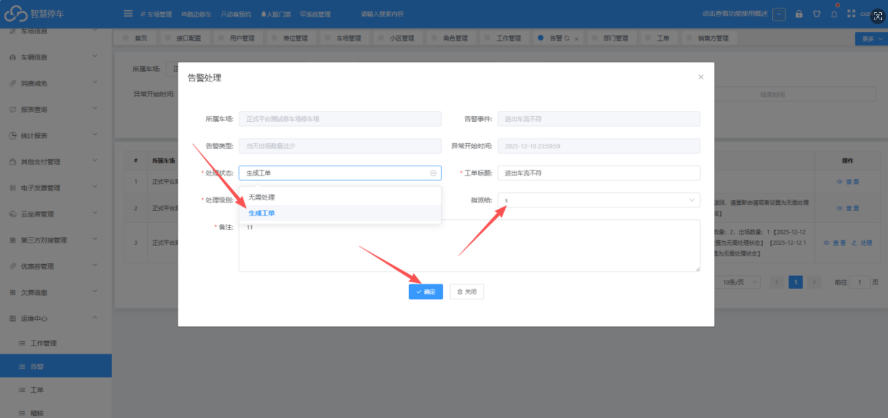
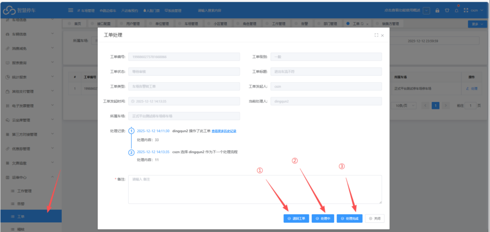
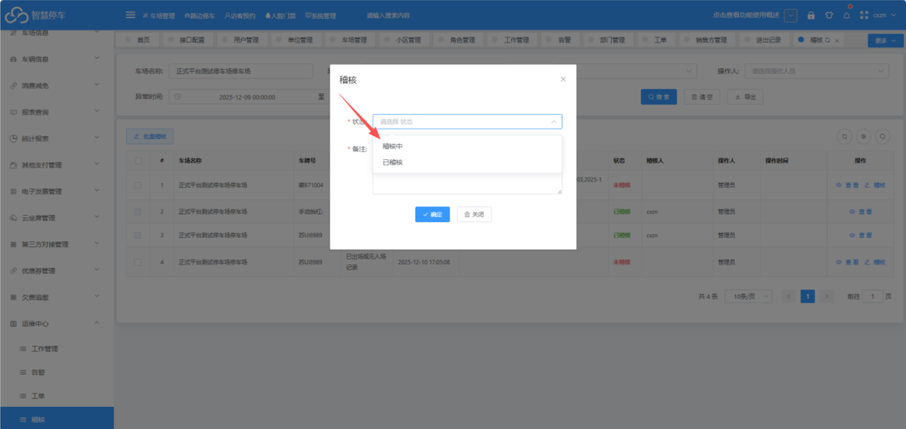

## 1.首先开启告警功能（车场管理---》更多---》开启）

**临停下滑：**少于前三周同一天平均值的百分比

**修改车牌：**数量超过前三周同一天平均值的百分比

**跟车数据过多：**数量超过前三周同一天平均值的百分比

**进出车流不符：**统计前一天入场数量大于出场数量的百分比

**僵尸车停留时长：**停留时长超出设置天数，则告警（0或空为不开启，单位天）

**手动开闸次数限制：**当天手动开闸次数超出限制，则告警（每天凌晨统计），当天手动开闸次数限制（0为不限制）

**本地车场离线：**本地车场离线超出5分钟告警

（注意：除车场离线外，其他告警事件都是当天凌晨统计前一天的数据）
## 2. 设置对应项目负责人（系统管理---》系统管理---》用户管理---》创建账号，勾选项目负责人）

然后给项目负责人设置运维中心权限

**告警报表权限：**是可以给项目负责人分配具体的告警任务

**工单报表权限：**项目负责人查看工单报表中，处理分配到的告警任务

**稽核报表：**记录一些异常信息，等待项目负责人处理（无入场记录，重复入场，重复出场，手动抬杆，滞留，折返，手动抬杆，遥控器开闸等）
## 3. 告警工单处理流程
### （1）首先告警报表出现告警信息，如需处理，项目负责人选择生成工单，然后指派给对应负责人处理，如果不指派，则所有的负责人均可以处理

### （2）项目负责人处理工单
#### ① 退回工单：如果项目负责人有事情需要转接任务，可以选择退回工单，由上一级项目负责人重新指派

#### ② 处理中：有时生成工单时没有指派给具体人员，所有项目负责人均可以处理，如果正在处理，可以先改为处理中，这样其他人员就不可以再次处理本工单

#### ③ 处理完成：对应工单任务处理完毕

## 4. 稽核处理流程
### (1) 找到稽核报表 选择对应事件进行处理
#### ① 稽核中：正在处理，改为该状态后，其他负责人无法处理该事件
#### ② 已稽核：处理完成，代表对应事件已经处理完毕

