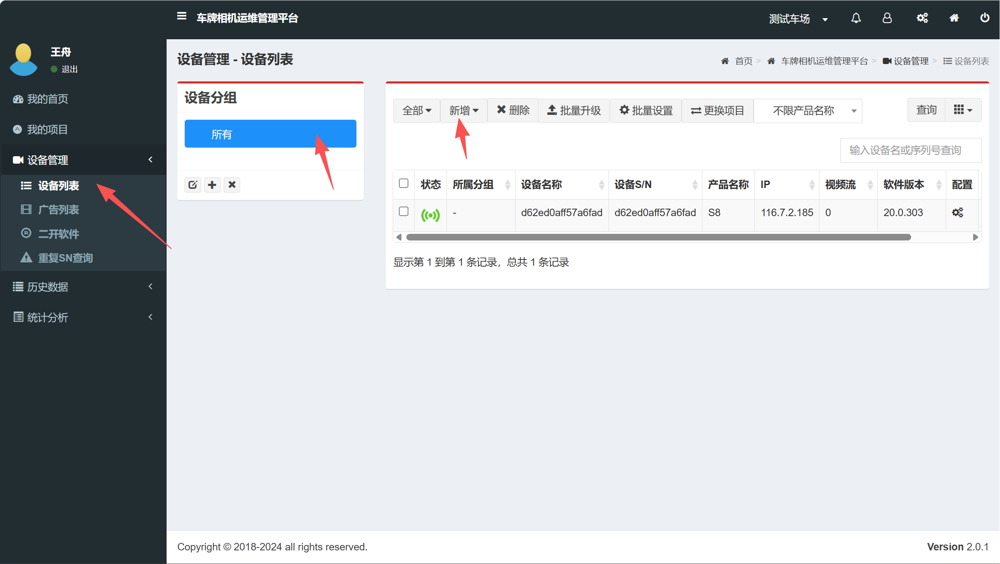
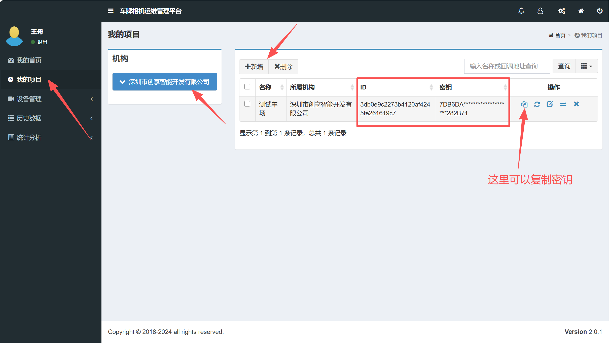
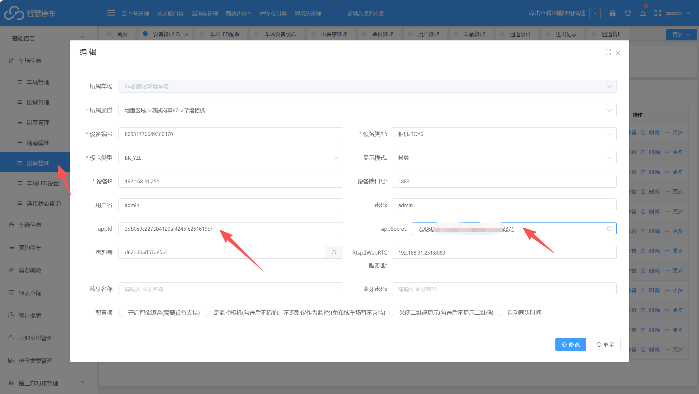
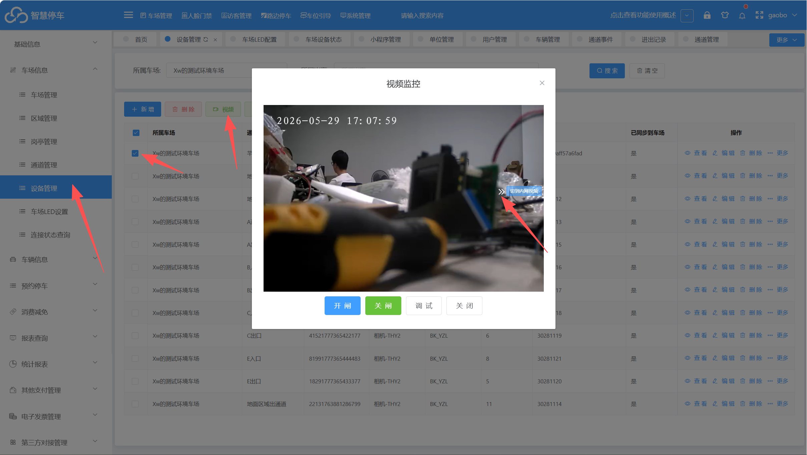

相机平台网站：https://qy-vds.com/
1.联系芊熠相机厂家那边开通账号

2.登入平台后，绑定相机

在设备管理--设备列表里面 新增绑定相机的序列号

3.绑定相机后需要获取2个参数在车场平台上绑定

在我的项目--新增，获取id和密钥

4.获取参数后，在车场平台上设备管理里面绑定相机

在设备管理里面选择芊熠的相机然后绑定id和密钥

5.绑定后保存就能在设备管理里面点击视频看到外网视频

选择设备 点击视频然后需要设置看外网视频，内网视频的配置方式不一样，内网是需要电脑和相机在同一个局域网
