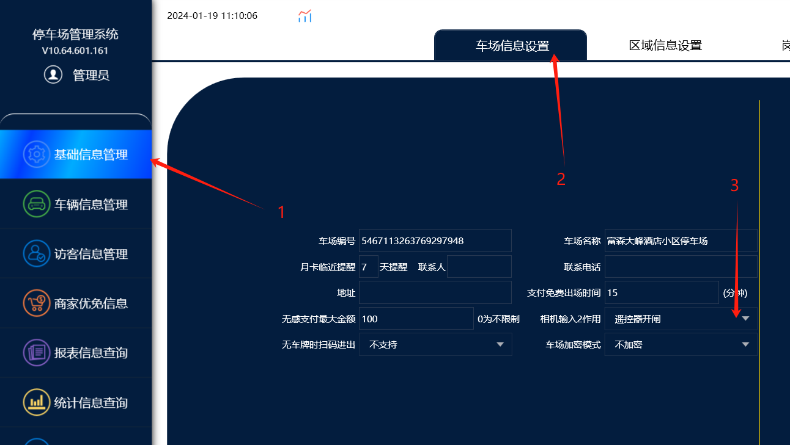
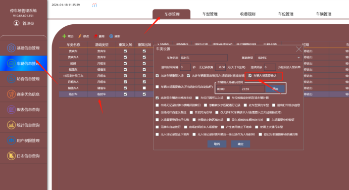
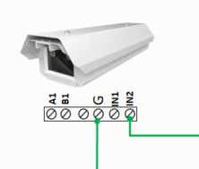

功能说明：
遥控器开闸放行收费放行要有记录（软件需要升级到64位最新版本的软件）

遥控器开闸查询记录,首先需要在车场管理里面设置：相机输入 2 作用改成遥控器开闸，这样使用遥控器开闸才能在报表信息通道事件里面查询到遥控器开闸的记录
遥控器开闸的其他功能：入场遥控器开闸入场，出口遥控器开闸收费放行

入口：需要遥控器放行的车辆类型，通道里不自动开闸，勾选确认放行，如临时车需要保安确认后按遥控器放行，则临时车不会自动抬闸；保安在车牌验证信息内按遥控器放车子通过，软件会有该车的入场纪录

出口：要收费的车辆，车主要么直接扫码付款开闸出去，车主给现金保安按遥控放行出去这样就会有收费的记录。

## 接线说明：遥控器模块接到相机的 IN2,（相机品牌不同接线也不一样，VZ，HX，信路通相机接 IN2,芊熠接 IN1)。

