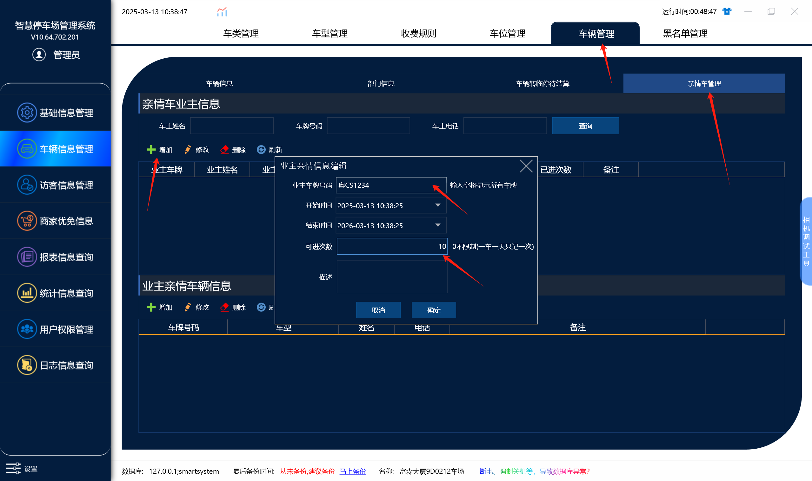
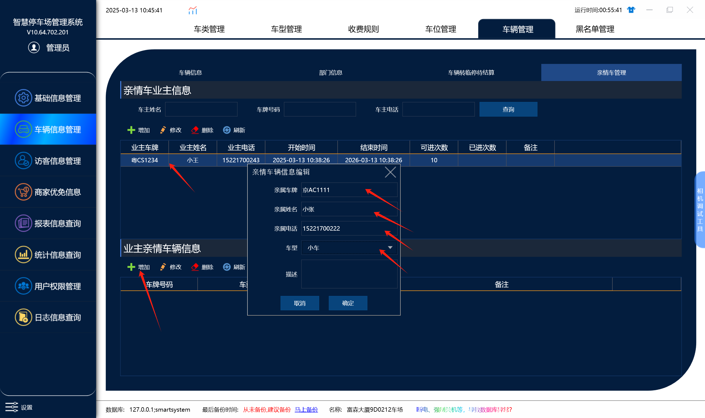
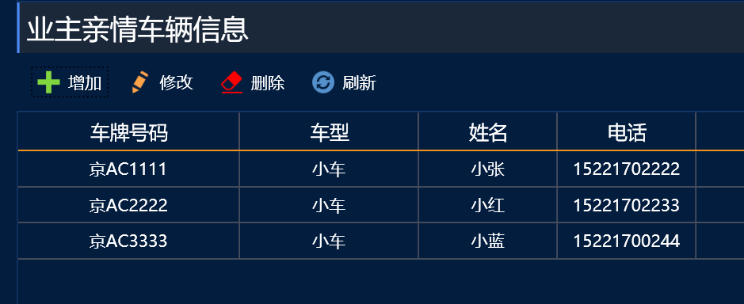

## 1.添加亲情业主车

在车辆管理，亲情车管理里面添加
1.首先添加一个业主车牌 然后设置开始有效期和结束有效期，和可进出次数
业主车牌号：XXX
开始有效期和接受有效期：不在有效期内添加的亲情车是不算亲情车进出的
可进出次数：1台亲情车进出1天算扣1次，次数  （设置0是不限制次数）
## 2.添加亲情车牌

添加的亲情车牌是免费进出的，进出不会产生费用（受前面的可进出次数和有效期影响，超出则不算亲情车）

选择业主车牌，然后点击添加亲情车牌，录入车牌，姓名，电话，车型保存 ，可以添加多个亲情车牌

（亲情车牌1个车牌入场1天扣1次，次数）
比如设置可进出次数10次，京AC1111当天入场扣1次 京AC2222当也入场了也会再扣一次，扣完之后当天可以免费进出不收费，然后可进出次数就只剩下8次