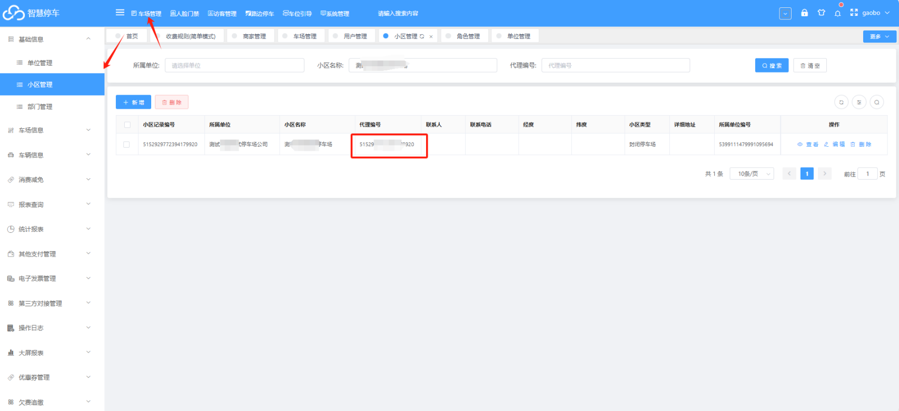
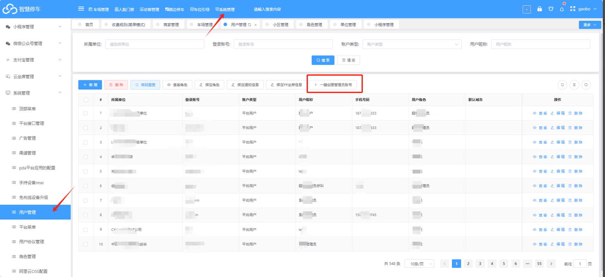
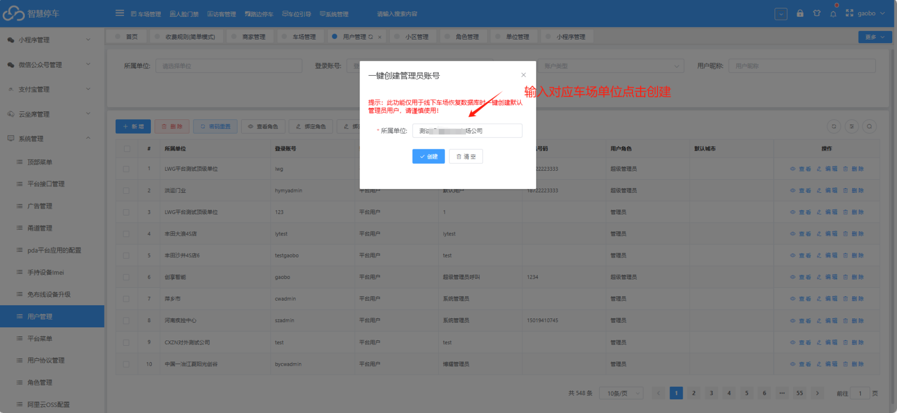
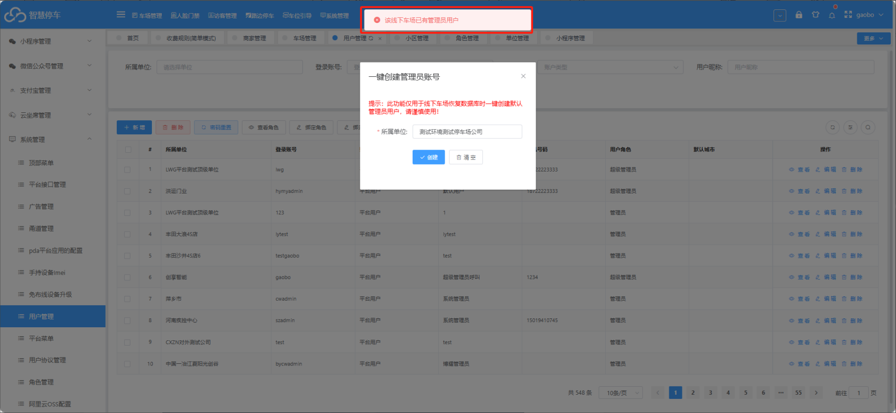
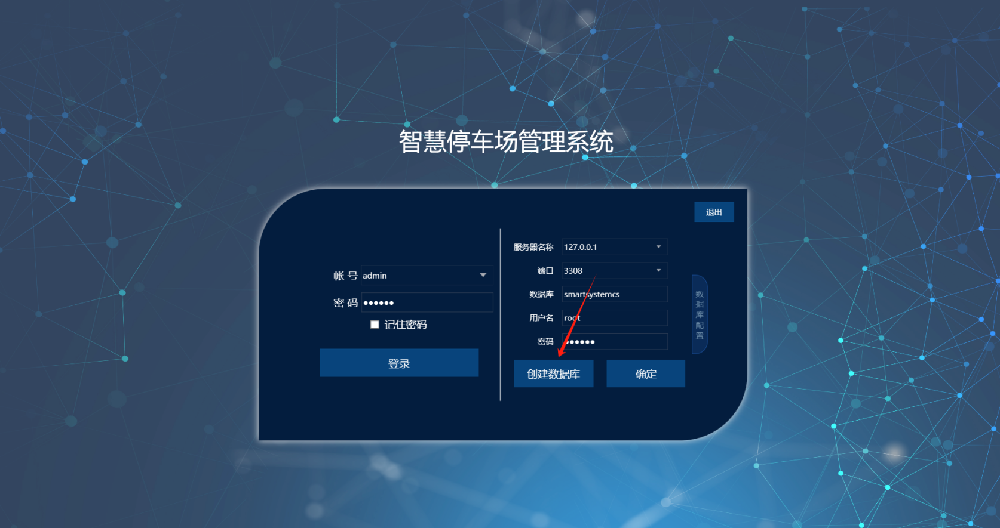
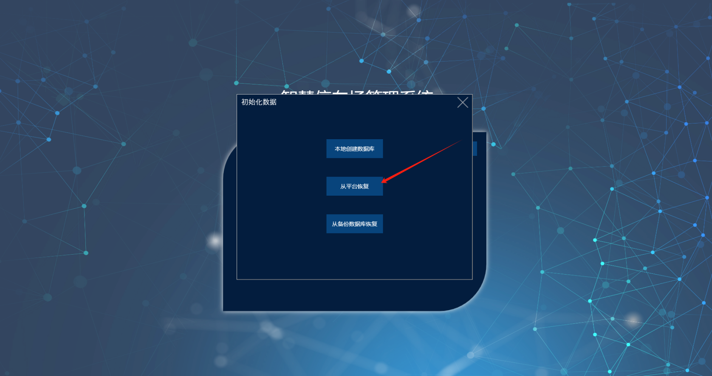
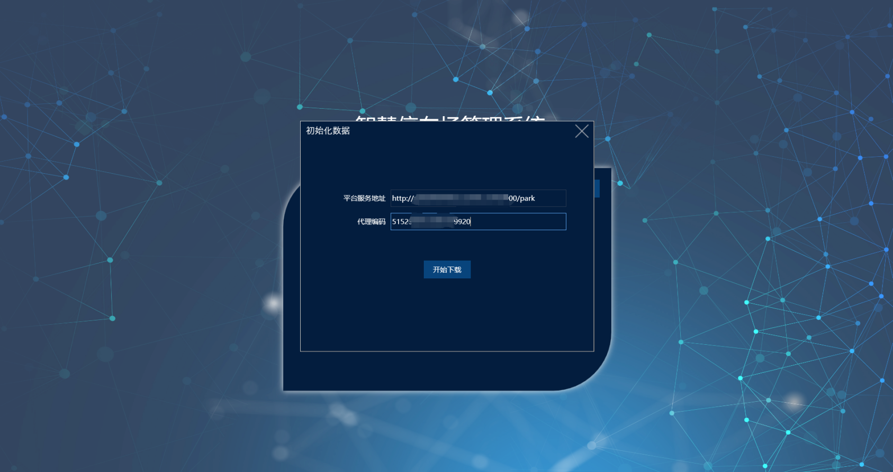
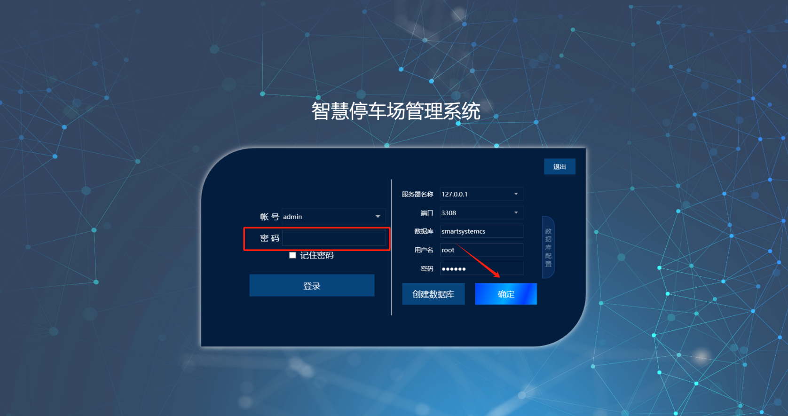
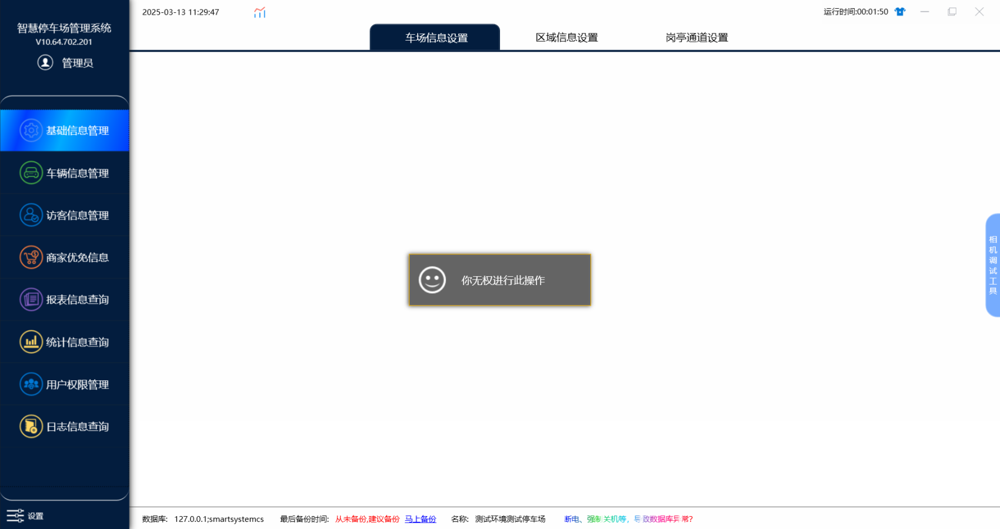
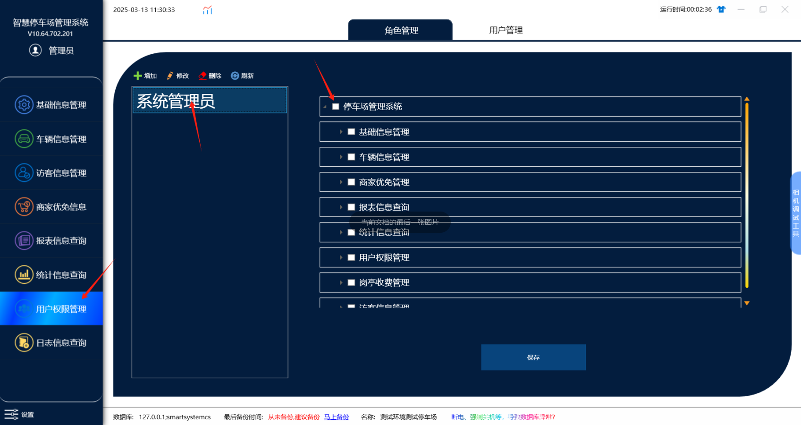

1. 在平台上找到对应车场  的  **代理编码** （车场管理--》小区管理）

2. 在平台的用户管理中  一键创建本地车场账号（系统管理--》系统管理--》用户管理--》一键创建管理员账号）

如果提示车场已有管理员用户，说明账号已经存在，可以直接在本地恢复数据

如果提示创建成功，说明账号创建成功，也可以直接在本地恢复数据了

3. 点击创建数据库

4. 选择从平台恢复

5.填写对应平台服务地址并将小区代理编码粘贴上去（小区代理编码  详见步骤 1 ）

6.恢复成功后，点击确定，输入对应密码登录

注：从平台一键创建的admin账号 可以使用**888888** 进行登录

:::caution
图片缺失：
:::7.如果点击菜单提示无权限

8.需要在用户权限管理中给对应角色添加权限，然后保存，保存成功之后，再次点击菜单

