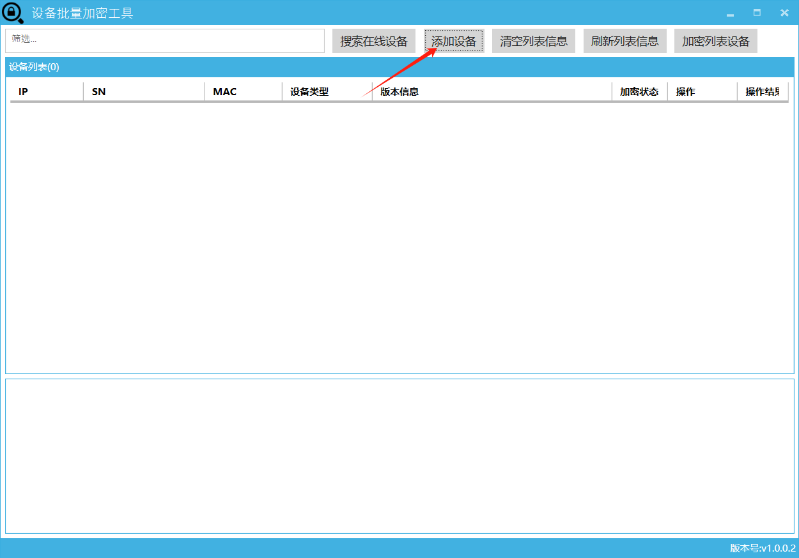
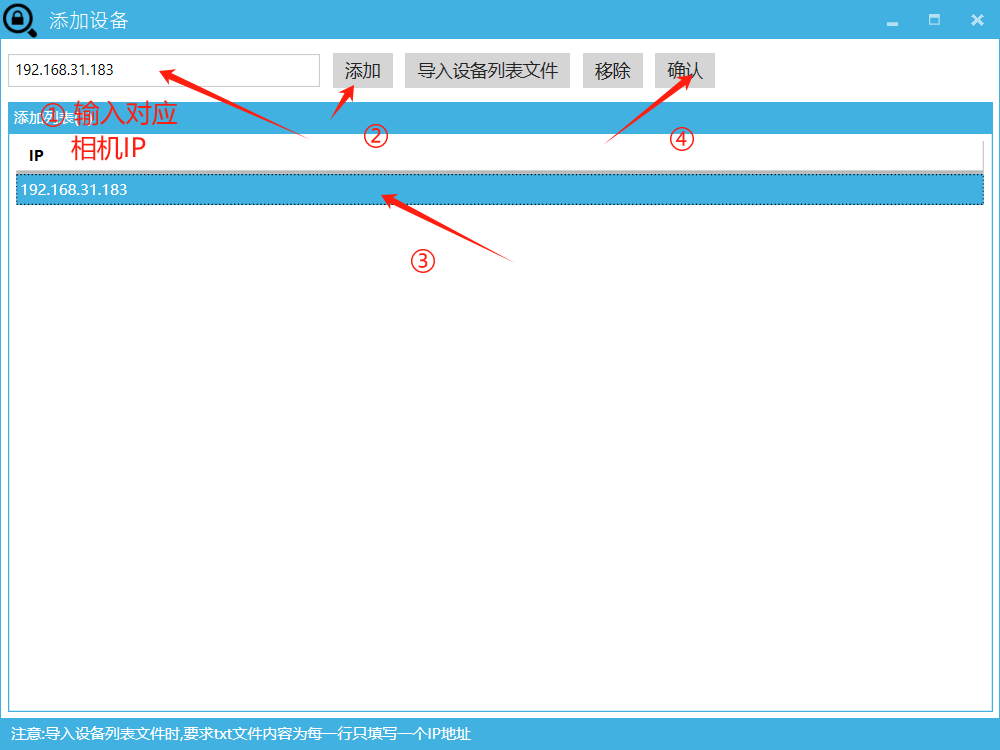
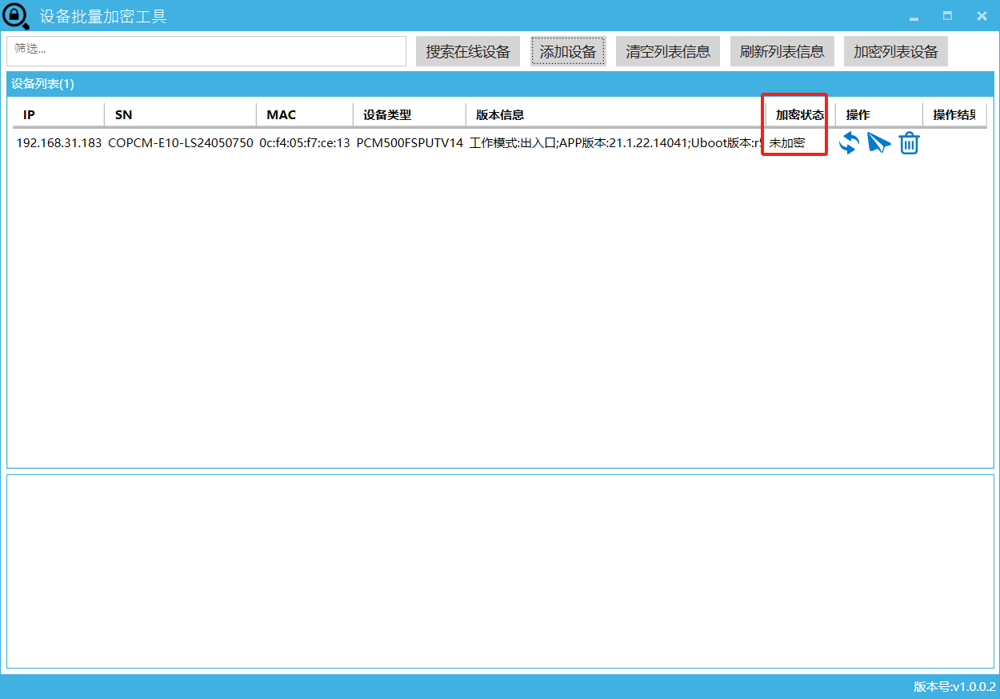
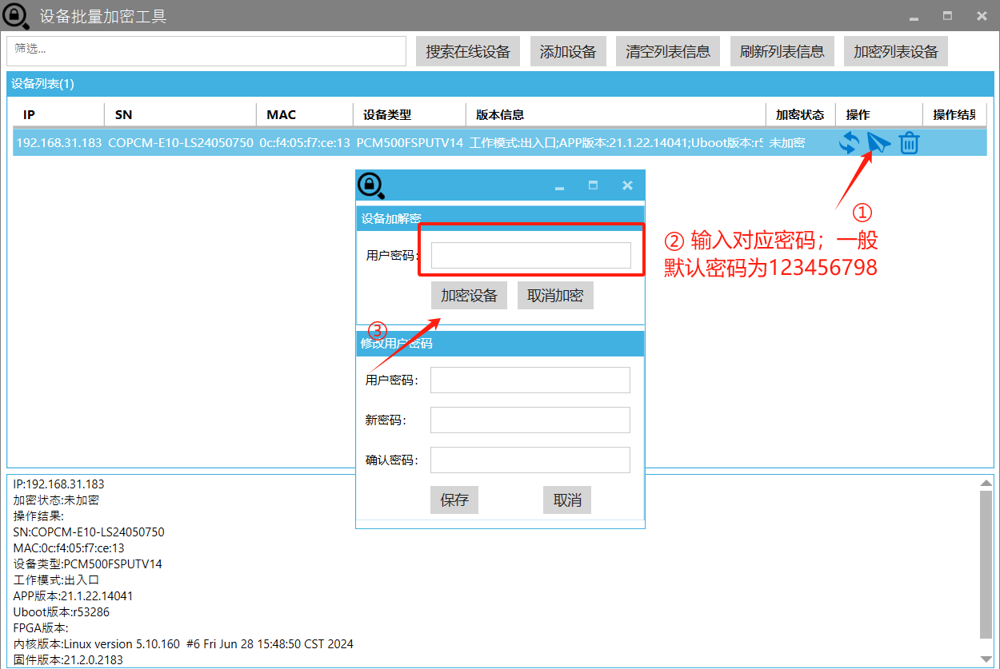
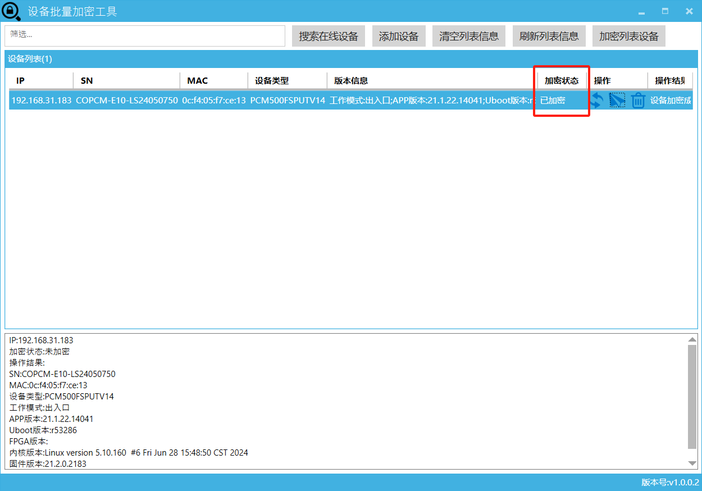

加密工具如下：
[设备批量加解密工具1.0.0.3.zip](https://www.showdoc.com.cn/server/api/attachment/visitFile?sign=dfacc91928482a558f11aa4ee8969b5b &quot;设备批量加解密工具1.0.0.3.zip&quot;)
## 信路通相机加密

### 1.打开工具    点击   添加设备

### 2.添加设备

添加成功后在主页就能够看到对应设备信息；一般来说刚添加的设备  加密状态为 未加密

### 3.点击中间的图标对相机进行加密   默认密码为123456798

相机加密状态为已加密说明已经加密成功，直接车场管理中的

