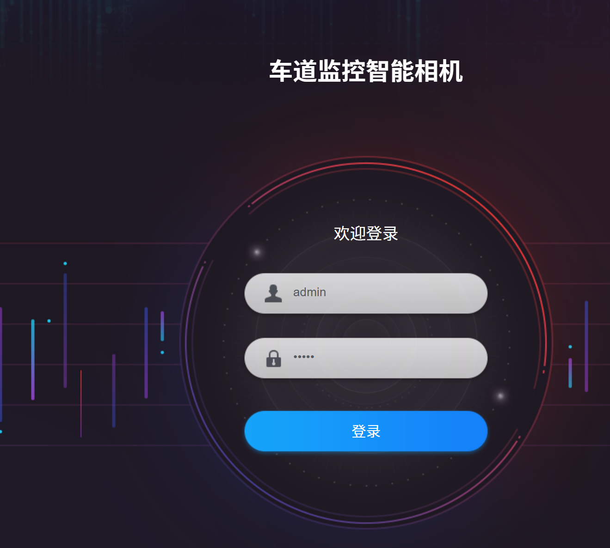
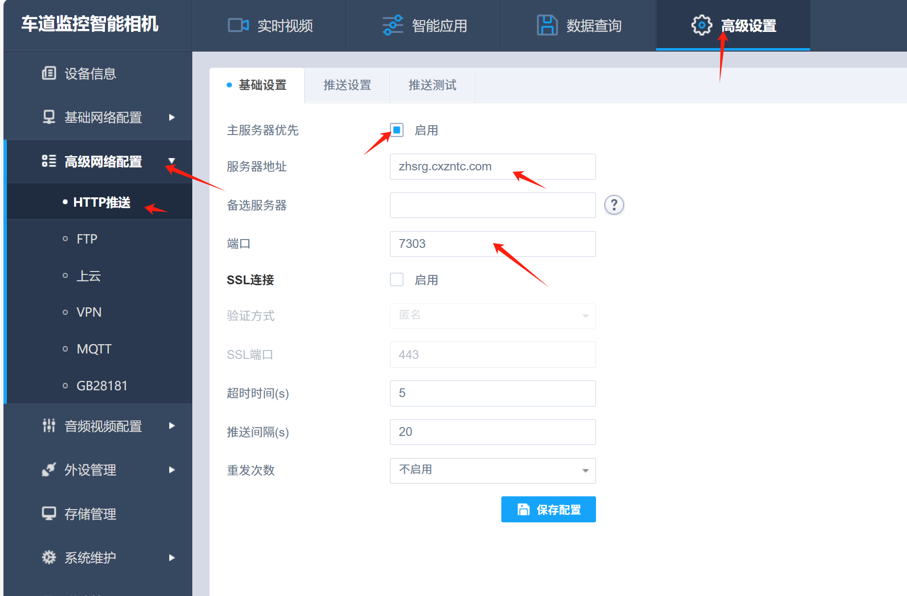
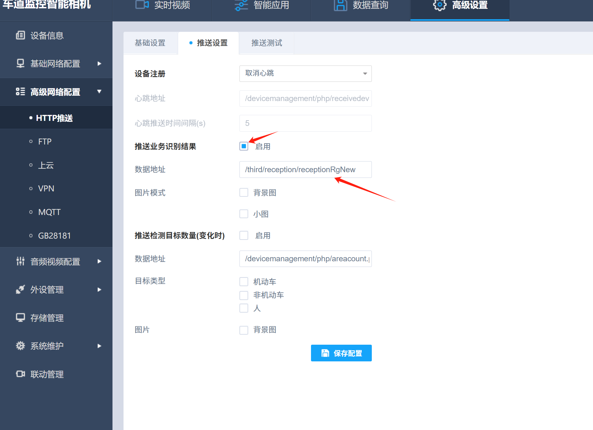
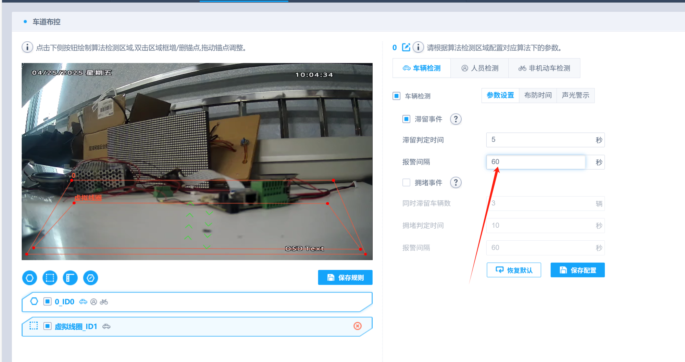
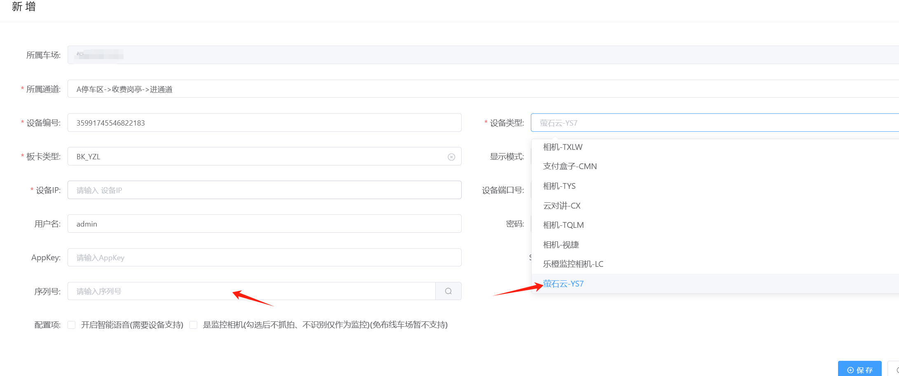
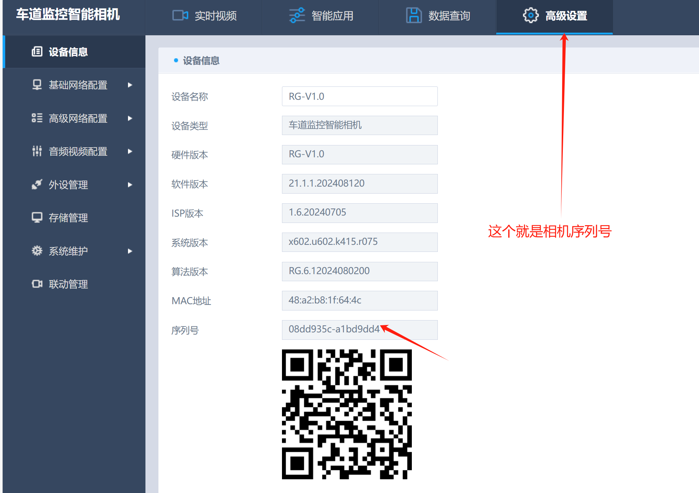

### 相机配置：

1 登陆相机    账户都是默认的admin，如果登陆不上请联系设备厂家那边
2点击高级设置
3点击高级网络配置 ——点击http推送
4基础设置 填好服务器地址，和端口
服务器地址（*zhsrg.cxzntc.com*） 端口7303
5推送设置  数据地址那里填好上传地址  （*/third/reception/receptionRgNew*）
6点击智能应用，滞留报警间隔设置成60秒
操作如下图

## 平台配置：
在平台上设备管理添加设备

设备类型-萤石云-YS7

最后把相机的序列号填进去就好了

