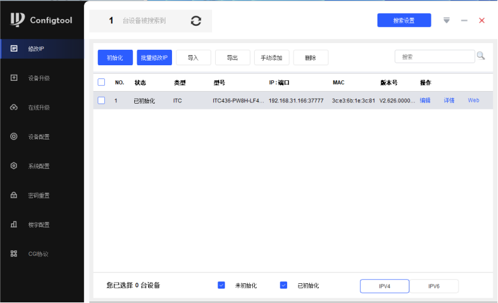
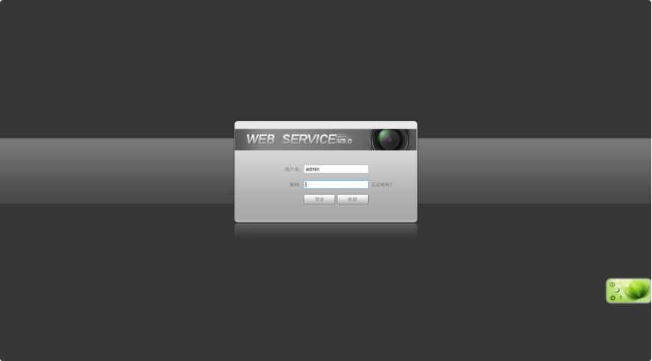
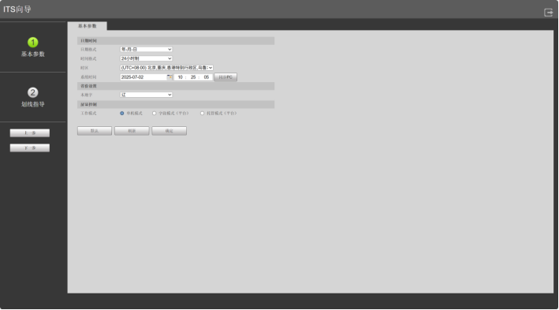
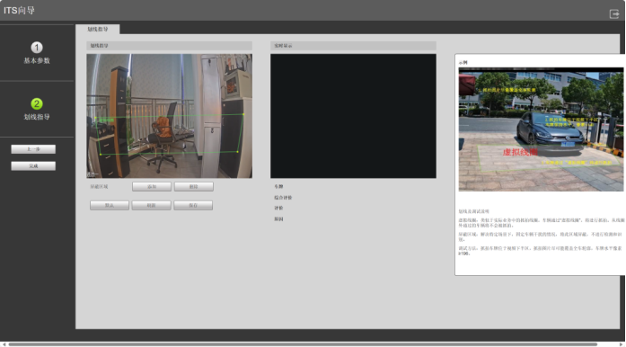
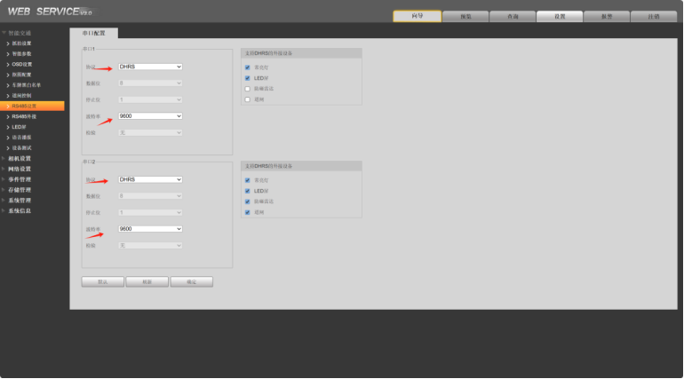
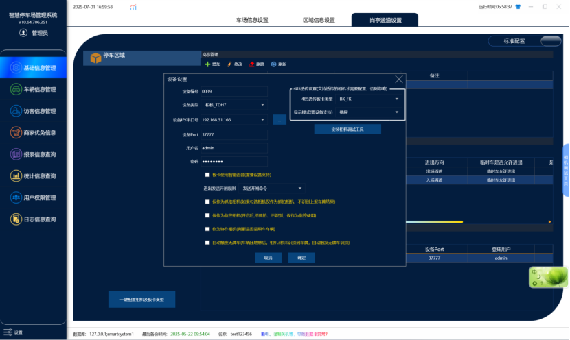

使用相机搜索工具进行搜索

点击web进入相机后台

进入相机后设置基础参数和识别区

进入相机后台设置485，选择对应主板的波特率

本地软件使用大华相机配置如下，在基础信息管理中选择岗亭通道设置，选中对应通道添加设备，板卡类型根据现场情况来选择，需要输入用户名和密码，其他参数不动，如下图：

1.设备类型 ：相机-TDH7
2.设备 IP：相机 ip
3.主板类型选择： 根据实际情况选择
4.默认用户名和密码不用动，如果修改过需要填入修改过的账户密码