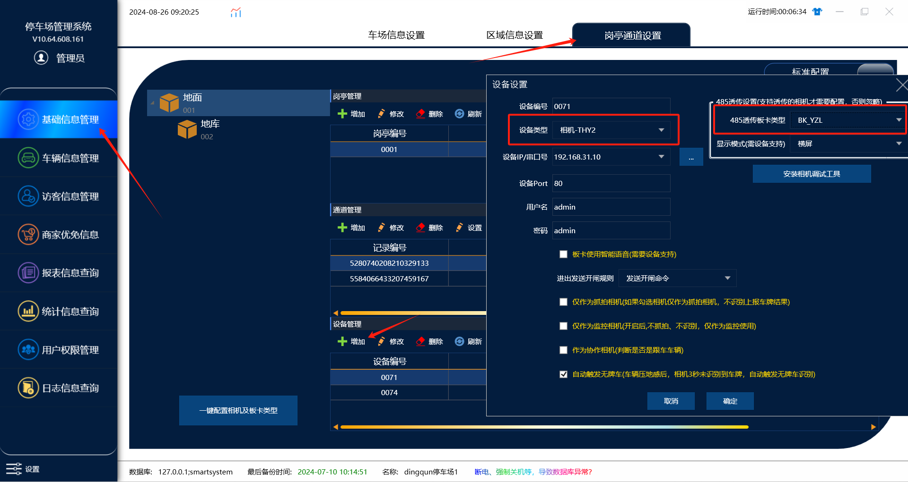

首先相机设备需要再管理端岗亭通道中添加

设备类型根据不同的相机类型选择对应的相机类型

相机                         设备类型
臻实相机                  相机-THY2/相机-THY2-GPU
HX相机                  相机-THX8
芊熠相机                  相机-TQY6/相机-TNQY6
485透传板卡类型  根据板卡类型去选择

注意：不同的板卡类型  在相机中的波特率设置不同
板卡类型           波特率
BK_YZL           19200
BK_FK             9600
BK_RTK           9600
BK_KF             19200
设备IP串口号   选填入相机的IP地址

用户名 和 密码如果相机没有修改过直接用默认的就好

注意：板卡使用智能语音（这个功能需要使用万能语音板卡  才能够支持）
