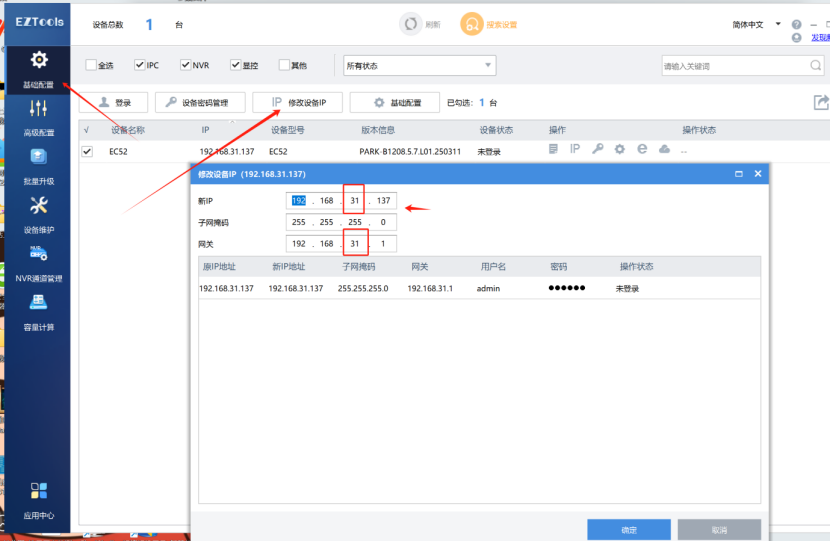
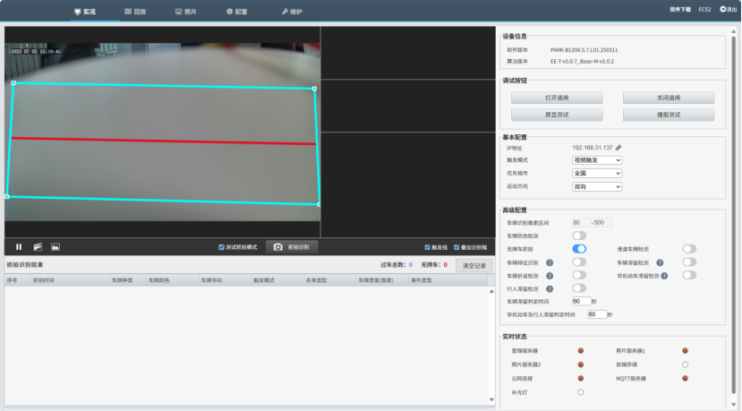
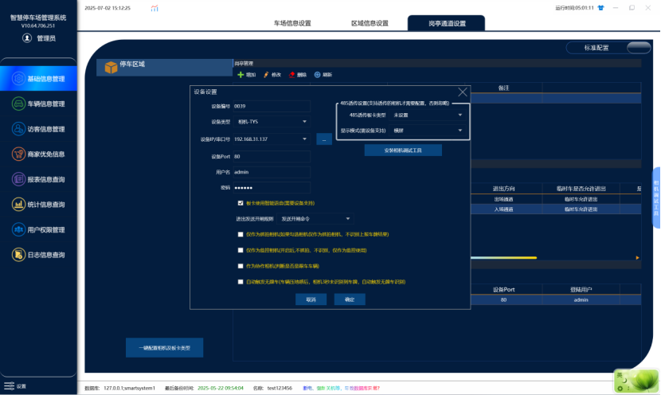
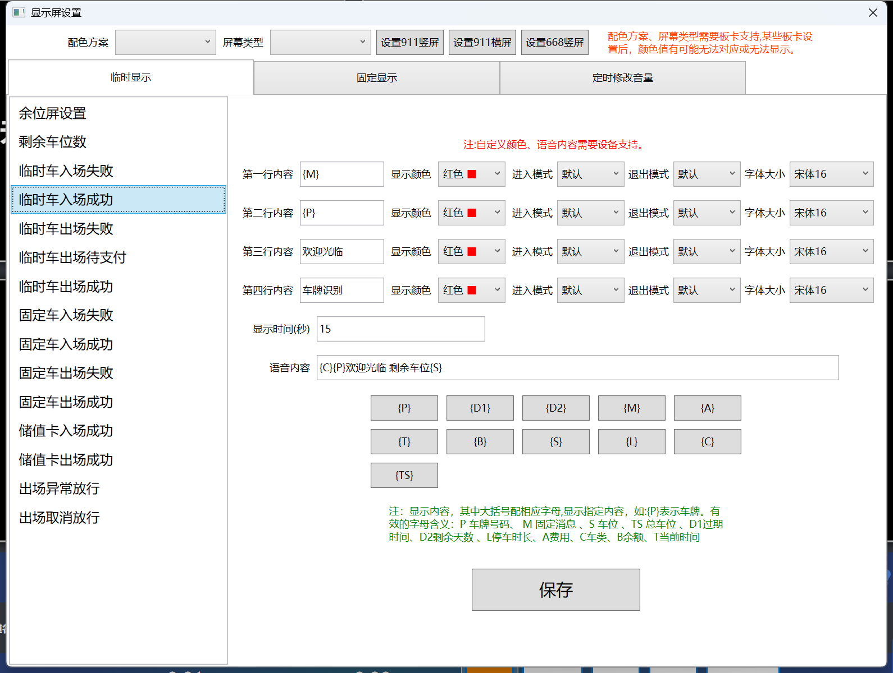

1.使用工具查询在线设备（工具可以直接下载）

[https://cn.uniview.com/Service/Service_Training/Tools/Top/EZtools-2/](https://gitee.com/link?target=https://cn.uniview.com/Service/Service_Training/Tools/Top/EZtools-2/)

2.修改相机IP，将相机ip修改为现场同网段

3.进入相机后台调整识别区域，默认账号admin 密码 123456

4.软件设置如下图

1.设备类型：相机-TYS

2.IP：根据现场情况输入

3.板卡类型：未设置
4.勾选智能语音

注意！显示内容需要全部设置为红色，否则可能会出现LED不显示

