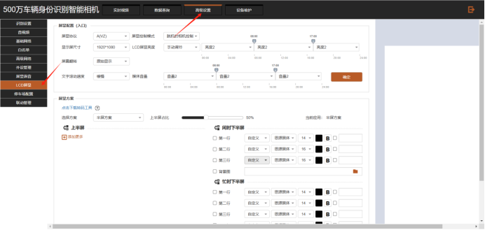
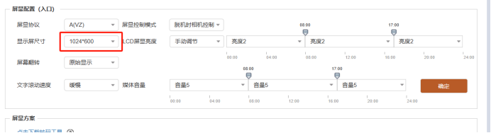
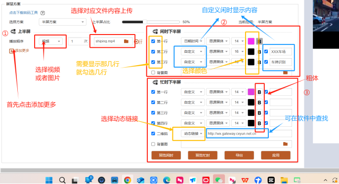
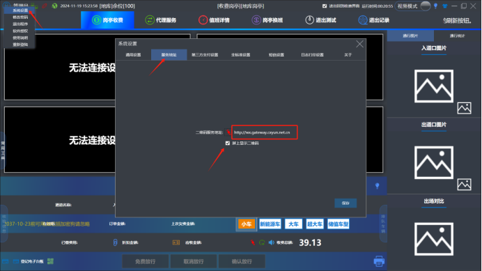
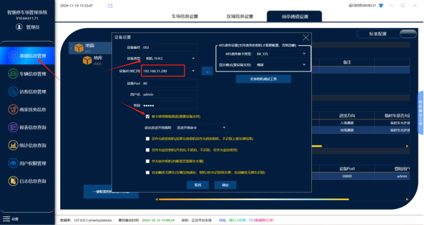
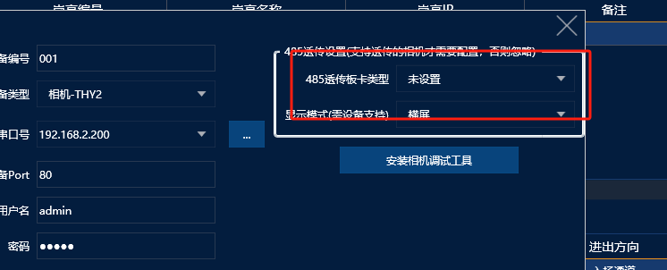
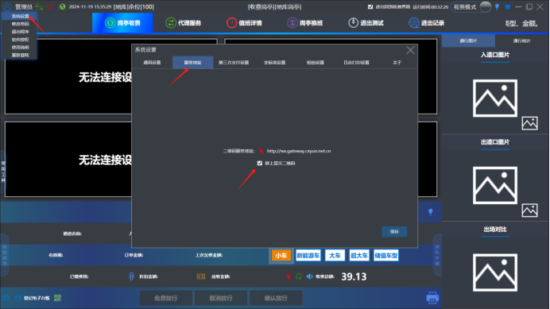

## 1.相机配置：
### (1) 找到LCD屏显



### (2) 配置屏显配置和屏显方案   具体配置如下图：

#### ① 屏显配置

```

```

10.1寸的屏幕是选择1024x600。18.5寸选择1366x768。21.5寸选择1920x1080



#### ② 屏显方案

1) 屏显方案主要是对上半屏和下半屏显示内容的设置，具体设置方式如图



```
a. 上半屏占比目前固定设置为
```

50%
```
b. 有关① 中上传的视频或者图片要求
```

```
a) 图片/视频文件名称要求：
```

```
资源名称只能包含
```

**字母数字下划线**，最长**32**个字符

```
b) 图片规格���
```

```

```

小于5M，png/jpg/jpeg 格式
```
c) 视频规格：
```

```

```

**小于100M，仅支持MP4格式，必须使用转码工具转换**，网页&gt;高级设置&gt;LCD屏显&gt;屏显方案下方有下			载转码工具按钮。

```
c. 另外关于下半屏的
```

**忙时显示③中的动态链接**内容可在收费软件中获取（**二维码服务地址**）如下图：



```
d. 都配置好之后点击应用
```

```
e. 另外有关忙时显示内容，如果联机状态为
```

**在线**，以软件设置的内容为准；不在线则以相机设置的内容为准

## 2.软件配置

### (1) 软件配置直接在软件中添加一个相机，最后重启一下收费端配置如图：

:::caution
图片缺失：
:::



### (2)485透传板卡类型  选择  未设置



### (3) 另外需要注意收费端必须勾选屏上显示二维码，出场时才能够显示车场的缴费二维码



