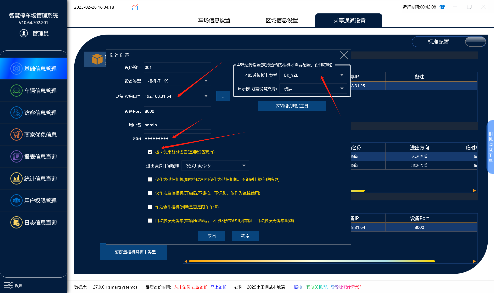
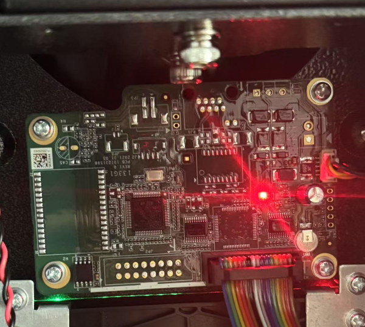
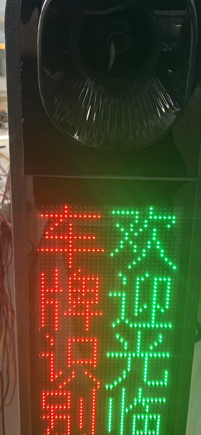

## 软件上如何添加相机：
注意：相机里面led设置需要相机模式

1. 软件管理端和收费端需要升级最新版本
2. 设备类型选 相机-THK9  主板类型默认不需要改
3. 输入相机的ip
4. 账号：admin
5. 密码：第一次连接相机会需要初始化的相机密码，这个密码就是填之前自己设置的密码
6. 需要勾选智能语音的功能
7. 然后打开收费端就能使用了

## 相机版本：

## 设备照片：

