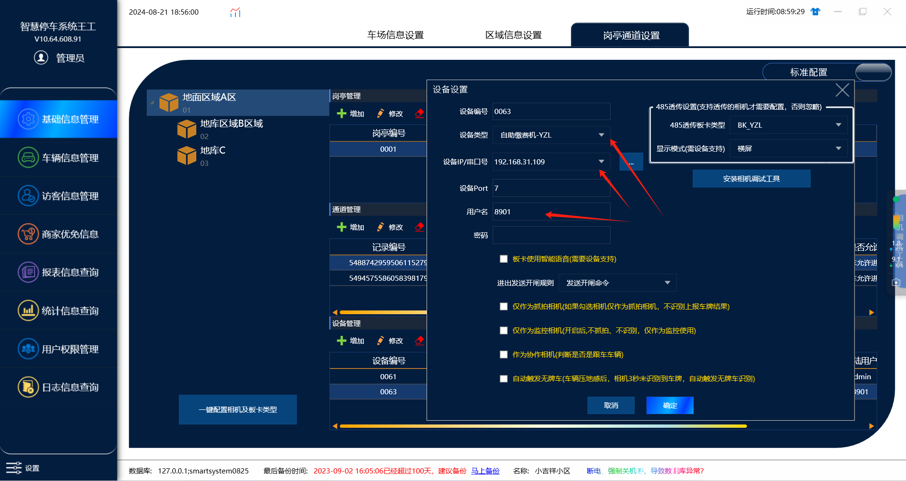
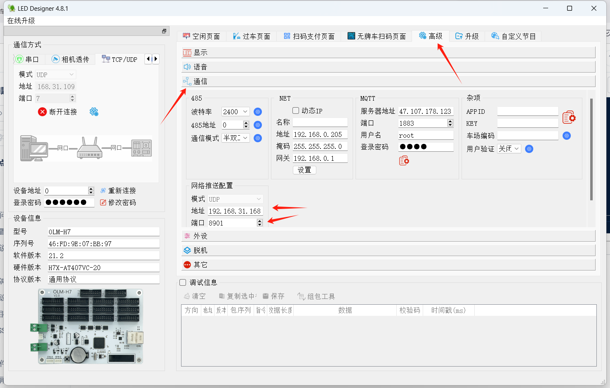
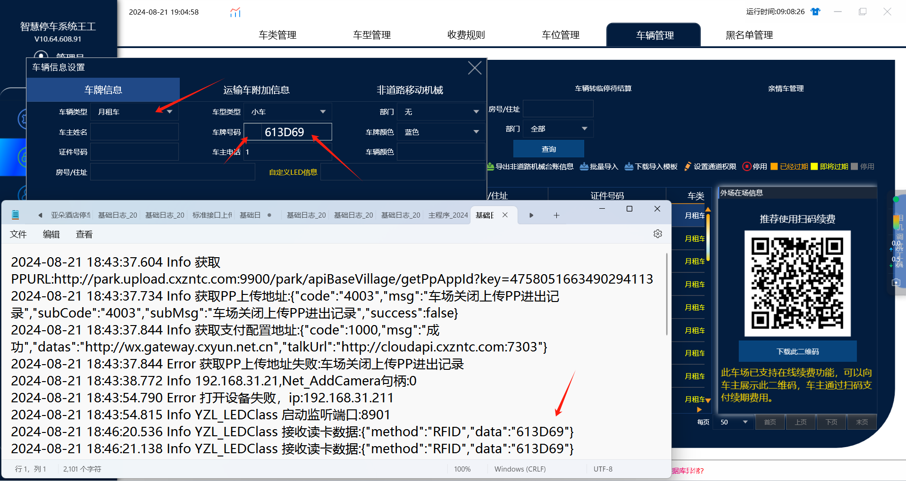
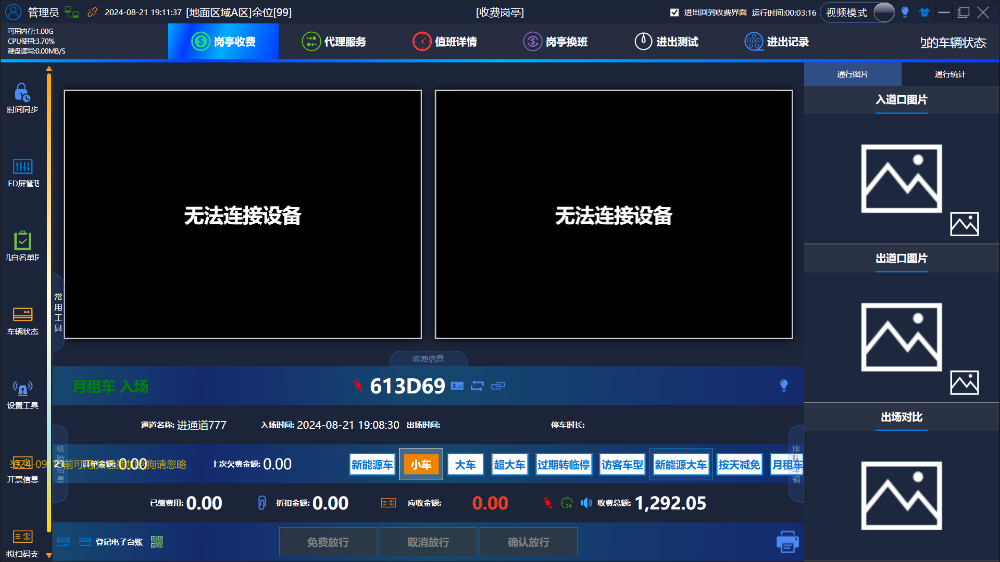

1.在管理端通道下面添加设备

设备类型：自助缴费机—YZL

设备IP：用工具搜索ip然后填进去

设备Port：7  （默认不需要修改）

用户名：8901  （可随意设置4位数字）

2.用YZL主板工具搜索设备ip,连上设备之后在：高级---通信---网络推送配置

模式：UDP  （默认）

地址：本机电脑IP

端口：8901    （就是前面在软件上添加设备的时候设置的用户名）

3.软件连上设备之后，需要先读出卡号，然后把卡号在车辆信息里面添加成月租车牌

这个读出的卡号日志在收费端查询，右击收费端图标，打开��件夹位置在log文件夹里面的基础日志里面查询读出来的卡号

然后把卡号在管理端软件车辆信息里面录入成月租车，首汉字改成空白的然后录入卡号就行了（必须把卡号录入在管理端，在刷卡进出收费端才有反应）

4.卡号添加成月租车之后在刷卡进出，收费端软件上才能正常提示月租车进出场
